A pedido do professor de Matemática B, os alunos de Artes Visuais criaram um Friso, explicando o seu trabalho. Dos trabalhos realizados, destacou-se o trabalho do aluno Pedro Vieira, que a seguir se apresenta.

## O que é um Friso?

No nosso dia a dia, convivemos com centenas de frisos, seja em casa ou na rua, mas nem todos nos apercebemos da sua existência. Um friso, matematicamente falando, é uma sequência, normalmente horizontal, de um motivo, isto é, uma figura que se repete numa única direção. Os “padrões” que podemos identificar nos frisos são formados por isometrias que variam entre translação, rotação de 180°, reflexões horizontal, vertical e deslizante. Azulejos, rodapés, passadeiras e gradeamentos são alguns dos imensos exemplos de frisos.

Para perceberem melhor a explicação da obra “Et auream oculum Plato et Fibonacci” (**friso construído para um trabalho de Matemática B**) que se segue, terão de saber o que são os Sólidos Platónicos e a Espiral Áurea.

Os **Sólidos Platónicos** são uma das geniais contribuições geométricas/matemáticas de Platão que apresentam, nas suas faces, polígonos regulares e congruentes; representam, individualmente, os 5 Elementos da Natureza; incluindo outras espantosas características mais complexas.

Já a **Espiral Áurea**, de Fibonacci, é uma espiral que representa o número Phi (simbolizado pela letra grega com o mesmo nome), referido muitas vezes como “o número de ouro”; vejamos o porquê. Dizemos que duas grandezas/segmentos de reta estão em divina proporção (ou proporção áurea) quando a sua proporção é a mesma que a proporção da sua soma e a maior das duas grandezas/segmentos de reta. (Quando isto acontece, o valor correspondente é exatamente Phi, $\varphi \approx 1{,}61$.)

$$
\frac{a + b}{a} = \frac{a}{b} = \varphi = \frac{1 + \sqrt{5}}{2} \approx 1{,}618
$$

A espiral áurea, mais uma forma de representar a proporção áurea, é a curva formada pelos infinitos arcos de 90° inscritos em cada um dos quadrados de retângulos áureos (basicamente, são retângulos divididos em proporção áurea, onde uma parte do retângulo fica dividida num quadrado e ao dividir-se a base do retângulo pela sua altura, obtém-se Phi). As “pontas” desses arcos são sempre vértices dos quadrados.

Esta fascinante espiral apresenta-se imensas vezes na natureza e no corpo humano (tendo sido considerada, por muitos notórios filósofos, como “a solução da vida” ou “o segredo da realidade”, pois caracteriza-se como uma figura “divina”); nos pentágonos regulares, qualquer diagonal é paralela a um dos lados do pentágono (tomando 1 como a medida do seu lado, a razão entre as medidas dos comprimentos da diagonal e do lado será exatamente Phi); inúmeras obras artísticas da antiguidade (destacando-se o “Homem de Vitrúvio”, “A Última Ceia” e “Mona Lisa”); em construções milenares (realçando as Egípcias e Gregas); na sequência/números de Fibonacci (sequência inventada pelo matemático Fibonacci em que os primeiros termos são iguais a 1, e cada termo subsequente corresponde à soma dos dois anteriores, estes números apresentam-se em configurações biológicas — disposição dos galhos das árvores —, nos quadrados que formam a espiral áurea, etc.).

## Explicação da obra “Et auream oculum Plato et Fibonacci”

> Nesta obra, os autores entrelaçam a famosa espiral áurea/dourada do matemático italiano Leonardo Fibonacci com os admiráveis sólidos platónicos, obviamente, do notório matemático e filósofo grego Platão. A forma como estas duas descobertas matemáticas se fundem acontece de uma maneira tão especial e fascinante que só o olho dourado comum destes dois génios a podia transparecer ao mundo…
>
> — Pedro Vieira, 10.º K

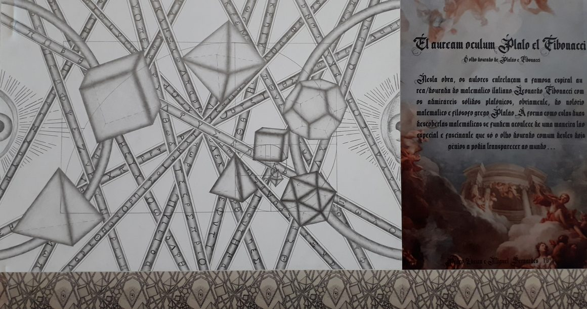

Apresentam-se, em seguida, mais alguns destes trabalhos.

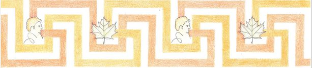

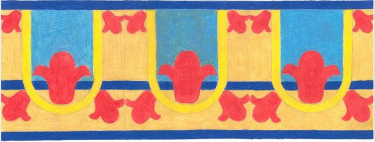

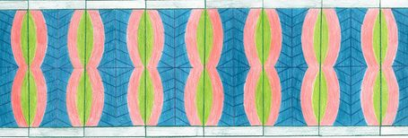

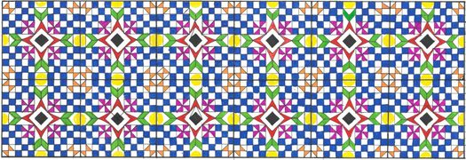

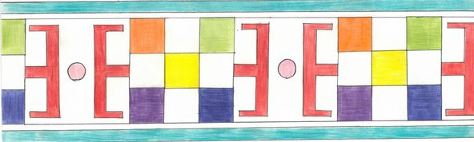

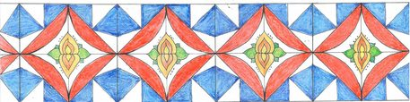

*Autores: Rita Fonseca e Pedro Morgado; Miguel Alves e Matilde Santos; Carolina Vikol e Adriana Salgueiro; Francisca e Patrícia; Julya e Aldaíra; Rodrigo Pereira; Jasmina Ziyoeva e Mariana Martins; Matilde Crespo e Larissa Souza.*

## Fractais

Também aos alunos do 3.º CE (Curso Técnico de Gestão e Técnico de Contabilidade) foi pedido que fizessem um pequeno trabalho sobre Fractais.

Estes alunos, estando mais voltados para os números e a lógica, revelaram, no entanto, uma excelente veia artística. No começo, houve alguma hesitação e incerteza, mas a determinação fez esquecer qualquer dúvida. Todos deram o seu melhor e fizeram um esforço incrível que, no final, acabou por ter o resultado pretendido, o que foi uma surpresa muito positiva para a professora. Os alunos estão de parabéns!

Um **fractal** é uma figura da geometria não clássica muito encontrada na natureza; a sua principal característica é o facto de que as suas partes separadas repetem os traços (a aparência) do todo completo. Podemos ver esta característica na maioria dos trabalhos dos alunos.

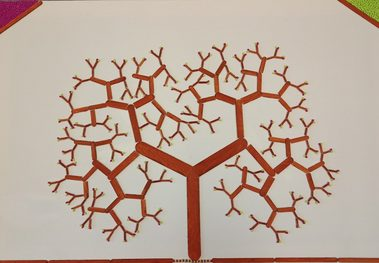

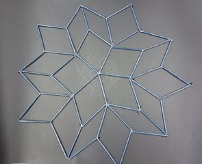

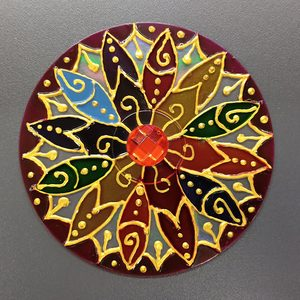

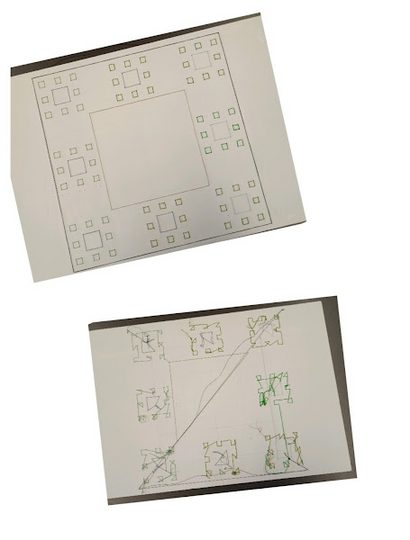

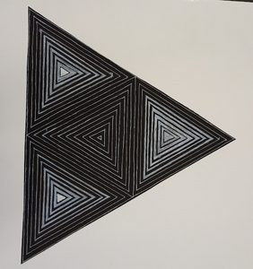

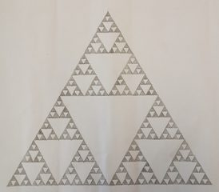

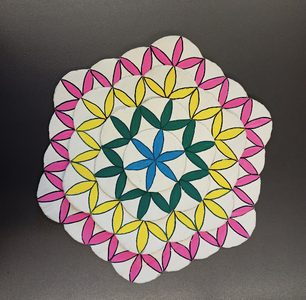

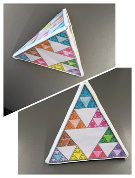

<strong>Desafio:</strong> pesquisa na internet sobre fractais. Falaremos deste tema na próxima edição do jornal.

