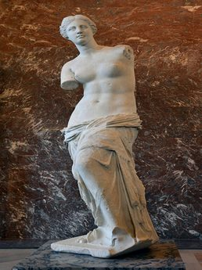

> O binómio de Newton é tão belo como a Vénus de Milo. 
> O que há é pouca gente para dar por isso.
>
> óóóó — óóóóóóóóó — óóóóóóóóóóóóóóó
>
> (O vento lá fora.)
>
> — Álvaro de Campos, *Poesias de Álvaro de Campos*. Fernando Pessoa. Lisboa: Ática, 1944 (imp. 1993), p. 110.

O poema “Binómio de Newton”, de Álvaro de Campos, acima transcrito, causa alguma estranheza pela equivalência que estabelece entre uma regra matemática e uma obra de arte (a Vénus de Milo), já que a primeira é considerada ciência e a segunda arte. Contudo, após reflexão, podemos perceber o confronto e até concordar com ele. A Vénus de Milo, sendo um paradigma de beleza estética, é também o resultado de princípios como a proporcionalidade e simetria das formas, já que na sua génese estão presentes princípios científicos/matemáticos.

Por outro lado, analisando o Binómio de Newton, do ponto de vista formal, a conjunção de números, letras e sinais resulta num quadro belo e proporcional, capaz de desencadear prazer estético ao observador.

É ainda de realçar o ponto de vista do matemático apaixonado pela sua ciência que, mais do que valorizar a aplicação prática de todo o teorema a que chega, o observa com a paixão e o prazer com que se aprecia uma obra de arte.

Apreciemos, então, as duas obras! A formulação do binómio de Newton escreve-se da seguinte forma:

$$
(x + y)^n = \sum_{k=0}^{n} \binom{n}{k} x^{n-k} y^k, \quad \text{onde } n \text{ e } k \text{ são inteiros e } k \le n.
$$

Os coeficientes $\binom{n}{k}$ são chamados **coeficientes binomiais** e traduzem, em análise combinatória, o número de combinações de $n$ elementos, agrupados $k$ a $k$; definem-se como

$$
\binom{n}{k} = \frac{n!}{k!\,(n-k)!}, \quad \text{onde } n! = 1 \times 2 \times \cdots \times (n-1) \times n \text{ é o fatorial de } n.
$$

Só um homem como Álvaro de Campos, heterónimo pessoano, simultaneamente um homem das letras (poeta) e das ciências (engenheiro), poderia ter a sensibilidade para estabelecer esta comparação. Não nos esqueçamos que, como refere o seu criador, Fernando Pessoa, em carta a Adolfo Casais Monteiro, «Álvaro de Campos teve uma educação vulgar de liceu; depois foi mandado para a Escócia estudar engenharia, primeiro mecânica e depois naval.».

Por outro lado, ao considerar o binómio de Newton como paradigma de beleza, introduz um novo conceito de belo.

Para finalizar, gostaria de acrescentar que, embora Campos não o refira no seu poema, a poesia supera todas as outras artes, pelo seu poder extraordinário de conciliar e enaltecer a beleza de todas elas, ao ponto de transformar as ciências em matéria poética, proporcionando ao leitor prazer estético.

*Professora Ana Olival*

---

Ora bem, nós, matemáticos, muito apreciamos a comparação de Álvaro de Campos, mas vamos mais além! Não será a Vénus de Milo quase tão bela como o Binómio de Newton?

Passamos a explicar: o Triângulo de Pascal pode ser escrito utilizando apenas combinações (os tais coeficientes binomiais).

$$
\begin{array}{c}
{}^{0}C_{0} \\
{}^{1}C_{0} \quad {}^{1}C_{1} \\
{}^{2}C_{0} \quad {}^{2}C_{1} \quad {}^{2}C_{2} \\
{}^{3}C_{0} \quad {}^{3}C_{1} \quad {}^{3}C_{2} \quad {}^{3}C_{3} \\
{}^{4}C_{0} \quad {}^{4}C_{1} \quad {}^{4}C_{2} \quad {}^{4}C_{3} \quad {}^{4}C_{4} \\
{}^{5}C_{0} \quad {}^{5}C_{1} \quad {}^{5}C_{2} \quad {}^{5}C_{3} \quad {}^{5}C_{4} \quad {}^{5}C_{5}
\end{array}
$$

E os desenvolvimentos dos binómios, utilizando a fórmula do Binómio de Newton, ficam tão simples!

$$
\begin{aligned}
(a+b)^0 &= 1 \\
(a+b)^1 &= 1a + 1b \\
(a+b)^2 &= 1a^2 + 2ab + 1b^2 \\
(a+b)^3 &= 1a^3 + 3a^2b + 3ab^2 + 1b^3 \\
(a+b)^4 &= 1a^4 + 4a^3b + 6a^2b^2 + 4ab^3 + 1b^4 \\
(a+b)^5 &= 1a^5 + 5a^4b + 10a^3b^2 + 10a^2b^3 + 5ab^4 + 1b^5
\end{aligned}
$$

Mais que perfeitos!!!
