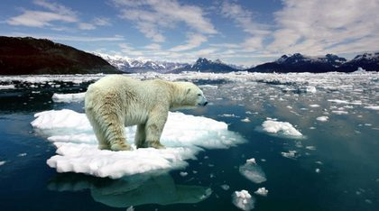

Em 2018, foi notícia o facto de que um cargueiro comercial conseguiu, pela primeira vez, atravessar a rota do norte do Oceano Ártico em pleno inverno. O que explica isto? O aquecimento global e consequente degelo no Ártico.

, em milhões de km². Fonte: Observatório NSIDC/NASA, via Público.")

O **degelo** é um processo natural que ocorre em determinadas regiões quando, devido à mudança de estação, a temperatura começa a subir. Desse modo, o gelo e a neve, que geralmente se acumulam em certos lugares, derretem. Este fenómeno é intensificado pelo aquecimento global, desencadeado pelo aumento do efeito de estufa. Desde 1996 tem-se observado uma diminuição do gelo na Terra. Entre as principais áreas afetadas estão o Ártico, a Gronelândia, a Antártida e diversas cordilheiras. Se este fenómeno continuar, ocorrerá um desequilíbrio ambiental (que prejudicará muitas espécies marinhas, tais como morsas, baleias, ursos polares, entre outros animais) e haverá um aumento considerável de água nos oceanos, aumentando o nível das águas do mar.

**Sabias que:**

- 50 % da subida do nível do mar acontece porque a água está mais quente e o seu volume aumenta?
- 42 % desta subida se deve ao derretimento dos glaciares e das camadas de gelo em locais como os Alpes, a Gronelândia e a Antártida?

O aumento da temperatura global contribui duplamente para a subida do nível das águas do mar!

A subida do nível dos mares a nível global durante o último século foi de cerca de 20 centímetros e espera-se que esta tendência acelere devido ao aquecimento global.

O Painel Intergovernamental sobre Mudanças Climáticas (IPCC), em 2019, referiu que, mesmo num cenário de cumprimento do Acordo de Paris, assistir-se-á a uma subida do nível do mar em 43 cm, no ano 2100. E se as metas estabelecidas neste acordo climático não forem cumpridas, o aumento do nível das águas poderá atingir mais de um metro de altura.

Chamamos a tua atenção para o facto de os oceanos terem uma influência muito significativa na regulação do clima. Por este motivo, alterações nas condições dos oceanos podem produzir mudanças irreversíveis no clima do Planeta. Assim, devido às alterações climáticas, os oceanos começaram a ser foco de atenção especial.

A finalizar, recordamos que Portugal é um país pequeno (92 256 quilómetros quadrados) mas tem uma costa continental muito extensa que, conjuntamente com as ilhas, forma uma Zona Económica Exclusiva (ZEE) que atinge os **1,73 milhões de quilómetros quadrados**. Temos a 10.ª maior ZEE do mundo, logo a seguir ao Brasil!

<strong>Somos 95 % mar! Temos uma grande responsabilidade neste assunto!</strong>

*Fontes: [euronews](https://pt.euronews.com/green/2021/11/05/os-perigos-da-subida-do-nivel-do-mar), [Público](https://www.publico.pt/2023/02/14/azul/noticia/metas-acordo-paris-nao-travam-rapida-irreversivel-subida-nivel-mares-2038754)*
