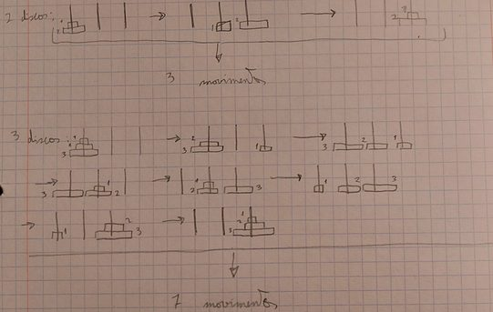
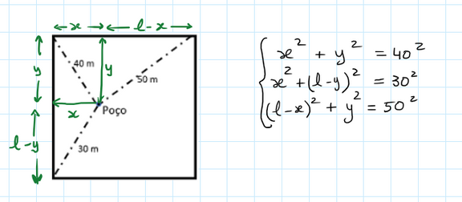

## Curiosidades

### 1) O número que volta sempre

Se escolhermos um número qualquer com 3 algarismos (por exemplo 657), o repetirmos à sua frente (657 657), o dividirmos por 13 (50 589), de seguida por 11 (4599) e, por fim, por 7 (657), o número vai ser igual ao número inicial.

Neste problema, tens de ter em atenção que trabalhamos em base 10. Por exemplo:

$$
657 = 6 \times 100 + 5 \times 10 + 7 \quad\text{ou}\quad 657 = 6 \times 100 + 57, \text{ etc.}
$$

Vamos agora ver a justificação deste resultado/curiosidade. Se o número escolhido for designado, genericamente, por $\overline{abc}$, na 1.ª etapa obtém-se o número $\overline{abcabc}$. Dividindo-o por 13, por 11 e por 7:

$$
\frac{\overline{abcabc}}{13 \times 11 \times 7} = \frac{\overline{abc} \times 1000 + \overline{abc}}{1001} = \frac{\overline{abc}\,(1000 + 1)}{1001} = \frac{\overline{abc} \times 1001}{1001} = \overline{abc}
$$

Obtemos o número inicial!

### 3) Capicuas

Sem contar com os números de um só algarismo:

- O menor número capicua: 11.
- O menor número capicua que é um quadrado perfeito: 121.
- Quantos outros quadrados há menores que 1000 que sejam capicuas? Apenas 2: $484 = 22^2$ e $676 = 26^2$. *(Na versão em papel aparecia também 729, que é um quadrado mas não é capicua.)*
- Há cinco números primos capicuas entre 100 e 200: 101, 131, 151, 181 e 191.

Passamos a explicar: os números capicuas são 101, 111, 121, 131, 141, 151, 161, 171, 181 e 191. Destes, alguns não são números primos: os que são divisíveis por 3 (111, 141 e 171), por 7 (161) e por 11 (121). Retirando esses, sobram 5 números: 101, 131, 151, 181 e 191.

Acerca da técnica de obtenção de números palíndromos apresentada na edição anterior, que consiste em escolher qualquer número, com qualquer número de dígitos, inverter a ordem dos algarismos e somar esse número ao número escolhido, repetindo até se obter um número palíndromo — para os números sugeridos, o número de etapas necessárias é:

- $1961 \to 3652 \to 6215 \to 11\,341 \to 25\,652$: **4 etapas**;
- $1999 \to 11\,990 \to 21\,901 \to 32\,813 \to 64\,636 \to 128\,282 \to 411\,103 \to 712\,217$: **7 etapas**.

## Desafios

### 1) Torre de Hanói

*Resolução de Diana Marques, 10.º F*

Na figura abaixo, apresenta-se um esquema dos movimentos a efetuar com 2 ou 3 discos. O número mínimo de movimentos parece ser igual a 2 elevado ao número de discos menos um. Efetivamente, prova-se que assim é.

| N.º de discos | N.º de movimentos (mínimo) |
| :-: | :-: |
| 1 | 1 |
| 2 | 3 |
| 3 | 7 |
| 4 | 15 |
| … | … |
| $n$ | $2^n - 1$ |

### 2) O claustro do mosteiro

Designando o lado do quadrado por $l$, a distância de $P$ (poço) a um dos lados por $x$ e ao outro por $y$, obtém-se o sistema formado pelas equações

$$
\begin{cases}
x^2 + y^2 = 40^2 \\
x^2 + (l - y)^2 = 30^2 \\
(l - x)^2 + y^2 = 50^2
\end{cases}
$$

Desenvolvendo os casos notáveis e substituindo a soma dos quadrados de $x$ e $y$ por 1600 nas 2.ª e 3.ª equações, obtêm-se duas equações em $l$ e $x$ e em $l$ e $y$. Resolvendo uma delas em ordem a $x$ e outra em ordem a $y$ e substituindo na primeira equação do sistema $x$ e $y$ pelas expressões obtidas, obtém-se a equação biquadrada (quadrática em $l$ ao quadrado):

$$
l^4 - 3400\,l^2 + 650\,000 = 0
$$

O quadrado de $l$ seria aproximadamente $3196{,}663$ m² ou $203{,}337$ m², o que daria lado $56{,}54$ m ou $14{,}26$ m, respetivamente. O valor $14{,}26$ m está excluído, visto que o lado do quadrado terá de ser maior do que 50 m.

**Resposta:** lado = **56,54 metros**.

### 3) O poder do “4”

Este problema foi apresentado no livro “O Homem que Calculava” pelo autor brasileiro Júlio César de Mello e Souza, mais conhecido como Malba Tahan. O objetivo é formar números inteiros usando o algarismo 4 por quatro vezes, além das operações aritméticas, como adição (+), subtração (−), multiplicação (×), divisão (÷), raiz quadrada e fatorial de um número. Não se pode usar letras (o que exclui a utilização de logaritmos, por exemplo).

Segundo o autor, é possível encontrar todos os números inteiros de 0 a 100. Por exemplo, 0 é igual a $44 - 44 = 0$; 1 é igual a $44 \div 44 = 1$; 10 é igual a $(44 - 4) \div 4$.

Apresentam-se as soluções de alguns destes números. Descobre os restantes e envia as tuas ideias para o jornal!

| | | | | |
| --- | --- | --- | --- | --- |
| $1 = \frac{44}{44}$ | $11 = \frac{4!}{\sqrt4} - \frac44$ | $21 = 4! - 4 + \frac44$ | $31 = \frac{\sqrt{\sqrt{\sqrt{4^{4!}}}} - \sqrt4}{\sqrt4}$ | $41 = {}$ ? |
| $2 = \frac44 + \frac44$ | $12 = 4 \times \left(4 - \frac44\right)$ | $22 = 4! - \frac{4 \times \sqrt4}{4}$ | $32 = 4 \times 4 + 4 \times 4$ | $42 = 44 - \frac{4}{\sqrt4}$ |
| $3 = \frac{4 + 4 + 4}{4}$ | $13 = \frac{4!}{\sqrt4} + \frac44$ | $23 = 4! - 4^{4-4}$ | $33 = \frac{\sqrt{\sqrt{\sqrt{4^{4!}}}} + \sqrt4}{\sqrt4}$ | $43 = 44 - \frac44$ |
| $4 = 4 + 4 \times (4 - 4)$ | $14 = 4 \times 4 + \sqrt4 - 4$ | $24 = 4 \times 4 + 4 + 4$ | $34 = \frac{\sqrt{\sqrt{\sqrt{4^{4!}}}} + 4}{\sqrt4}$ | $44 = 4! \times \sqrt4 - \sqrt4 - \sqrt4$ |
| $5 = \frac{4 \times 4 + 4}{4}$ | $15 = 4 \times 4 - \frac44$ | $25 = 4! + 4^{4-4}$ | $35 = \frac{44}{4} + 4!$ | $45 = 44 + \frac44$ |
| $6 = 4 + \frac{4 + 4}{4}$ | $16 = 4 \times 4^{\frac44}$ | $26 = 4! + \frac{4 + 4}{4}$ | $36 = (4 + \sqrt4) \times (4 + \sqrt4)$ | $46 = 4! \times \sqrt4 - \frac{4}{\sqrt4}$ |
| $7 = 4 + 4 - \frac44$ | $17 = 4 \times 4 + \frac44$ | $27 = 4! + 4 - \frac44$ | $37 = \frac{4! + \sqrt4}{\sqrt4} + 4!$ | $47 = 4! \times \sqrt4 - \frac44$ |
| $8 = \frac{4 \times 4}{4} + 4$ | $18 = 4 \times 4 + 4 - \sqrt4$ \* | $28 = 4! + \sqrt4 + \sqrt4$ | $38 = 44 - 4 - \sqrt4$ | $48 = 4! \times \sqrt4 + \sqrt4 - \sqrt4$ |
| $9 = 4 + 4 + \frac44$ | $19 = 4! - 4 - \frac44$ | $29 = 4! + 4 + \frac44$ | $39 = {}$ ? | $49 = 4! \times \sqrt4 + \frac44$ |
| $10 = \frac{44 - 4}{4}$ | $20 = 4 \times \left(4 + \frac44\right)$ | $30 = 4! + 4 + \frac{4}{\sqrt4}$ | $40 = 44 - \sqrt4 - \sqrt4$ | $50 = 4! \times \sqrt4 + \frac{4}{\sqrt4}$ |

\* *Na versão em papel aparecia $18 = 4 \times (4 - \sqrt4) + 4$, que dá 12; corrigimos na versão digital.*

### 4) A ida ao museu

*Resolução de vários alunos*

Qual dos rapazes entrou sem bilhete? Analisando o enunciado:

- “Eu não fui”, diz o Benjamim.
- “Foi o Carlos”, diz o Mário.
- “Foi o Pedro”, diz o Carlos.
- “O Mário não tem razão”, diz o Pedro, ou seja, o Pedro afirmou que não foi o Carlos.

Vemos que o Mário e o Pedro não podem falar ambos verdade, uma vez que se contradizem, o que obriga um deles a ser o mentiroso. Ficamos ainda a saber que o Benjamim e o Carlos falam verdade, logo **foi o Pedro** (segundo a afirmação do Carlos). E podemos acrescentar que o mentiroso é o Mário.

De facto, assim, apenas o Mário mente e os outros três falam verdade.

<strong>Esperamos pelas tuas resoluções e sugestões!</strong>

