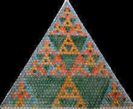
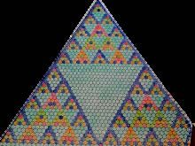

Na edição anterior, lançámos o desafio de pintares o triângulo de Pascal de acordo com os restos da divisão dos seus elementos por 4 e também por 5. Diz-se que se trata de uma divisão módulo 4 ou módulo 5, respetivamente.

Em cada um dos casos, o que te propusemos foi que escolhesses uma cor diferente para cada um dos restos. Mas poderíamos produzir alterações à regra. Por exemplo, poderias pintar o resto zero com uma cor e todos os outros com outra!

Vamos analisar agora os dois casos que foram propostos.

## Triângulo de Pascal pintado com 4 cores

Nota que:

- a soma de dois números divisíveis por 4 é divisível por 4 (resto 0 + resto 0 = resto 0);
- a soma de um número divisível por 4 com outro qualquer com resto $k$ é um número com resto $k$. Assim, a cor verde é “neutra”, isto é, o resultado terá a cor do outro número;
- por exemplo, a soma de dois números que tenham resto 3 dá um número cujo resto será 2 ($3 + 3 = 6 \to 6 - 4 = 2$);
- etc.

## Triângulo de Pascal pintado com 5 cores

Nota que:

- a soma de dois números divisíveis por 5 é um número divisível por 5 (resto 0 + resto 0 = resto 0);
- a soma de um número divisível por 5 com outro qualquer que dê resto $k$ é um número com resto $k$. Assim, a cor azul-turquesa é “neutra”, isto é, o resultado terá a cor do outro número;
- a soma de dois números que tenham resto 3 dá um número cujo resto será 1 ($3 + 3 = 6 \to 6 - 5 = 1$): verde com verde dá azul-escuro;
- verde com laranja dá cor-de-rosa porque $3 + 4 = 7$, logo o resto será 2 ($7 - 5 = 2$);
- etc.

Compara com o triângulo gerado no computador:

<PascalTriangle divisors={[4, 5, 2, 3, 7]} />
