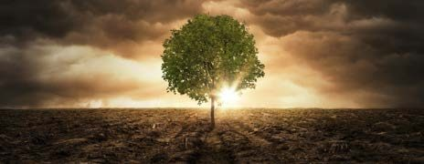

## Porque são tão importantes as florestas?

As florestas têm um valor social, económico e ambiental substancial. Ajudam a proteger o solo da erosão, participam no ciclo da água, fornecem um habitat para diferentes espécies, contribuindo assim para a biodiversidade, e ajudam a controlar o clima local. Elas representam 43 % da cobertura terrestre da UE e 80 % da biodiversidade terrestre encontra-se nas florestas.

As florestas saudáveis também são fundamentais na luta contra as alterações climáticas mundiais, porque capturam dióxido de carbono da atmosfera e libertam oxigénio, contribuindo para que a vida se mantenha — é por isso que lhes chamamos os pulmões do mundo. As florestas da União Europeia (UE) absorvem anualmente o equivalente a 8,9 % do total das emissões de gases com efeito de estufa da UE.

As alterações climáticas e a perda de biodiversidade provocam secas, inundações e incêndios mais intensos que conduzem a uma maior desflorestação e, por conseguinte, ao agravamento das alterações climáticas.

No entanto, temos vindo a assistir à destruição de florestas para que a terra possa ser usada para outros fins (desflorestação), e os dados são alarmantes: entre 1990 e 2020, perderam-se 420 milhões de hectares de floresta devido à desflorestação — o que equivale a uma área do tamanho da UE, de acordo com a Organização das Nações Unidas para Agricultura e Alimentação (FAO).

A exploração madeireira ilegal continua a ser uma das principais causas da desflorestação na UE e em todo o mundo. Um exemplo disso é o que se passa na maior floresta do mundo, a Amazónia. Nas últimas duas décadas, a Amazónia perdeu 8 % da sua área florestal, uma área equivalente a Espanha. Só em 2022, a Amazónia brasileira perdeu 10 278 quilómetros quadrados de cobertura vegetal e, infelizmente, esta tendência não parece estar a diminuir.

Já o processo oposto tem lugar na UE, onde as florestas aumentaram 10 % entre 1990 e 2020. A exceção é Portugal onde, à custa dos fogos, as florestas primárias estão em risco de desaparecer. **Portugal é o quarto país do mundo com maior desflorestação percentual** e é responsável pela desflorestação de cerca de 7200 metros quadrados por ano.

Existem atualmente 159 milhões de hectares de área florestal na União Europeia, o que representa 43,5 % da superfície terrestre da UE. Esta cobertura da área florestal pode variar substancialmente de um Estado-Membro para outro, desde os pouco mais de 10 % em Malta aos cerca de 70 % na Finlândia.

O que podemos fazer para ajudar a inverter esta tendência? Temos de mudar hábitos enraizados há muito na nossa sociedade…

*Fontes: [Parlamento Europeu](https://www.europarl.europa.eu/news/pt/headlines/society/20221019STO44561/as-causas-da-desflorestacao-e-a-resposta-da-ue), [florestas.pt](https://florestas.pt/conhecer/qual-a-relacao-entre-alteracoes-climaticas-e-florestas/), [ecoxxi.abae.pt](https://ecoxxi.abae.pt/our_news/portugal-e-o-quarto-pais-do-mundo-com-maior-desflorestacao/)*
