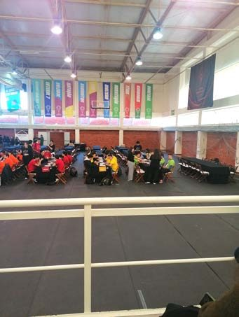
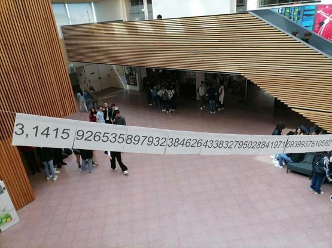
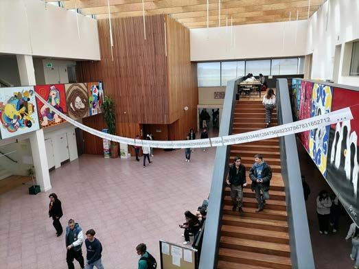
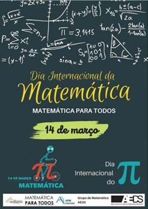
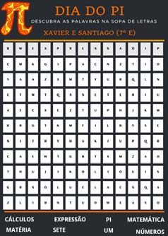

## Campeonato Nacional de Jogos Matemáticos

No dia 24 de março realizou-se o 16.º Campeonato Nacional de Jogos Matemáticos. A Escola Secundária do nosso agrupamento participou com os alunos Caterina Fezzi, do 11.º E, Dinis Santo, do 10.º E, e Rafael Frade, do 1.º B, nos jogos Produto, Atari Go e Dominório, respetivamente. O aluno Rafael Frade passou à segunda fase, ficando em 8.º lugar a nível nacional.

Parabéns a todos os alunos, e em especial ao Rafael!

## PmatE

No dia 26 de abril, a ESDS participou no concurso Xeqmat, provas de Matemática inseridas nas Competições Nacionais de Ciência 2023 (PmatE), evento promovido pela Universidade de Aveiro. Os resultados ficaram um pouco aquém das expectativas, no entanto esperamos que a iniciativa sirva de motivação a futuras participações.

## Dia da Matemática

No dia 14 de março, celebrou-se o Dia Internacional da Matemática e do Pi. Esta data não ficou esquecida: além da afixação de um cartaz que fizemos para divulgar o dia, decidimos, ainda, engalanar o magnífico átrio da ESDS com alguns algarismos do Pi.

Por essa altura, também aproveitámos para dar a conhecer algumas mulheres que se destacaram na Matemática.

Também na Escola Básica José Saraiva o dia foi assinalado com a realização de algumas atividades mais lúdicas.
