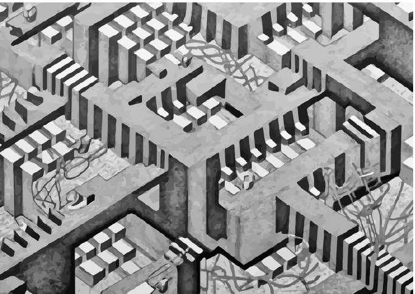
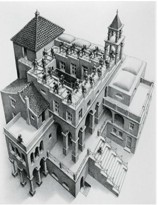
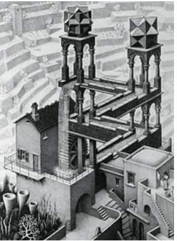
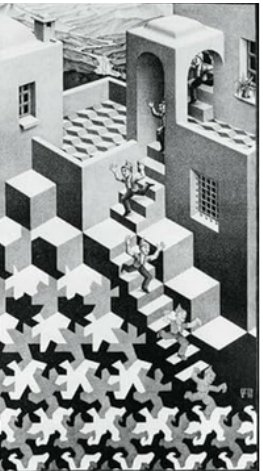
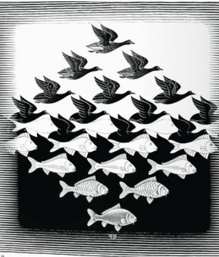
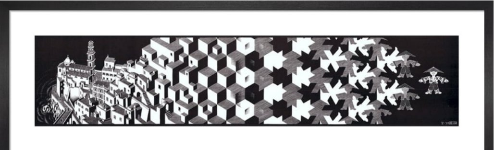

Maurits Cornelis Escher, neerlandês, foi um dos mais famosos artistas gráficos de todos os tempos. Notabilizou-se pela criatividade que revelou nos seus trabalhos, que mostravam não só geometrias impossíveis, tais como “subidas” e “descidas”, como também incríveis “metamorfoses” (I, II e III, Ar e Água, Répteis…).

Desafiámos o aluno **Pedro Vieira, do 11.º K**, a fazer um trabalho inspirado em Escher. O resultado foi o trabalho que se segue.

Parabéns ao Pedro Vieira pelo seu magnífico trabalho e empenho!

## A obra de Escher

")

Escher, além de ter sido um artista gráfico, foi considerado um artista matemático e, sobretudo, geométrico. Deixou-nos 448 litografias e mais de 2000 desenhos. As figuras seguintes mostram alguns dos trabalhos com os quais se destacou.

Nas duas primeiras figuras, Escher criou **uma ilusão de ótica** com algumas **figuras impossíveis**:

- alguns dos soldados estão sempre a subir, outros sempre a descer, voltando ao ponto de partida;
- a água cai, mas as superfícies de onde e para onde cai estão no mesmo plano.

Nas figuras seguintes, observamos algumas das suas famosas **metamorfoses**:

- da figura humana para padrões geométricos (*Cycle*, litografia de 1938);
- entre aves e peixes (*Sky and Water I*, xilogravura de 1938);
- a transformação gradual de uma pequena cidade numa boneca chinesa, passando por cubos (*Metamorfose I*, litografia de 1937).

*Para conheceres mais sobre o trabalho de Escher, podes consultar, entre outros, o site [mcescher.com](https://mcescher.com/about/books-on-escher/), de onde foram tiradas estas imagens.*
