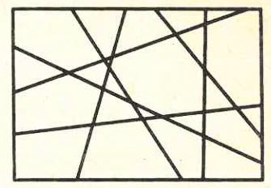
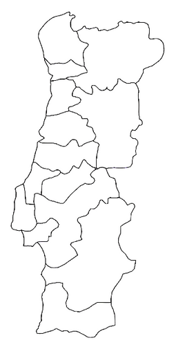

Nas figuras seguintes temos um mapa imaginário e o mapa de Portugal Continental.

Tenta colorir cada um dos mapas com menos de quatro cores. Como é óbvio, regiões adjacentes não podem ser pintadas com a mesma cor.

Na tua opinião, qual é o número mínimo de cores necessárias para colorir estes mapas?

Uma pista

O mapa imaginário é feito só de retas que atravessam todo o retângulo. Experimenta pintar as regiões alternadamente, como num tabuleiro de xadrez: cada vez que atravessas uma reta, mudas de cor. Quantas cores bastam?

E sabias que **qualquer** mapa pode ser pintado com, no máximo, quatro cores? É o famoso *Teorema das Quatro Cores*, demonstrado em 1976 com a ajuda de um computador — foi uma das primeiras grandes demonstrações a precisar de um!

Envia-nos imagens de mapas que tenhas conseguido pintar!

## Jogo — Colorir o mapa

Propomos-te um jogo baseado nesta temática.

**Regras do jogo**

- Dois jogadores, A e B, quatro cores diferentes e um mapa por colorir.
- Cada um dos jogadores pinta sucessivamente uma região do mapa.
- Perde o primeiro que não consiga colorir adequadamente nenhuma das regiões ainda sem cor.

Envia-nos comentários sobre este jogo!

