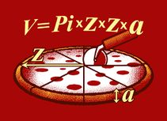
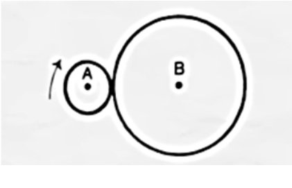

## 14 de março — Dia Mundial da Matemática e Dia do Pi

É o único número que tem um dia a celebrá-lo. Tem de ser um número muito importante. De facto, há várias constantes muito importantes e essenciais no estudo da Matemática, mas nenhuma é tão conhecida como o pi.

O pi é um número irracional; tem uma infinidade de casas decimais que não seguem nenhum padrão. Atualmente, conhecem-se 62,8 biliões de casas decimais deste número. Sugerimos-te que leias a [2.ª edição do ano 1 do +MAT](/edicoes/ano1-edicao2/01-o-numero-pi/) para conheceres mais curiosidades do Pi.

## Volume de uma pizza

O volume de uma pizza de raio $z$ e altura $a$ pode ser calculado através da expressão… **Pizza**:

$$
\text{Pizza} = \text{Pi} \cdot z^2 \cdot a = \pi r^2 h
$$

*Rodrigo Paiva, 10.º B*

## O número 142 857

Este número é obtido quando convertemos a fração $1/7$ em número decimal: $1/7 = 0{,}142857142857\ldots$

Se multiplicarmos o número 142 857 por 1, 2, 3, 4, 5 e 6, o resultado é um número formado pelos 6 algarismos deste número, só que “baralhados”:

$$
\begin{aligned}
142\,857 \times 1 &= 142\,857 \\
142\,857 \times 2 &= 285\,714 \\
142\,857 \times 3 &= 428\,571 \\
142\,857 \times 4 &= 571\,428 \\
142\,857 \times 5 &= 714\,285 \\
142\,857 \times 6 &= 857\,142 \\
142\,857 \times 7 &= 999\,999 \quad \text{(número curioso)}
\end{aligned}
$$

Mais “coincidências”: se multiplicarmos 142 857 por um número superior a 7, o resultado tem mais de 6 dígitos. Retirando os algarismos excedentes, à esquerda, e somando o número por eles formado com o número de 6 dígitos que se deixaram à direita, teremos novamente o número mágico ou uma sequência com os seus algarismos:

- $142\,857 \times 8 = 1\,142\,856 \to 1$ e $142\,856$. Ora, $142\,856 + 1 = 142\,857$;
- $142\,857 \times 13 = 1\,857\,141 \to 857\,141 + 1 = 857\,142$;
- $142\,857 \times 325 = 46\,428\,525$ (8 algarismos) $\to 46 + 428\,525 = 428\,571$.

Experimenta com outros números.

## Múltiplos de 37

Ao multiplicarmos 37 pelos múltiplos de 3 menores do que 30, deparamo-nos com um facto curioso:

$$
3 \times 37 = 111,\quad 6 \times 37 = 222,\quad 9 \times 37 = 333,\quad \ldots,\quad 27 \times 37 = 999
$$

Se multiplicarmos 37, ainda, pelos múltiplos de 3 compreendidos entre 33 e 54, também encontramos uma sequência muito interessante de resultados:

$$
\begin{aligned}
33 \times 37 &= 1221 & 36 \times 37 &= 1332 & 39 \times 37 &= 1443 & 42 \times 37 &= 1554 \\
45 \times 37 &= 1665 & 48 \times 37 &= 1776 & 51 \times 37 &= 1887 & 54 \times 37 &= 1998
\end{aligned}
$$

37 é, de facto, um número curioso! **Consegues explicar este facto?**

*Sofia Ferreira Gaspar, 11.º E*

## A intuição às vezes falha

A curiosidade que aqui apresentamos é um problema que integrou uma das provas do SAT, um conhecido exame dos Estados Unidos da América que faz a seleção dos estudantes ao nível de ensino superior. Este exame é constituído por 30 questões de escolha múltipla e tem a duração de 30 minutos, o que significa que, em média, o aluno terá 1 minuto para cada resposta. Não serão perguntas de grande complexidade… mas este problema não tinha a resposta nas cinco opções de resposta apresentadas no enunciado!

<Challenge id="desafio-655141a4" title="Quantas voltas dá o círculo A?" answer="4|quatro" unit="voltas" source="Problema sugerido pelo aluno Luís Rodrigues, 11.º K">

Na figura, o raio do círculo A é 1/3 do raio do círculo B. Iniciando na posição que a figura mostra, o círculo A roda à volta do círculo B. Quantas voltas terá de dar o círculo A até voltar à sua posição inicial, o momento em que o centro do círculo A alcança, pela primeira vez, o ponto de partida?

Uma das respostas possíveis era 3, que era a resposta esperada, mas não correta. Porque era a esperada? Considerando as linhas que contornam os dois círculos, uma mede o triplo da outra, logo 3 voltas parecia a resposta a dar. No entanto não é a correta.

Para te convencer, façamos uma simplificação do problema: consideremos dois círculos iguais, um a rodar à volta do outro. O mesmo raio, o mesmo perímetro, seria necessário dar apenas uma volta. Mas não é assim. Podes experimentar com duas moedas iguais e constatar que precisamos de duas voltas, e não de apenas uma.

Voltemos ao nosso problema. Podes construir dois círculos com cartão grosso e fazer a experiência: são necessárias **4 voltas**. Repara que o centro do círculo menor percorre uma circunferência de raio 4, percorrendo 4 vezes a distância do contorno do círculo maior.

</Challenge>

## Uma data capicua

No dia 20 de fevereiro de 2002 foi uma data histórica. Existiu uma combinação de algarismos que somente ocorre duas vezes em cada milénio. Essa combinação ocorreu exatamente às 20 horas e 02 minutos de 20 de fevereiro do ano 2002, ou seja, 20:02 20/02/2002:

$$
\mathbf{200220022002}
$$

Isto é uma simetria que na matemática é chamada de capicua, ou seja, os números podem ser lidos tanto da direita para a esquerda como da esquerda para a direita. A raridade deve-se ao facto de que os três conjuntos de quatro algarismos são iguais (2002) e simétricos em si (20:02, 20/02 e 2002).

A última ocasião em que isso ocorreu, antes desta, foi às 11h11min de 11 de novembro do ano 1111, formando a data 11:11 11/11/1111. A próxima vez será às 21h12min de 21 de dezembro de 2112 (21:12 21/12/2112), mas provavelmente não estaremos aqui para a presenciar.

Depois, nunca mais haverá outra capicua. Em 30 de março de 3003 não ocorrerá essa coincidência matemática, já que não existe a hora 30.

*Matilde Angélico e Inês Alves, 10.º F; [somatematica.com.br](https://www.somatematica.com.br/curiosidades/c25.php)*
