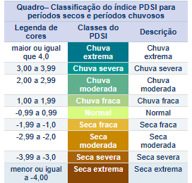
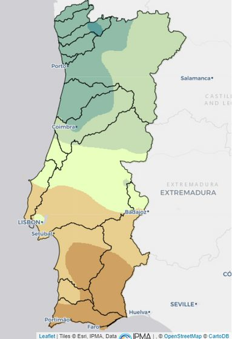
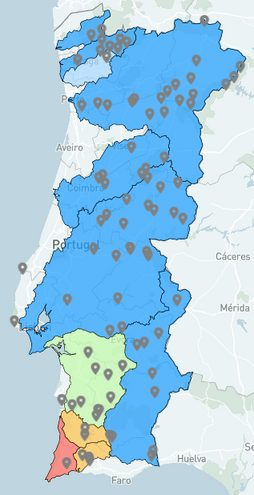
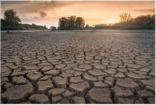

O índice PDSI (*Palmer Drought Severity Index*) foi desenvolvido por Palmer para detetar e classificar períodos de seca.

- O mês de janeiro de 2024 em Portugal Continental foi o terceiro mais quente desde 1931 e o mais quente dos últimos 58 anos. Fevereiro foi o mais quente de sempre!
- Janeiro de 2024 foi 1,66 °C mais quente do que a estimativa da média de janeiro na era pré-industrial (período entre 1850 e 1900).
- No final de dezembro de 2023 verificou-se que a região Centro e Sul apresentava um cenário de seca (38 % do território); a 31 de janeiro, 20 % do território estava em seca meteorológica.

## Qual é o nível de água nas barragens e albufeiras de Portugal?

No Algarve (dados do dia 24 de fevereiro de 2024):

- Barragem de Odeleite (42,43 %) → apenas 31,22 % de volume útil;
- Barragem de Odelouca (32,26 % do total) → 16,97 % útil;
- Barragem de Beliche (35,32 % do total) → 27,61 % útil.

No Alentejo, temos a Barragem do Alqueva, que, como sabes, é o maior lago artificial da Europa. O Alqueva está, à data, com 87 % do seu volume total.

Muitos desertos são formados a partir do processo de desertificação do solo, que consiste na perda de vegetação através da ação do homem ou da própria natureza. Será que teremos um deserto em Portugal no futuro?

*Para saberes mais, consulta [barragens.pt](https://barragens.pt/?dam_id=1627751880&nz) e o [observatório de secas do IPMA](https://www.ipma.pt/pt/oclima/observatorio.secas/).*

<strong>Curiosidade:</strong> pesquisa no Google “Blue Dragon River”. Surpreendido?

