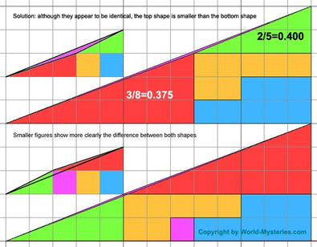
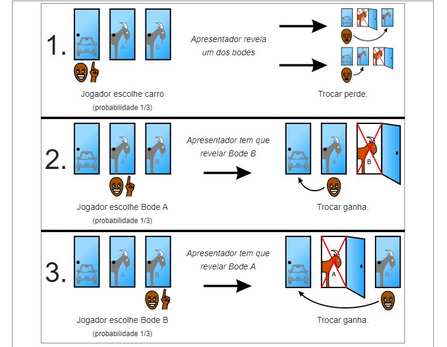

## Desafios e curiosidades

### Desafio 1 — as meias

Numa gaveta, há 12 meias brancas, 12 meias pretas e 12 meias azuis. Quantas meias devemos retirar, ao acaso, para termos a certeza de obter um par de meias da mesma cor?

A resposta é simples: apenas **4 meias**. As três primeiras podem ter todas cores diferentes. A quarta meia terá de repetir uma das cores.

### Desafio 2 — os 13 pontos

Se marcarmos 13 pontos num retângulo 3 × 4, existem dois pontos tais que a distância entre si é menor do que $\sqrt{2}$.

**Justificação:** uma vez que temos 12 quadrados, ao colocarmos 13 pontos há pelo menos dois pontos, digamos A e B, num mesmo quadrado (pelo Princípio das gavetas de Dirichlet). Ora, num quadrado de lado 1, a distância máxima entre dois pontos é igual à diagonal, que nesse caso mede $\sqrt{2}$.

### Curiosidade 2 — números de três algarismos

Porque é que este processo funciona?

1. Ao repetir o número $\overline{abc}$ ao lado do mesmo, obtém-se $\overline{abcabc}$, que é igual a $\overline{abc} \times 1000 + \overline{abc}$, isto é, $\overline{abc} \times 1001$ (basta colocares $\overline{abc}$ em evidência).
2. $13 \times 11 \times 7 = 1001$.
3. $\overline{abcabc}$ a dividir por 1001 dá $\overline{abc}$, o número inicial.

Parece magia, não é? Mas é simplesmente uma “habilidade” matemática!

### Curiosidade 4 — algarismo das unidades

Multiplicando todos os números ímpares de 1 a 2023, qual é o algarismo das unidades do resultado? Seja $N = 1 \times 3 \times 5 \times 7 \times \cdots \times 2023$.

1. O número $N$ é ímpar.
2. O número $N$ é múltiplo de 5, dado que o 5 aparece na sua fatorização.

Já estás a ver em que algarismo termina: **5** (se é múltiplo de 5, termina em 0 ou 5; como é ímpar, termina em 5).

### 1) A nação de Zox

- A ilha mais pequena tem 1/10 dos Zoxianos de toda a nação de Zox → **75 Zoxianos**.
- Uma das ilhas tem 1/5 da população total de Zox. Outra ilha tem 1/3 → **150 e 250 Zoxianos**.
- Zop tem mais 100 pessoas do que a ilha mais pequena → **Zop tem 175 Zoxianos**.

75, 150, 175 e 250 são as populações apuradas. Logo, a quinta ilha tem 100 Zoxianos. Constatamos que **Zob terá 150 Zoxianos** (uma vez e meia de 100) e que **Zod tem 250 Zoxianos** (é a maior). Como a ilha mais pequena não é Zoz, a ilha mais pequena (75) é **Zog** e a que tem 100 é **Zoz**.\*

Também poderíamos resolver o problema recorrendo a sistemas de equações.

<small>\* Na versão em papel, os nomes de Zog e Zoz apareciam trocados, contrariando a primeira pista; corrigimos na versão digital.</small>

### 2) O quadrado que sobra

Nas duas figuras, a troca entre os triângulos verde e vermelho originou dois retângulos, A e B, com áreas diferentes, respetivamente: 15 unidades de área ($3 \times 5$) e 16 ($2 \times 8$). Como se justifica a existência do quadrado branco?

As figuras não são iguais porque não são triângulos! Repara que os triângulos verde e vermelho não são semelhantes, visto que as medidas dos seus lados não são proporcionais; o triângulo verde tem de base 5 e altura 2, e o vermelho tem base 8 e altura 3; por consequência, as hipotenusas não formam um segmento de reta e, portanto, as figuras não são triângulos. No entanto, estas diferenças são muito pequenas, criando esta ilusão.

### 3) Às compras

Timóteo gastou tudo o que tinha no bolso em cinco lojas. Em cada loja gastou 1 € a mais do que a metade do que tinha ao entrar. Quanto tinha o Timóteo no bolso à partida?

**Resolução:** vamos começar pela 5.ª loja, depois passamos para a 4.ª, e assim sucessivamente até à 1.ª loja. Se em cada loja o Timóteo gastou metade da quantia que tinha, ao entrar, mais 1 €, então em cada loja sobrou-lhe metade do que tinha, ao entrar, menos 1 €. Ao entrar na 5.ª loja, a quantia que tinha era a mesma que lhe tinha sobrado na 4.ª loja ($A$) e gastou-a toda, ficando com 0 euros:

$$
\frac{A}{2} - 1 = 0 \iff A = 2
$$

Analogamente:

$$
\frac{B}{2} - 1 = 2 \iff B = 6, \qquad \frac{C}{2} - 1 = 6 \iff C = 14, \qquad \frac{D}{2} - 1 = 14 \iff D = 30, \qquad \frac{N}{2} - 1 = 30 \iff N = 62
$$

| Loja | Gastou | Sobrou |
| :-: | :-: | :-: |
| 1 | 32 | 30 |
| 2 | 16 | 14 |
| 3 | 8 | 6 |
| 4 | 4 | 2 |
| 5 | 2 | 0 |

**O Timóteo tinha 62 euros no bolso.**

## Problema de Monty Hall

Depois de feita a escolha da porta e de o apresentador abrir uma das portas, valerá a pena mudar a sua escolha?

Suponhamos que o carro está na Porta 1 (o mesmo raciocínio poderá ser feito para o caso de o carro estar numa das outras duas). Deparamo-nos com três casos diferentes:

1. **O concorrente escolheu a porta 1.** Neste caso, o apresentador abre uma das outras duas portas, onde está, naturalmente, uma cabra. Perante as duas portas fechadas à sua frente, o jogador terá de decidir se mantém a escolha ou se a altera. Dado que escolheu a porta certa, se mudar perde.
2. **O concorrente escolheu a porta 2.** Neste caso, o apresentador abre a porta 3, com a cabra. Perante as duas portas fechadas à sua frente (a 1 e a 2), se mudar, muda para a porta 1, pelo que vai ganhar o carro.
3. **O concorrente escolheu a porta 3.** Neste caso, o apresentador abre a porta 2, com a cabra. Perante as duas portas fechadas à sua frente (a 1 e a 3), se mudar, será para a porta 1, e ganha.

Ou seja, em duas das três situações possíveis, se mudar a sua escolha, ganha. A probabilidade de ganhar o carro, mudando a escolha, é $2/3$.

**Conclusão: o concorrente deve mudar a sua escolha!** Podes confirmar com o [simulador da edição anterior](/edicoes/ano2-edicao1/02-probabilidades/).

<strong>Esperamos pelas tuas resoluções e sugestões!</strong>

