## Canguru Matemático

No passado dia 10 de abril, realizou-se, no nosso agrupamento, o Concurso Canguru Matemático. Participaram 10 alunos na categoria Mini-Escolar I (2.º ano), 41 na categoria Mini-Escolar II (3.º ano), 64 na categoria Mini-Escolar III (4.º ano), 45 na categoria Escolar (5.º e 6.º anos), 21 na categoria Júnior (10.º e 11.º anos) e 5 alunos na categoria Estudante (12.º ano). Aguardamos pelos resultados nacionais, previstos para o final deste mês (maio 2024).

## PmatE

No dia 3 de maio de 2024, a ESDS participou nas Competições Nacionais de Ciência 2024 (PmatE), evento promovido pela Universidade de Aveiro. As equipas participantes tiveram um ótimo desempenho, tendo arrecadado 5 prémios, no total, dos quais destacamos o **1.º prémio obtido na prova de Matemática — XeqMat 11.º ano, pela dupla Lourenço Passadouro e Tiago Henriques, do 11.º A**.

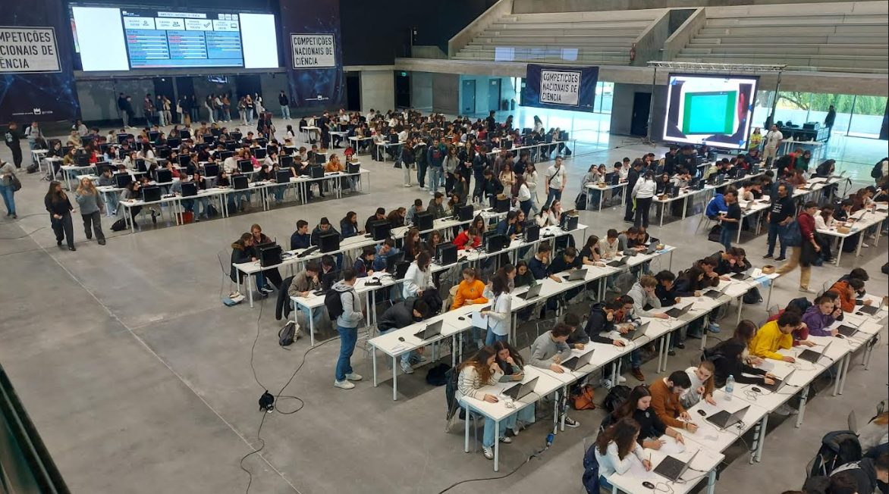

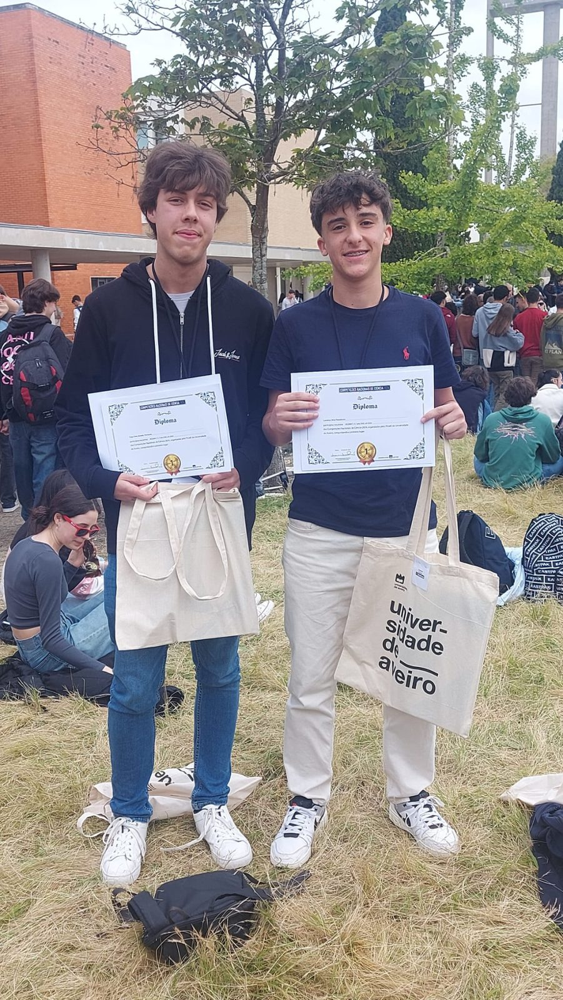

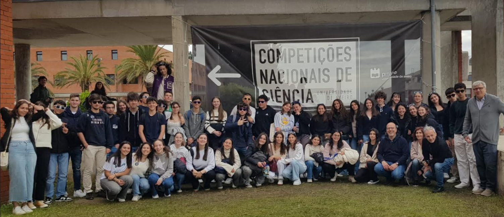

<strong>Contamos com a tua participação em futuros eventos!</strong>

## Dia da Matemática — 14 de março

O Dia Internacional da Matemática, Dia do Pi, foi celebrado na ESDS com duas iniciativas. No período da manhã, os alunos participaram na atividade dinamizada pela SPM, APM e CML, que teve lugar no Teatro José Lúcio da Silva. Nesta atividade houve lugar a teatro, bailado, uma conferência sobre números e um jogo geométrico. Deixamos aqui os testemunhos de alguns alunos:

> A palestra foi muito bem organizada e interativa com todos os alunos presentes, fazendo assim com que a nossa atenção fosse ainda maior e a dança feita pelas bailarinas foi magnífica, com os seus movimentos graciosos. Conseguimos ver que a matemática está por toda a cidade. — **10.º F**

> Com a palestra ficámos mais esclarecidos da forma como a Matemática se enquadra em todos os parâmetros da nossa vida. A Matemática pode ser divertida como a dança o é. — **12.º F**

> É fácil pensar que tudo o que é belo na matemática é inútil e tudo o que é útil não é belo, mas numa só palestra é demonstrada a incrível utilidade e beleza que é possível encontrar numa coisa tão fundamental como os números primos. — **André Gaspar, 12.º G**

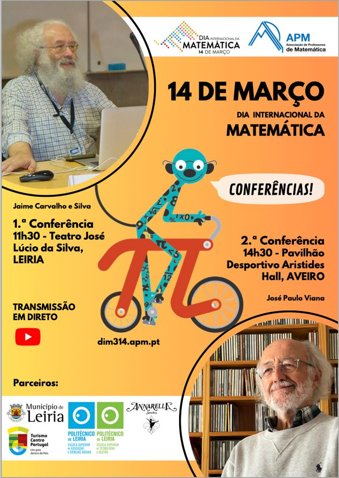

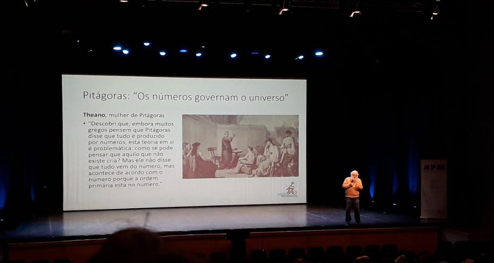

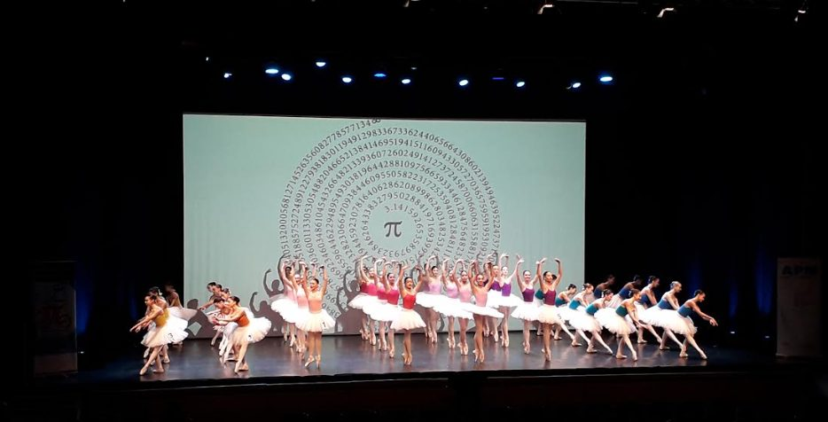

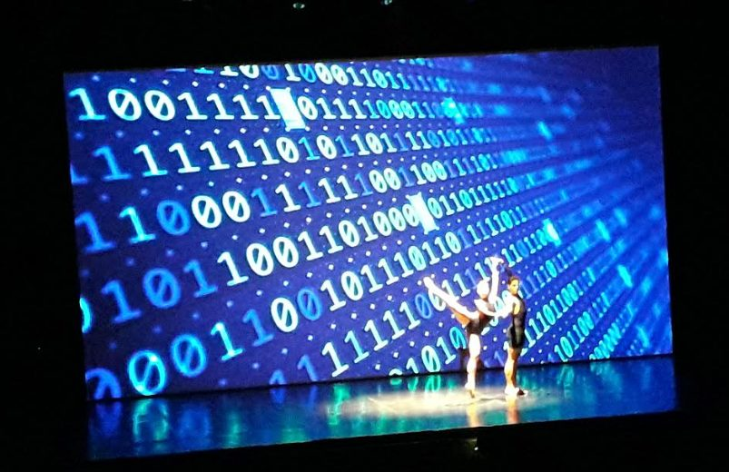

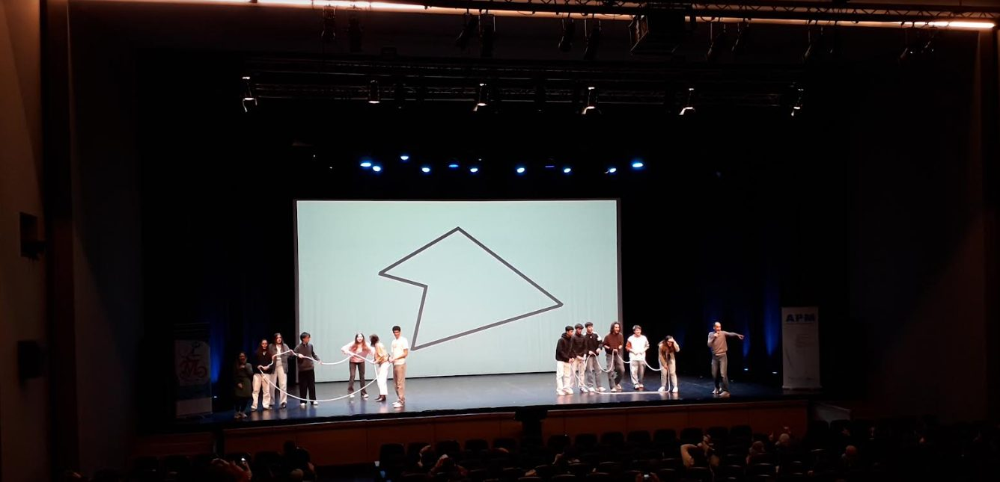

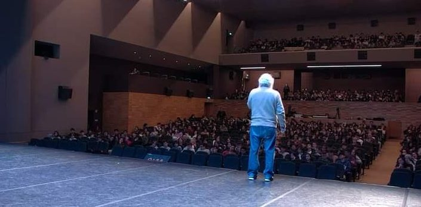

## Dia da Matemática — na escola

Durante a tarde deste dia, as professoras Rosa Bértolo e Carla Nunes “invadiram” algumas salas de aula com um truque de cartas que envolvia Matemática. Deixamos aqui um texto de opinião de uma das alunas surpreendidas.

> **Matemágica**
>
> Quem diria que um simples truque de cartas, executado com um ar enigmático, seria o suficiente para despertar a curiosidade e a vontade de aprender?
>
> A nossa escola assinalou, este ano, o Dia Internacional da Matemática, celebrado a 14 de março, com uma pequena atividade envolvendo magia e números.
>
> Esta iniciativa, promovida por duas professoras, convidava os alunos a porem em prática as suas capacidades de raciocínio. Inicialmente, uma das professoras ficava na sala de aula e a outra no corredor, não vendo o que se passava na sala de aula. Com a ajuda da professora que estava na sala, os alunos escolhiam, ao acaso, cinco cartas do baralho, disposto para baixo, e davam-nas à professora presente. De seguida, essa professora escolhia uma carta desse conjunto de cartas, que dava a um aluno e era-lhe pedido que a mostrasse a todos. Depois de efetuada a seleção, a professora dispunha no quadro as quatro cartas restantes, com algumas delas voltadas para cima e outras para baixo (aleatoriamente? Talvez não). No fim, a outra professora, que se encontrava fora da sala desde o início, era chamada e tinha de adivinhar a carta retirada pelo aluno.
>
> Após algumas repetições da atividade, os alunos, inicialmente intrigados, tornaram-se cada vez mais ágeis, tentando decifrar o mistério por trás do truque.
>
> Este desafio demonstrou, assim, como a Matemática está presente no nosso quotidiano e permite experiências tão fascinantes que parecem verdadeiros truques de magia.
>
> — Gabriela Major, 12.º H

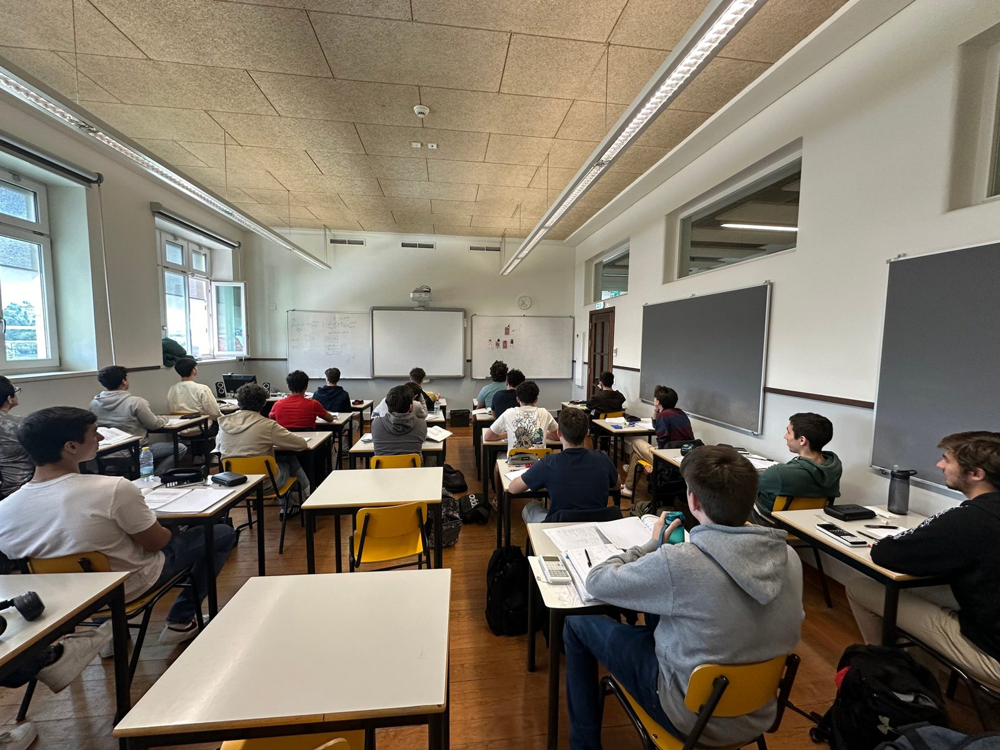

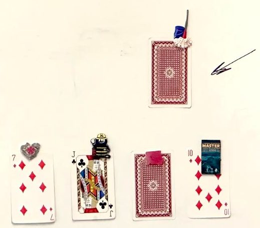

**Consegues fazê-lo também?**
