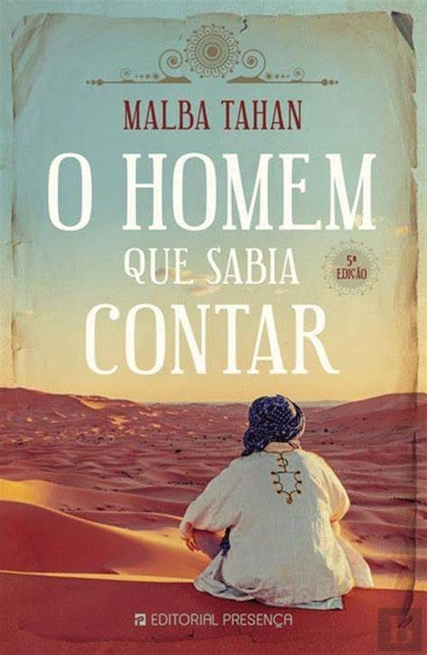
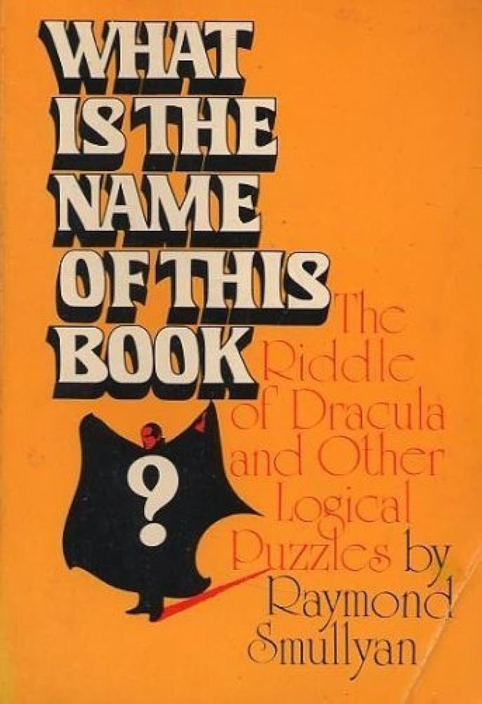
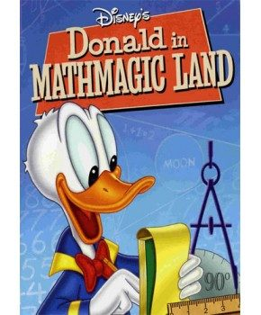
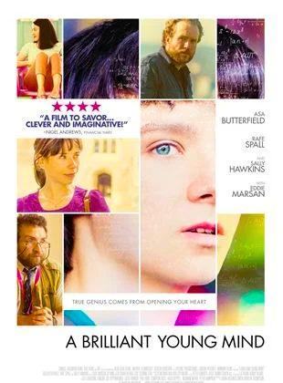

Quase a finalizar esta edição, deixamos-te algumas sugestões de leituras e de filmes. Os livros que propomos estão ambos disponíveis em *pdf* online. Os dois filmes sugeridos podem ser vistos também online. Se tiveres interesse, contacta a BECRE. Envia-nos os teus comentários.

## Livros

## Filmes

<strong>Por agora, é só!</strong> Mas não terminamos esta edição sem antes apresentarmos as resoluções de todos os desafios da edição anterior! Desejando que tenhas gostado desta edição, esperamos pela tua colaboração no próximo ano letivo! <strong>Boas férias!</strong>

