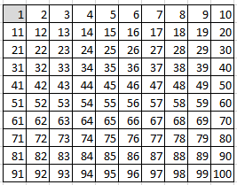

No dia 12 de outubro deste ano foi descoberto mais um número primo, o maior número primo conhecido até hoje. Tem mais de 41 milhões de dígitos e foi descoberto pelo ex-programador da Nvidia, Luke Durant. Tratou-se de uma descoberta notável, dada a dimensão do número. Para o conseguir, Durant precisou de quase um ano de trabalho.

Como sabes, um número primo é um número inteiro que é divisível apenas pela unidade e por si próprio, como 2, 3, 5 e 7. Este número primo pertence à classe especial de números primos raros, conhecidos como primos de Mersenne, e é o 52.º primo deste tipo que é descoberto. Os primos de Mersenne devem o seu nome ao monge francês Marin Mersenne, que os estudou há cerca de 350 anos. Estes números têm uma fórmula simples: $2^n - 1$.

Este novo número primo foi encontrado após o computador calcular dois elevado a 136 279 841, menos um. Por este motivo, este número foi apelidado de **M136279841**:

$$
M_{136\,279\,841} = 2^{136\,279\,841} - 1
$$

O primo M136279841 possui uns incríveis **41 024 320 dígitos**! O maior número primo que se conhecia até agora tinha 24 862 048 dígitos, ou seja, o número de dígitos quase duplicou! Esta descoberta foi o primeiro avanço significativo em números primos em quase seis anos.

## Como foi descoberto este número?

A descoberta de Durant foi anunciada pelo projeto Great Internet Mersenne Prime Search (GIMPS) em 21 de outubro. O GIMPS é um exemplo de ciência cidadã, porque permite que pessoas comuns façam descobertas significativas: utilizando a tecnologia avançada do GIMPS e combinando elementos de computação em nuvem, conseguiu criar um supercomputador incrivelmente rápido. A comunidade GIMPS inclui voluntários de todo o mundo que executam o software do projeto nos seus computadores pessoais em busca de novos primos.

A descoberta de Durant é notável por ter sido a primeira que foi realizada através de unidades de processamento gráfico (GPUs), conhecidas pela sua eficiência em lidar com cálculos matemáticos repetitivos em alta velocidade. As GPUs profissionais usadas por Durant incluíam milhares de GPUs de servidores, cruzando 24 regiões de *data centers* em 17 países.

## Ainda com números primos

Já ouviste falar do Crivo de Eratóstenes? O Crivo de Eratóstenes é um método prático e simples para determinar todos os números primos menores ou iguais a um certo número. Basta escreveres todos os números naturais até esse número e ires cortando: os múltiplos de 2 (pares), os múltiplos de 3, os múltiplos de 5, e assim sucessivamente.

