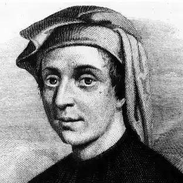
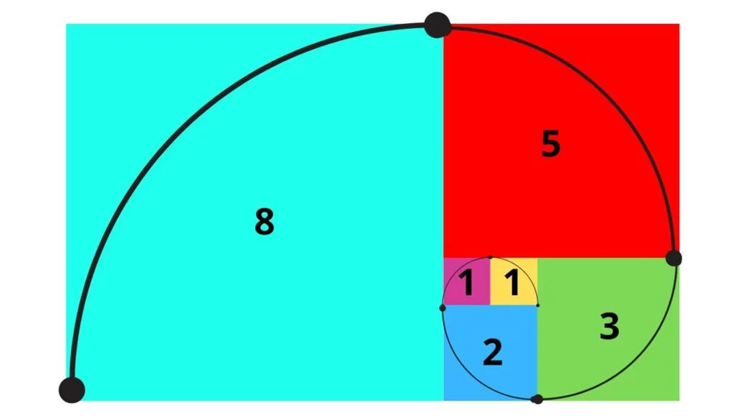
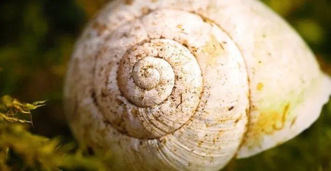
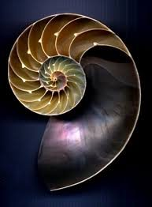
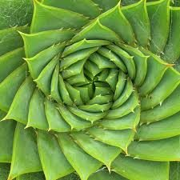
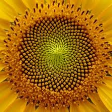
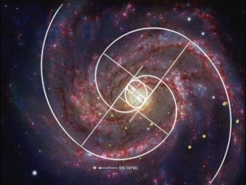
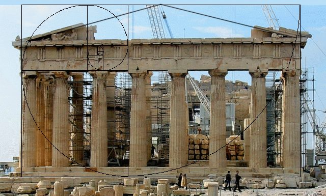
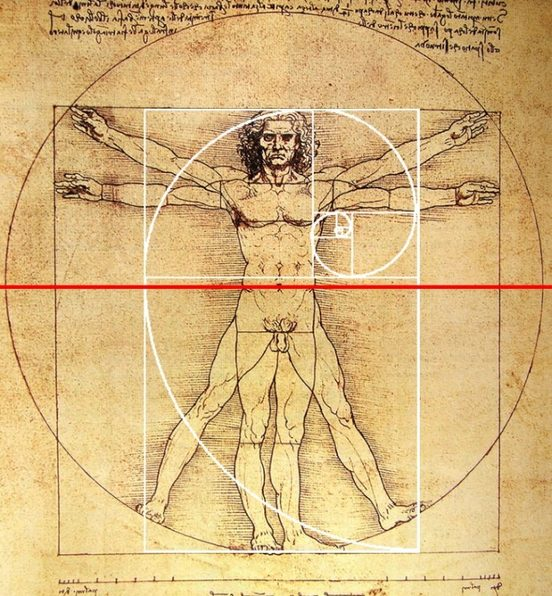

Fibonacci, ou Leonardo de Pisa, viveu na Idade Média e foi um dos maiores matemáticos do seu tempo. Uma das suas maiores “descobertas” foi a sucessão que ficou conhecida pelo seu nome, a sucessão de Fibonacci. Apesar de já ser conhecida há muito tempo, foi ele que a divulgou e explicou ao mundo matemático. Começou por a utilizar na reprodução de um casal de coelhos, mas a aplicação desta sucessão de números está por toda a natureza.

**Sucessão de Fibonacci:** 1, 1, 2, 3, 5, 8, 13, 21, 34, 55, 89, …

Nota que o 3.º termo da sucessão e seguintes se obtêm somando os dois termos anteriores: $2 = 1 + 1$; $3 = 1 + 2$; $5 = 2 + 3$; $8 = 3 + 5$; $13 = 5 + 8$; $21 = 8 + 13$; $34 = 13 + 21$; $55 = 21 + 34$; $89 = 34 + 55$, …

Considerando a sucessão de quadrados dos termos da sucessão, e dispondo-os de forma geométrica, consegue-se traçar uma espiral perfeita, que é visível por toda a natureza.

Com os números desta sequência forma-se outra sequência: a proporção áurea. Esta sucessão terá um pequeno artigo na próxima edição do jornal. Queres ser o redator do artigo?

**Por que razão foi escolhida esta data (23/11) para comemorar o dia de Fibonacci?** Devido à escrita inglesa das datas, que coloca primeiro o mês e depois o dia, e aos primeiros quatro termos da sequência: 1 1 2 3, o que dá 11/23, ou seja, em novembro, o dia 23! Este dia é celebrado mundialmente.

*Fonte: [clube.spm.pt](https://clube.spm.pt/news/dia-de-fibonacci-23-de-novembro-de-2020)*
