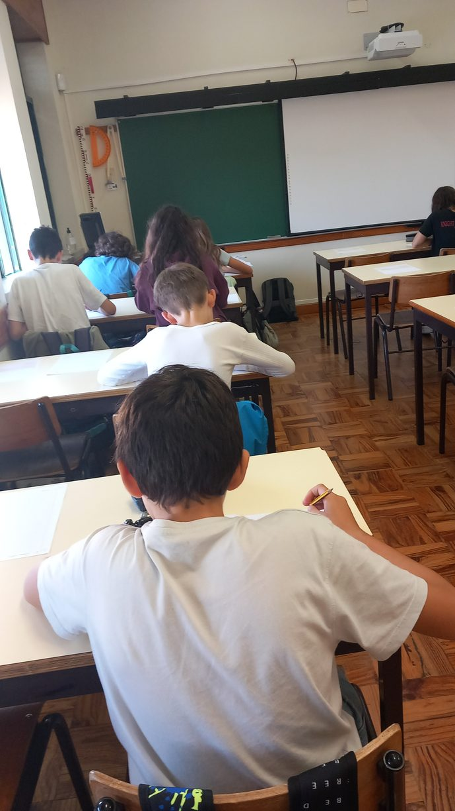
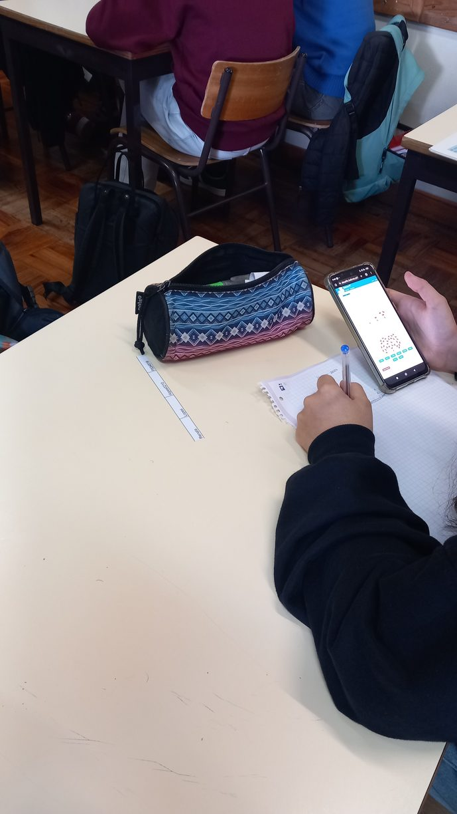
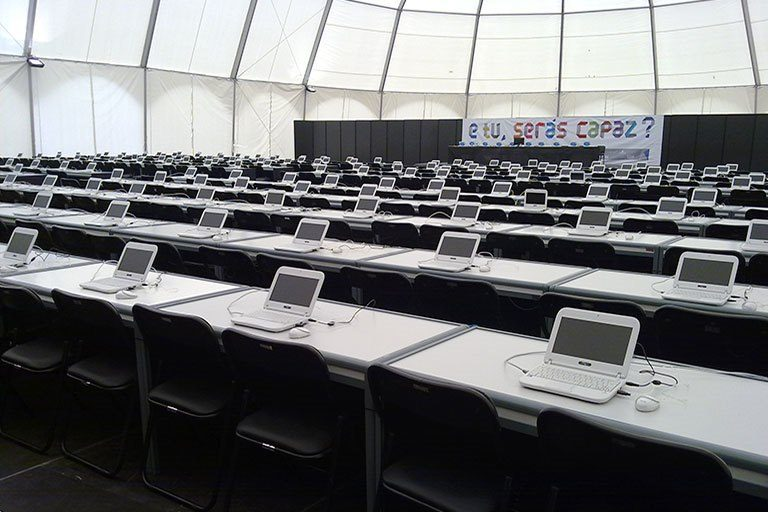
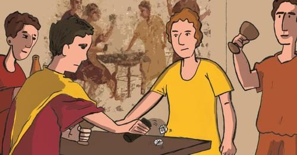
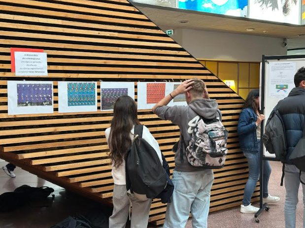
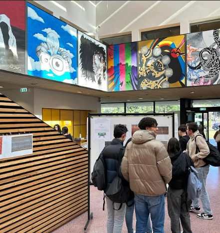
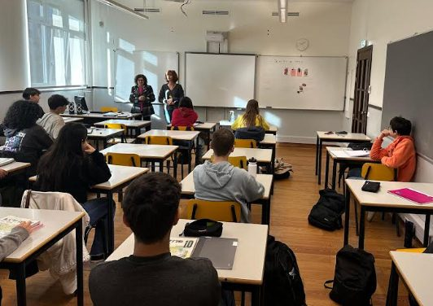

## Olimpíadas Portuguesas de Matemática

Na tarde do dia 6 de novembro realizou-se a primeira eliminatória das XLIII Olimpíadas Portuguesas de Matemática. Foi com agrado que 11 alunos da EBJS e 24 alunos da ESDS aceitaram participar neste desafio, lançado pela Sociedade Portuguesa de Matemática em parceria com o Departamento de Matemática da Universidade de Coimbra. Com esta atividade, os alunos tiveram a oportunidade de desenvolver o gosto pelo raciocínio estratégico, o treino na resolução de problemas e o conhecimento matemático. Do 7.º ao 12.º ano, mostraram os seus interesses e vocações na área da Matemática.

Participaram no evento 5 alunos na categoria Júnior (7.º ano), 6 alunos na categoria A (8.º e 9.º anos) e 24 alunos na categoria B (Secundário). Foram apurados para a 2.ª eliminatória os alunos: Camila Baptista, da categoria Júnior, Salvador Rinhonha Pragana, da categoria A, e Ana Fonseca, Beatriz Conde, Lourenço Passadouro, Pedro Gameiro e Tiago Henriques, da categoria B. Boa sorte aos sete para a próxima etapa!

Apresentamos-vos aqui um dos problemas que integraram esta eliminatória (Categoria A) para ver o vosso desembaraço e sagacidade:

<Challenge id="desafio-6a4623ab" title="Torneio de xadrez" answer="4|quatro" unit="pontos" source="XLIII OPM, 1.ª eliminatória, Categoria A">

Num torneio de xadrez participaram 6 jogadores e cada jogador jogou uma vez com cada um dos restantes jogadores. Uma derrota vale 0 pontos, um empate vale 1 ponto (para cada jogador) e uma vitória vale 2 pontos. No final do torneio um dos jogadores terminou com 8 pontos, outro com 6 pontos e os restantes quatro jogadores terminaram todos com o mesmo número de pontos.

Qual o número de pontos com que cada um destes quatro jogadores terminou o torneio?

Há ${}^{6}C_2 = 15$ jogos e cada jogo distribui sempre 2 pontos, logo foram distribuídos 30 pontos no total. Retirando $8 + 6 = 14$, sobram 16 pontos para os outros quatro: **4 pontos** cada um.

</Challenge>

## Bebras

O Desafio Bebras, que vai na 6.ª edição, é uma iniciativa mundial que promove o Pensamento Computacional através de uma prova de 45 minutos, que envolve alunos do 3.º ao 12.º ano. A prova decorreu entre os dias 4 e 15 de novembro. O Bebras potencia a resolução de problemas e o conhecimento em Informática, preparando os alunos para as competências do futuro.

O AEDS participou, pela primeira vez, no desafio:

- a EBJS, com cerca de 100 alunos das turmas A, B e C do 7.º ano, e G do 8.º ano;
- na ESDS participaram cerca de 90 alunos (10.º A, D e H e 12.º G — 1 aluno).

Em breve serão divulgados os resultados e entregues os respetivos certificados. Alunos e professores referiram que a atividade foi muito positiva e será para repetir!

## PmatE

As Competições Nacionais de Ciência 2025 (PmatE) são um evento promovido pela Universidade de Aveiro e a ESDS irá participar. As competições terão lugar no dia 2 de maio na Universidade de Aveiro. Os treinos já estão disponíveis! **Inscreve-te junto do teu professor.**

## Canguru Matemático

É um concurso que pretende estimular e motivar o maior número possível de alunos para a Matemática e é um complemento a outras atividades, tais como olimpíadas. Em Portugal, a organização deste concurso está a cargo do Departamento de Matemática da Faculdade de Ciências e Tecnologia da Universidade de Coimbra, com o apoio da Sociedade Portuguesa de Matemática. O Concurso é para TODOS os alunos (não existe seleção prévia) e a prova consiste num questionário de escolha múltipla de várias questões de dificuldade crescente. As inscrições começam em janeiro.

## Campeonato Nacional de Jogos Matemáticos

A ESDS irá participar no 18.º Campeonato Nacional de Jogos Matemáticos (CNJM), que terá a sua final no dia 14 de março de 2025, em Aveiro — Dia Internacional da Matemática! Dia do Pi!

O CNJM é o resultado da colaboração entre a Associação Ludus, a Associação de Professores de Matemática, a Sociedade Portuguesa de Matemática e a Agência Ciência Viva. Esta competição, cuja participação anual ronda os **100 000 jovens**, promove a prática dos jogos de tabuleiro abstratos, que potencia o pensamento rigoroso e criativo, tão típicos da Matemática. No secundário, os jogos a concurso são **Produto, Atari Go e Nex**. Cada escola pode participar com um aluno por jogo. Escolhe o teu jogo preferido e treina com os teus colegas. Esta pode ser a tua vez de representar a ESDS!

Podes consultar as regras dos jogos: [Produto](http://ludicum.org/jogos/abstr/produto/view), [Atari Go](http://ludicum.org/jogos/abstr/atari-go/view), [Nex](http://ludicum.org/jogos/abstr/nex/view).

## SuperTmatik

A Escola Básica José Saraiva (3.º ciclo do Ensino Básico) irá participar no campeonato SuperTmatik, de cálculo mental, que decorrerá em maio de 2025. Dos objetivos deste campeonato, destacam-se o desenvolvimento das destrezas numéricas e do cálculo, e o reforço da componente lúdica na aprendizagem da Matemática.

- Até 21 de março — treino para apuramento dos grandes finalistas.
- Grande Final — entre 1 e 16 de maio de 2025.

## Dia Nacional da Cultura Científica

De 25 a 29 de novembro realizaram-se atividades na escola no âmbito da Cultura Científica, cuja comemoração ocorreu no dia 27. A Matemática deu o seu contributo com uma exposição de estereogramas e espalhou magia pelas salas de aula.

Os estereogramas permitiram despertar os sentidos para ver além da realidade. A partir de uma imagem 2D, com a técnica certa, as figuras “saem do papel” e somos surpreendidos com uma imagem a 3 dimensões, que parece ter estado lá desde sempre. Para os menos habilidosos, temos a dizer-lhes que é possível treinar o olhar e o jeito surge naturalmente!

Relativamente à magia, deixamos-vos o testemunho de duas alunas onde esta aconteceu!

> Numa manhã de quarta feira, na semana em que se comemorou o Dia da Ciência, duas professoras vieram à nossa aula para nos mostrar um truque de magia envolvendo matemática, o que deixou a turma muito curiosa. Este truque envolveu as duas “mágicas”, que trabalharam em perfeita sintonia, criando um espetáculo intrigante e envolvente.
>
> A primeira “mágica” aproximou-se com um baralho de cartas e pediu a um aluno que escolhesse 5 cartas à sua vontade. Em seguida, a mágica selecionou uma dessas 5 cartas como “a carta escolhida” e, com gestos calculados, reorganizou as cartas restantes, virando algumas para cima e outras para baixo, criando aparentemente um padrão confuso.
>
> Depois, entrou em cena a segunda “mágica”, que não assistiu ao processo inicial. Observou as cartas que foram manipuladas como se estivesse a decifrar um código secreto. Após um momento de concentração, anunciou, com total precisão, qual tinha sido a carta escolhida pelo aluno.
>
> Este truque é uma combinação fascinante de técnica, comunicação secreta e, acima de tudo, ilusão, criando a impressão de uma leitura mental impossível. A interação entre as duas “mágicas” e a reação de surpresa dos alunos tornaram esta performance inesquecível, uma experiência que desafia a lógica e brinca com a perceção de todos.
>
> — Petra Gouveia e Maria Cruz, 10.º A

**Nota das “mágicas”, Carla Nunes e Rosa Bértolo:** “Este truque de cartas é fantástico porque surpreende, é simples e envolve Matemática! Para dar o mote, pesquisem por Princípio do Pombal ou Princípio de Dirichlet. Vão perceber a razão de o truque envolver 5 cartas. O resto, fica a cargo da vossa curiosidade. Divirtam-se!”

<strong>Contamos com a tua participação em futuros eventos!</strong>

