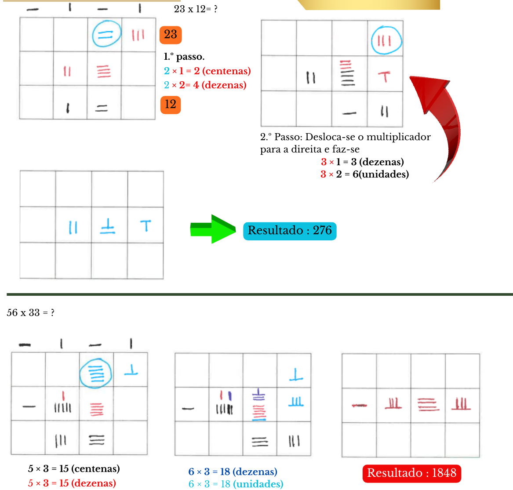
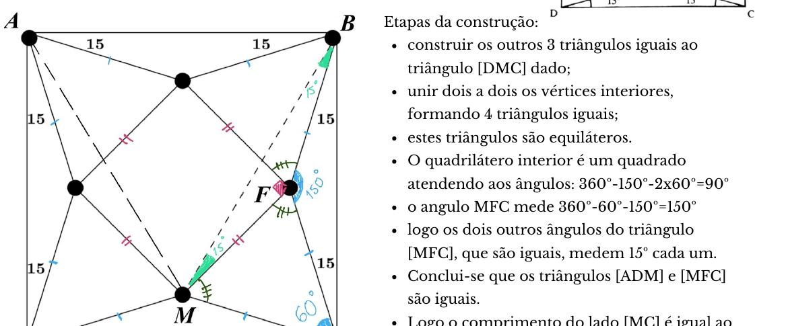

## Multiplicações chinesas

- $23 \times 12 = 276$: 1.º passo: $2 \times 1 = 2$ (centenas), $2 \times 2 = 4$ (dezenas); 2.º passo: desloca-se o multiplicador para a direita e faz-se $3 \times 1 = 3$ (dezenas), $3 \times 2 = 6$ (unidades).
- $56 \times 33 = 1848$: $5 \times 3 = 15$ (centenas), $5 \times 3 = 15$ (dezenas); $6 \times 3 = 18$ (dezenas), $6 \times 3 = 18$ (unidades).
- Com linhas: $11 \times 13 = 143$; $14 \times 19 = 266$ (1 | 13 | 36 → 1 | 16 | 6 → 266); $46 \times 22 = 1012$ (8 | 20 | 12 → 8 | 21 | 2 → 10 | 1 | 2).
- $311 \times 45 = 13\,995$: $4 \times 3 = 12$; $3 \times 5 + 1 \times 4 = 19$; $5 \times 1 + 4 \times 1 = 9$; $5 \times 1 = 5$ → 12 | 19 | 9 | 5 → 13 995.

## Curiosidades

**Primos que terminam em 2 e 5.** Os únicos números primos que terminam em 2 e 5 são 2 e 5. Nenhum número primo termina em 0. Porque são divisíveis por 2 ou por 5, pelo que têm pelo menos 3 divisores.

**Brincando com palavras 1 — Doublets** *(proposta de resolução de Carolina Sousa, 12.º D)*

- SOU → SEU → SEI → LEI
- TEM → VEM → VEZ → VOZ
- FIM → SIM → SOM → SÓS
- TEM → TOM → COM → COR
- CABE → CABO → CUBO → TUBO → TUDO
- SEIS → SEIO → SELO → SELA → SEDA → SEDE → SETE
- SETE → SETA → SELA → VELA
- BOM → BOA → MOA → MOR → MAR → MAU

## Combinatória

**Problema 1 — palavras de ABRIL.** A primeira palavra desta sequência é ABILR. Começadas por A temos $1 \times 4 \times 3 \times 2 \times 1 = 24$; as seguintes começam por B e são 24; as seguintes começam por I e são 24 (até aqui já temos 72 palavras); as seguintes começam por L e são 24 (até aqui já temos 96). As próximas 24 começam por R: por RA → RABIL, RABLI, RAIBL, RAILB, RALBI e RALIB → 102 palavras; por RB → outras 6 → 108; por RI → outras 6 → 114 → é neste grupo que está a 111.ª: RIABL (109.ª), RIALB (110.ª), **RIBAL (111.ª)**. **Resposta: letra L.**

**Problema 2 — algarismos 1.** De 1 a 100: 1, 10, 11, 12, …, 19, 21, 31, …, 91, 100 → **21**. De 1 a 1000: na posição das unidades → 100 vezes; na posição das dezenas → o algarismo 1 aparece em 10 números em cada centena (10 a 19, 110 a 119, …, 910 a 919), e temos 10 centenas, então aparece 100 vezes; na posição das centenas → apenas nos números entre 100 e 199 → 100 vezes; número 1000 → 1 vez. **Resultado final: 301 algarismos 1.**

**Problema 3 — códigos crescentes.**

- *Situação 1* — os quatro algarismos são diferentes. Só há uma sequência possível para cada grupo de quatro algarismos (exemplo: com 3, 6, 2 e 0 é o código 0236). Dado existirem 210 grupos com 4 algarismos, escolhidos de entre os 10 possíveis, temos 210 números nestas condições.
- *Situação 2* — um dos algarismos aparece repetido: existem 3 algarismos diferentes no código. Por exemplo, para os algarismos 1, 2 e 3, os códigos possíveis são 1123, 1223, 1233. Há 3 códigos diferentes para cada grupo de três algarismos diferentes. Dado podermos formar 120 grupos de 3 algarismos diferentes, temos 360 códigos.
- *Situação 3* — o código tem apenas 2 algarismos diferentes. Por exemplo, para os algarismos 2 e 3: 2233, 2223, 2333. Há 3 códigos para cada grupo de dois algarismos; com 45 grupos, temos 135 códigos.
- *Situação 4* — o código tem os algarismos todos iguais: há 10 códigos (0000, 1111, …, 9999).

Assim, o total de códigos que têm os algarismos por ordem crescente, da esquerda para a direita, é $210 + 360 + 135 + 10 = $ **715**.

## Puzzles lógicos

**Problema dos prisioneiros ou dos chapéus** *(Theo Choicoski, 12.º A)*. O número 1 pode ver o chapéu do 2 e do 3. Se fossem da mesma cor, ele já poderia deduzir que o dele seria da cor oposta. Como são de cores diferentes ele não pode concluir nada e portanto não se manifesta. Como ele (n.º 1) permaneceu em silêncio, os outros prisioneiros podem concluir que ele está vendo chapéus de cores diferentes. Dessa forma, o número 2 pode deduzir que seu chapéu tem uma cor diferente do chapéu do 3, que ele está vendo. Portanto, conclui que o chapéu na sua cabeça só pode ser o preto. **É o prisioneiro 2 que pode libertar todos eles!**

**Smullyan — Problema 1.** A frase “$A$ disse que é mentiroso” não pode ser verdadeira porque ninguém pode dizer de si próprio que é mentiroso. Logo $B$ está a mentir — $B$ é mentiroso. $C$ afirma que $B$ está a mentir, logo $C$ está a falar verdade: $C$ é verdadeiro. (Não é possível saber a natureza de $A$.)

**Smullyan — Problema 2.** A afirmação da Ana é uma conjunção de duas proposições, pelo que será verdadeira apenas se as duas próprias o forem. Mas a Ana não pode dizer da própria que é mentirosa, pelo que a afirmação da Ana é falsa — a Ana está a mentir. Sabemos que uma das proposições é falsa (o que a Ana diz), pelo que a outra poderá ser verdadeira ou falsa: o Bruno poderá estar a dizer a verdade ou a mentir. Se fossem ambos mentirosos, a Ana estaria a dizer a verdade, o que não corresponde à realidade. Assim, **a Ana é mentirosa e o Bruno fala a verdade**.

**Smullyan — Problema 3.** $A$ não pode ser verdadeiro: dizendo sempre a verdade, não diria que é normal. Então $A$ mentiu. $A$ pode ser normal ou mentiroso. Mas $A$ também não pode ser normal porque, estando a mentir, não diria que é normal. Logo $A$ é mentiroso. Por este motivo, também está a mentir, visto dizer que $A$ fala verdade. Logo $B$ é normal. Consequentemente, $C$ é verdadeiro. **$A$ é o mentiroso, $B$ o normal (que está a mentir) e $C$ é verdadeiro.**

## Desafios

### 1) No quadrado

*Aventuras matemáticas, Miguel de Guzmán*

O triângulo $[MAB]$ é isósceles, por construção. Provemos que estes dois lados iguais são iguais ao lado do quadrado, o que conclui o pretendido.

Etapas da construção:

- construir os outros 3 triângulos iguais ao triângulo $[DMC]$ dado;
- unir dois a dois os vértices interiores, formando 4 triângulos iguais;
- estes triângulos são equiláteros;
- o quadrilátero interior é um quadrado, atendendo aos ângulos: $360^\circ - 150^\circ - 2 \times 60^\circ = 90^\circ$;
- o ângulo $MFC$ mede $360^\circ - 60^\circ - 150^\circ = 150^\circ$;
- logo os dois outros ângulos do triângulo $[MFC]$, que são iguais, medem $15^\circ$ cada um;
- conclui-se que os triângulos $[ADM]$ e $[MFC]$ são iguais;
- logo o comprimento do lado $[MC]$ é igual ao comprimento do lado do quadrado.

### 2) Em viagem

*Berloquin, Pierre, 100 jogos numéricos, Gradiva*

Notas: os algarismos do 1.º marco não podem ser iguais (após uma hora, o número seria o mesmo?!); $a < b$, caso contrário, o 2.º marco teria um número menor do que o 1.º.

- Número do 1.º marco: $X = \overline{ab} = 10a + b$;
- número do 2.º marco: $Y = \overline{ba} = 10b + a$;
- número do 3.º marco: $Z = \overline{a0b} = 100a + b$.

Sabemos que $Y - X = Z - Y$, dado que decorreu uma hora entre a passagem nestes marcos e a velocidade é constante. Assim, $10b + a - (10a + b) = 100a + b - (10b + a)$, daqui resulta $b = 6a$. Se $a = 1$, $b = 6$; se $a = 2$, $b = 12$, o que é impossível porque $b$ é um algarismo. Assim, $a = 1$ e $b = 6$. Os marcos mostram os números 16, 61 e 106. Entre estes vão 45 km e esta é a velocidade a que circula o Timóteo. **R: 45 km/h.**

### 3) O avô e o neto

*Matemáticas recreativas, Y. Perelman*

À primeira vista pode parecer que avô e neto têm a mesma idade, o que seria absurdo, mas não é isso que acontece. O neto nasceu, evidentemente, no século XX. Os primeiros algarismos do ano do seu nascimento são 1 e 9. Para que a idade do neto, em 1932, coincida com os dois últimos algarismos do ano em que nasceu é necessário que a diferença entre esses dois anos seja exatamente igual a esses dois algarismos, isto é: $32 - x = x$. Assim, facilmente se conclui que o neto tinha 16 anos. O ano de nascimento do neto é 1916 e em 1932 tinha 16 anos.

Já o avô, a quem aconteceu o mesmo, terá de ter a mesma característica, com a diferença que ele terá nascido antes de 1900, ou seja no século XIX. Os primeiros algarismos do ano do seu nascimento são 1 e 8. O dobro do número expresso pelos restantes algarismos deve ser igual a 132 (ou $32 + (100 - n) = n$). Isso quer dizer que o seu valor é igual a metade desse número, ou seja, 66. O avô nasceu em 1866 e em 1932 tinha 66 anos. Desta forma, em 1932, cumprem-se os requisitos do problema:

- o avô tinha **66** anos, tendo nascido em 18**66**;
- e o neto tinha **16** anos, tendo nascido em 19**16**.

### 4) Qual é o mais alto?

*100 jogos lógicos, Pierre Berloquin*

Designemos por $A$ o primeiro cozinheiro e por $B$ o segundo. Se $A$ e $B$ estão na mesma fila, $A$ é o mais alto. Se $A$ e $B$ estão na mesma coluna, $B$ é o mais baixo. Se se encontram em filas e colunas diferentes, designemos por $C$ o soldado que está no cruzamento da fila de $A$ e da coluna de $B$… e, de modo análogo ao que vimos, $A > C$ e $C > B$, donde $A > B$. **$A$ é sempre mais alto do que $B$.**

<strong>Por agora é tudo! Esperamos pelas tuas resoluções e sugestões!</strong>

