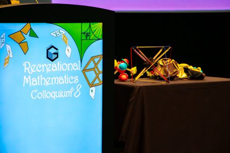
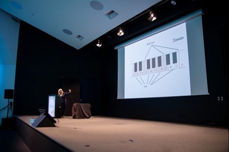
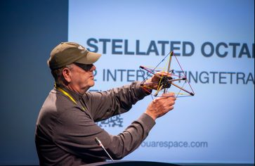
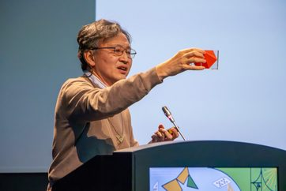

")

M. Gardner licenciou-se em Filosofia, mas foi na Matemática que se destacou. Escreveu inúmeros artigos, em jornais e revistas, e publicou mais de 100 livros fantásticos na área da Matemática Recreativa. Ironicamente, Gardner tinha dificuldade para aprender cálculo e não estudou matemática depois do ensino médio.

> Em 1993, em Atlanta, o matemático e colecionador de quebra-cabeças Tom Rodgers (1943–2012) convenceu Martin Gardner a comparecer numa tertúlia dedicada à resolução de quebra-cabeças. Essa reunião teve uma segunda edição com a presença de Gardner, em 1996, o que motivou Rodgers e alguns amigos a transformá-la num evento periódico. Desde então, este evento tem-se realizado em anos alternados, em Atlanta, e passou a ser designado por **Gathering for Gardner (G4G)**, reunindo apaixonados pela Matemática Recreativa de vários pontos dos Estados Unidos e do Mundo. Nestes encontros, são proferidas palestras sobre temas variados de Matemática Recreativa, são divulgados e analisados jogos e quebra-cabeças e são revelados truques de magia, muitos deles com fundamentação matemática.
>
> Em Portugal, desde 2009 e em anos alternados com o G4G, realiza-se o evento Recreational Mathematics Colloquium, organizado pela Associação Ludus. O reconhecimento internacional da qualidade e interesse desta iniciativa foi tal que, por sugestão da organização do G4G, o Recreational Mathematics Colloquium passou a designar-se, desde a sua quarta edição, em 2015, por Gathering for Gardner Europe.
>
> — Adaptado de *Gathering for Gardner 12*, de Ricardo Cunha Teixeira, Departamento de Matemática, Universidade dos Açores

A 8.ª edição deste evento (RMCVIII) decorreu em Lisboa, de 27 a 29 de janeiro de 2025 (o evento não se realizou em 2021). Mais de uma centena de oradores de vários cantos do mundo partilharam o que de melhor se faz na Matemática Recreativa. Do abstracionismo geométrico do artista português Almada Negreiros às simetrias musicais… foram vários os temas “fora da caixa” trazidos a palco.

Destacaram-se as apresentações da professora da Universidade de Coimbra, Carlota Simões, que explicou e exemplificou como diferentes escalas musicais “imprimem” tonalidades diferentes às músicas, do matemático britânico e, também, historiador da Matemática, Professor Robin Wilson, que partilhou problemas, puzzles e jogos do curso em Matemática Recreativa que leciona, e do criador do primeiro museu de ciência dedicado inteiramente à Matemática, Professor Albrecht Beutelspacher (Alemanha).

*Fontes: [sites.uac.pt/rteixeira](https://sites.uac.pt/rteixeira/files/2016/04/Ricardo-C-Teixeira-A89.pdf)*
