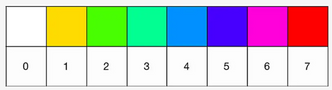
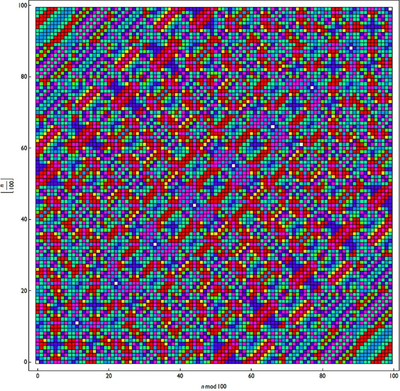

Considera um número qualquer com quatro algarismos, que não tenha todos os algarismos iguais, por exemplo 1184. A partir deste número, forma dois números: um deles, considerando os algarismos por ordem decrescente (8411); outro, considerando os algarismos por ordem crescente (1148). Subtrai o menor ao maior ($8411 - 1148$) e repete o processo vezes sem conta…

O que há de especial nesta situação? Incrivelmente, o processo estabiliza sempre no mesmo número, qualquer que seja o número de partida. Vejamos este e outro exemplo:

$$
\begin{aligned}
1184 \to 8411 - 1148 &= 7263 \\
7632 - 2367 &= 5265 \\
6552 - 2556 &= 3996 \\
9963 - 3699 &= 6264 \\
6642 - 2466 &= 4176 \\
7641 - 1467 &= \mathbf{6174} \\
7641 - 1467 &= \mathbf{6174}
\end{aligned}
\qquad\qquad
\begin{aligned}
2025 \to 5220 - 0225 &= 4995 \\
9954 - 4599 &= 5355 \\
5553 - 3555 &= 1998 \\
9981 - 1899 &= 8082 \\
8820 - 0288 &= 8532 \\
8532 - 2358 &= \mathbf{6174}
\end{aligned}
$$

O 6174 ficou conhecido como a **Constante de Kaprekar**, em homenagem ao matemático indiano com o mesmo nome, Dattatreya Ramchandra Kaprekar (1905–1986), que, em 1949, apresentou o problema.

<Challenge id="desafio-37c7d75b" title="Número máximo de etapas" answer="7|sete" unit="etapas">

Haverá um número máximo de etapas necessárias para atingir este valor?

Sim! Verificou-se que todos os números “vão parar” a esta constante ao fim de **7 etapas, no máximo**. (Confirmámos por computador, para todos os números de 4 algarismos, contando 0001, 0002, … com zeros à esquerda.)

</Challenge>

Também os números com três algarismos verificam esta regularidade. Para estes, a constante é **495**:

- $726 \to 762 - 267 = 495$; $954 - 459 = 495$
- $474 \to 744 - 447 = 297$; $972 - 279 = 693$; $963 - 369 = 594$; $954 - 459 = 495$

> Atualmente, a empresa sem fins lucrativos Scigram Technologies Foundation desenvolve na Índia uma plataforma de ensino em computadores especialmente para escolas rurais e tribais. Utilizando computadores simples, calcularam, para cada número de 4 algarismos, o número de etapas para atingir o número 6174 (que variava entre 0 e 7); a cada um destes 8 números foi atribuída uma cor, criando um código. Então, substituíram cada um dos números de quatro algarismos pela cor correspondente, dando origem à imagem seguinte, que apresenta um belíssimo padrão!

> Kaprekar teve sempre uma grande fascínio por números ao longo da sua vida, mas só alcançou fama internacional em 1975, quando Martin Gardner escreveu sobre ele e os seus números na sua coluna *Mathematical Games* na edição de março da *Scientific American*.

**Sugestão de pesquisa:** o que são [Números de Kaprekar](/edicoes/ano3-edicao3/02-numeros-de-kaprekar/)?

*Fontes: [BBC](http://www.bbc.com/portuguese/geral-49469384), [clube.spm.pt](http://clube.spm.pt/news/vida-obra-de-dattatreya-r-kaprekar)*
