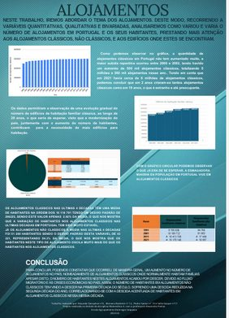
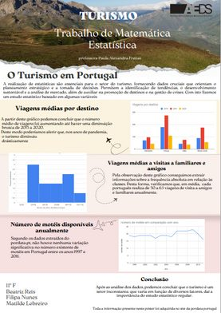
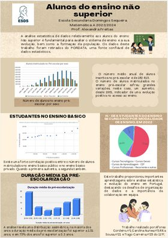
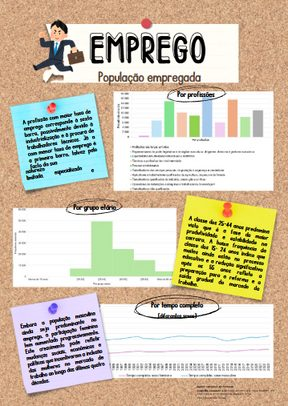
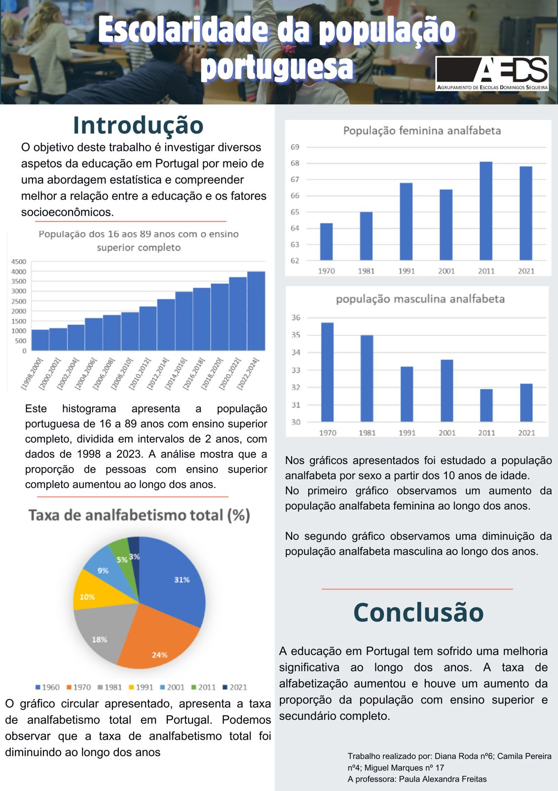

No ano letivo transato, os alunos do 11.º ano das turmas E e F realizaram, no âmbito da disciplina de Matemática A, um estudo estatístico abordando vários temas da atualidade: turismo, emprego, ensino superior, entre outros.

“A metodologia de trabalho foi a da colaboração entre pequenos grupos, permitindo que os alunos aprendessem através da pesquisa, da partilha, da reflexão e da produção de materiais, e também da apresentação oral à turma, realizada em contexto de aula. Os resultados foram muito positivos dado o empenho e interesse revelado pelos alunos.”

Na próxima edição do jornal revelaremos trabalhos elaborados por alunos de outras turmas no ano passado e já neste ano letivo!

