No **dia 14 de março** celebrou-se o **Dia Internacional da Matemática**, que é também o Dia Internacional do pi. Foi escolhida esta data para comemorar este dia devido à escrita inglesa das datas, que coloca primeiro o mês e depois o dia, neste caso 3/14, sendo o número 3,14 a aproximação mais comum do pi, um dos números mais importantes da Matemática.

Como sabes, o pi não é um número inteiro, nem um número racional. O pi tem uma infinidade de casas decimais que não têm qualquer regularidade, daí ser um número irracional. Como foi referido numa edição anterior deste jornal, já foram descobertas 62,8 biliões de casas decimais deste número. O pi é a razão entre o perímetro e o diâmetro de qualquer circunferência, mas não é utilizado apenas na geometria. Aparece em cálculos de quase todas as áreas da Matemática.

Para assinalar e comemorar este dia, os professores do grupo de Matemática do agrupamento (3.º ciclo — Escola Básica José Saraiva, e secundário — Escola Secundária Domingos Sequeira) desafiaram os alunos com várias atividades que procuraram envolver toda a comunidade escolar.

## Concurso de desenho — Matemática e Arte na cidade de Leiria

> Todos os anos é anunciado um tema para dar sabor à celebração, despertar a criatividade e trazer luz às conexões entre a matemática e todos os tipos de campos, conceitos e ideias. O tema do DIM 2025 (Dia Internacional da Matemática deste ano) é “Matemática, Arte e Criatividade”. Com este tema pretende-se celebrar a criatividade encontrada na descoberta matemática e na arte. Usar a Matemática na arte abre portas para novas ideias, criações belas e cativantes. *(Adaptado do site da APM)*

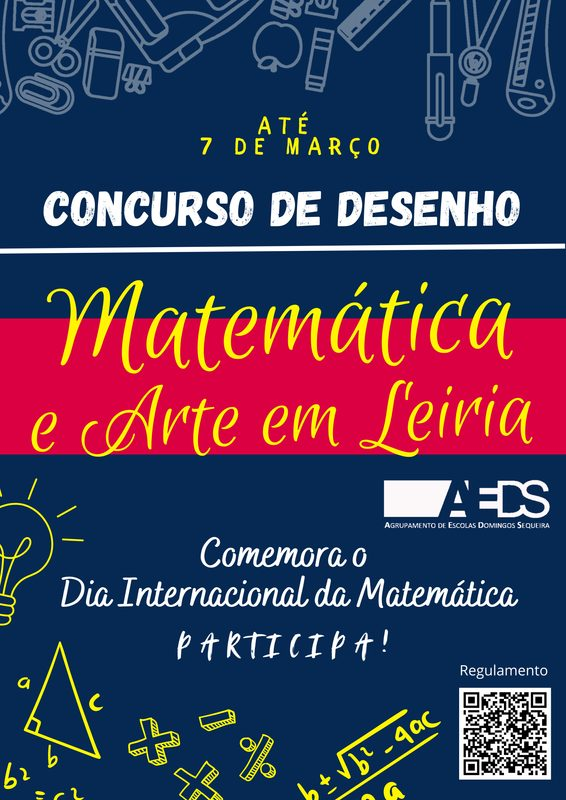

Com o mote deste tema, desafiámos os alunos a fazer um desenho que envolvesse Matemática, Leiria e Arte. O concurso desenvolveu-se em duas categorias, uma para alunos do 3.º ciclo e outra para os do secundário. Os alunos tiveram de fazer um desenho à mão livre numa folha A4, usando os materiais de desenho que quisessem. O trabalho teria de conter a frase “Dia Internacional da Matemática 2025”. E, claro está, havia prémios para cada um dos três premiados em cada categoria: dois bilhetes para um espetáculo que terá lugar no dia 19 de abril no Teatro José Lúcio da Silva.

O concurso teve uma grande adesão por parte dos alunos.

- **Categoria A — ensino básico**, concorreram 64 alunos e os premiados foram: 1.º prémio — Leonor Fernandes, do 7.º C; 2.º prémio — Gabriel Pacheco, do 7.º A; 3.º prémio — Diana Melo, do 9.º D.
- **Categoria B — ensino secundário**, concorreram 25 alunos e os premiados foram: 1.º prémio — Luís Rodrigues, do 12.º J; 2.º prémio — Miguel Bernardes, do 12.º K; 3.º prémio — Sofia Barreiro, do 12.º D.

Além destes seis trabalhos, muitos outros revelaram excelente qualidade, pelo que os professores felicitam todos os alunos participantes pela sua iniciativa e pelo seu trabalho e empenho!

### Na ESDS

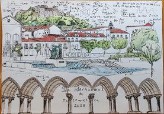

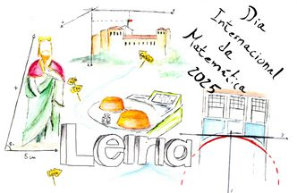

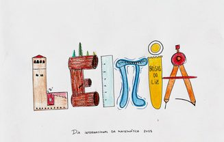

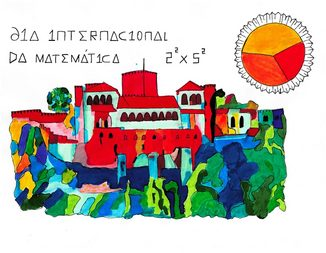

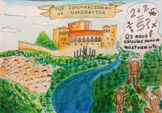

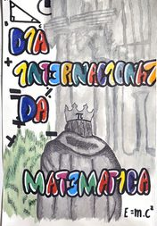

### Na EBJS

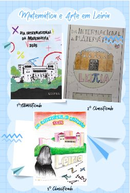

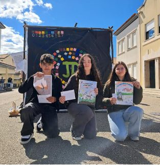

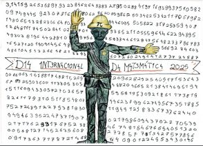

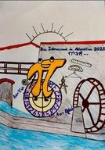

A escolha foi difícil! Parabéns a todos os que contribuíram para enriquecer esta iniciativa.

## Exposições — APM

Durante 10 dias, os alunos puderam visitar as exposições, disponibilizadas pela Associação de Professores de Matemática, “Sempre houve problemas” e “A Matemática e a natureza”, que estiveram patentes nas escolas ESDS e EBJS, alternadamente. Todas as turmas do 2.º e do 3.º ciclos visitaram e exploraram as exposições. No secundário, a participação não foi tão abrangente. Os alunos puderam visitá-la em contexto de sala de aula, respondendo a questionários elaborados para o efeito, ou de forma autónoma, uma vez que as mesmas estiveram disponíveis na biblioteca da escola. Os alunos colaboraram e mostraram empenho nas atividades propostas, cujo objetivo era promover uma reflexão capaz de induzir os alunos a perspetivar a importância da Matemática em vários domínios.

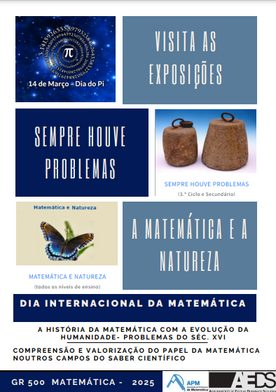

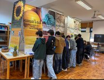

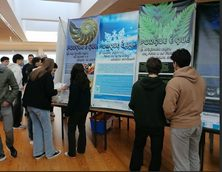

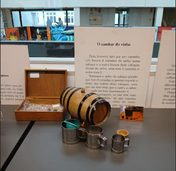

## Peddy paper

Entre as 9:15 e as 12:10, 7 turmas foram desafiadas para um peddy paper. Nestes 3 tempos, os alunos, em equipas de 4, correram pela escola, ao longo de quatro postos, resolvendo um desafio em cada um destes e decifrando pistas para encontrar os postos seguintes.

> O peddy paper que foi realizado no dia da Matemática, 14/03, foi, sem dúvida, uma experiência divertida. Por ser em equipas, a tarefa foi mais leve e acabou por ficar mais fácil entre todos. A minha equipa ficou em primeiro lugar, e tanto a experiência quanto os prémios valeram muito a pena! Acho que esta é uma dinâmica que vale a pena ser repetida, para que os meus colegas de outros anos possam desfrutar um bocadinho e descontrair enquanto se apercebem que a Matemática também pode ser divertida.
>
> — Beatriz Reis, 12.º F

Os dois melhores grupos foram premiados com livros: **1.º lugar** — 12.º F: Beatriz Reis, Inês Rodrigues e Ricardo Pereira; **2.º lugar** — 12.º H: Ana Fonseca, Matilde Cordeiro, Matilde Sousa e Rita Marques.

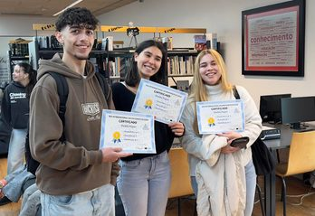

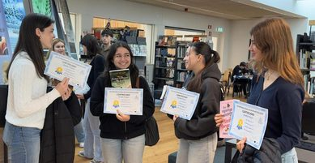

## Filme

Três turmas do 10.º ano tiveram uma aula diferente: a visualização de um filme que retrata a vida de uma menina com aptidão e interesse extraordinários pela Matemática. Tratou-se do filme “Gifted”, em português “Dotada”. “Gifted” é um drama comovente que toca em temas profundos como família, responsabilidade, genialidade e o que significa realmente fazer o melhor por uma criança. O filme provoca empatia e reflexão, especialmente sobre como a sociedade lida com crianças superdotadas e o preço da excelência.

## A Matemática nas diversas profissões

No dia 14 de março, o Professor do IPLeiria, Diogo Baptista, falou para duas turmas do 12.º ano sobre a importância da Matemática nas diversas profissões. Os alunos tiveram contacto com alguns dos conteúdos matemáticos que são abordados nas licenciaturas e que se estendem à prática de algumas profissões. Com alguns exemplos concretos, de forma eloquente e cativante, mostrou-lhes a importância do estudo da trigonometria, dos números complexos, das derivadas de funções, entre outras matérias.

## Na EBJS

Na EBJS este dia foi celebrado com muitas outras atividades, das quais se destacaram:

- **Espiral do pi** — recorrendo a um código de cores, os alunos construíram uma espiral com quadrados coloridos correspondentes aos primeiros trezentos algarismos do número pi. Este trabalho foi realizado em colaboração com os colegas de Educação Visual.
- **O Caminho do Pi** — os 40 primeiros algarismos do pi a indicar o caminho para a sala de Matemática!
- **Pi humano** — os alunos do 2.º e 3.º ciclos foram convidados a participar na construção de um Pi Humano no espaço exterior da escola. Esta atividade decorreu no dia 14 de março, durante o segundo intervalo da manhã, tendo sido registada em vídeo e fotografia recorrendo a um drone.
- **Biscoitos e não só…** — os Saraivinhas (alunos da Educação Especial) também participaram na Comemoração do DIM, num exemplo de interdisciplinaridade e inclusão. Estes alunos e as docentes de Educação Especial foram desafiados a elaborar trabalhos com a forma do π e puseram mãos à obra! Tendo sempre presente a aquisição de aprendizagens e, simultaneamente, a promoção da autonomia e desenvolvimento pessoal, confecionaram deliciosas bolachinhas em forma de π (de manteiga, de chocolate e de massa folhada e quebrada com recheio de chocolate); elaboraram marcadores de livros; e, ainda, uns deslumbrantes porta-chaves em feltro! A banca dos Saraivinhas foi um sucesso, o que nos deixou a todos muito felizes! A forma dos biscoitos que foi desenhada e impressa em 3D pelo ex-aluno do agrupamento Vítor Clara.

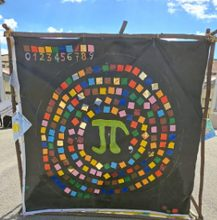

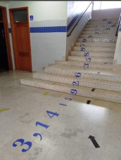

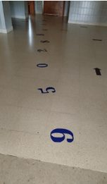

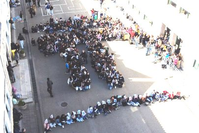

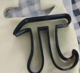

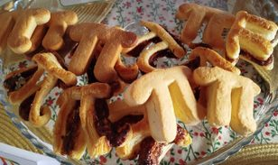

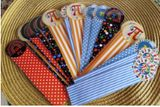

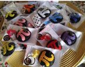

