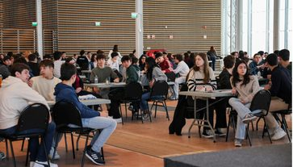
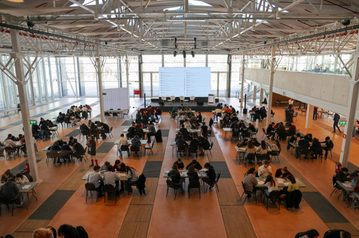
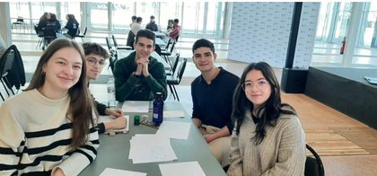
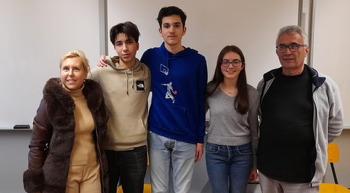
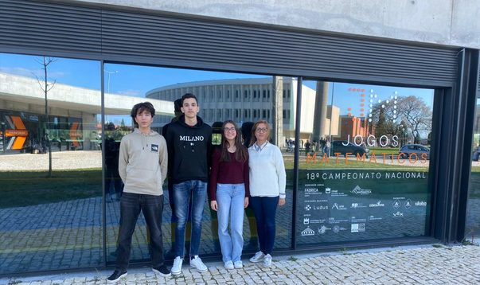
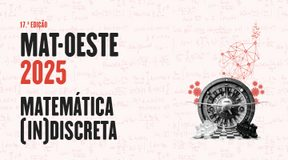
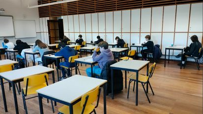
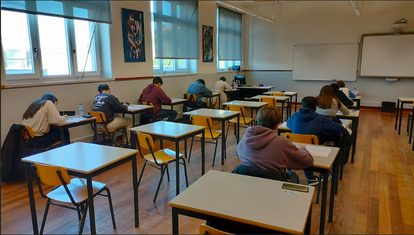
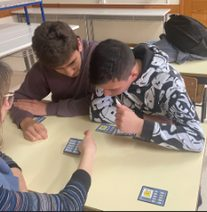
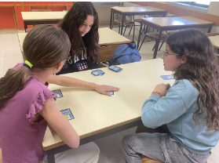

## Competição Náboj

No dia 14 de março, realizou-se, pela primeira vez em Portugal, a competição Náboj, que teve lugar no Técnico Innovation Center, em Lisboa. O Náboj é uma competição internacional de matemática destinada a equipas de cinco estudantes do ensino secundário que representam as suas escolas. Tem a duração de 120 minutos, durante os quais as equipas tentam resolver o maior número possível de problemas propostos. No início, cada equipa recebe seis problemas. Assim que a equipa resolve corretamente qualquer um dos problemas, recebe um novo.

Desde 2005, o Náboj Math ocorre simultaneamente em vários países. Este ano participaram 15 países. Esta competição oferece uma oportunidade única para os estudantes compararem as suas capacidades e conhecimentos com colegas de outros países. Embora os resultados sejam avaliados principalmente a nível local, a comparação internacional acrescenta um elemento extra de motivação e competição.

A Escola Secundária Domingos Sequeira — representada pelos alunos Miguel Rocha, Francisco Silva, Nicole Silva, Diana Marques e Miguel Pereira, acompanhados pela sua professora de Matemática, Helena Rufino — conquistou a **11.ª posição no ranking em Portugal**, um excelente resultado para a estreia na competição.

O Náboj contou com a cobertura mediática de algumas das maiores plataformas de comunicação portuguesas, como a SIC, o Jornal Económico, o Portal SAPO, entre outras.

## Campeonato Nacional de Jogos Matemáticos

No dia 19 de fevereiro, na ESDS, realizou-se a eliminatória para seleção dos 3 alunos que representaram a escola na final do Campeonato de Jogos Matemáticos 2025, em Aveiro. Os alunos que passaram nesta fase foram: Beatriz Conde (10.º E), com o jogo Produto; Francisco Baptista (11.º F), com o jogo Atari Go; e Rui Silva (11.º B), com o jogo Nex.

As professoras responsáveis pela coordenação deste campeonato na ESDS, Alexandra Freitas e Cristina Tomé, contaram com a presença e colaboração do professor João Rino. Na eliminatória, observou-se uma grande adesão e participação por parte dos alunos, demonstrando empenho e responsabilidade.

Os alunos, acompanhados pela professora Cristina Tomé, rumaram a Aveiro no dia 14 de março para representarem a escola nesta competição. Esta edição do campeonato foi a mais participada de sempre, tendo estado presentes mais de 1800 alunos! O aluno Rui Silva competiu até muito perto da final! Parabéns a todos os participantes!

## Prémio Pedro Matos

“Matemática (in)Discreta” é o mote da 17.ª edição do Prémio Pedro Matos, promovido pelo Instituto Politécnico de Leiria, destinado a alunos e professores do ensino secundário e do 3.º ciclo do ensino básico, nas categorias “Prémio Pedro Matos” e “Prémio Pedro Matos Júnior”, respetivamente.

Candidatura e entrega de trabalhos até 13 de junho. Contacta o teu professor!

## Olimpíadas Portuguesas de Matemática

No dia 15 de janeiro decorreu, na nossa escola, a 2.ª eliminatória das Olimpíadas Portuguesas de Matemática (OPM), um evento de grande prestígio. A competição envolveu os alunos Ana Fonseca, Beatriz Conde, Lourenço Passadouro, Pedro Gameiro e Tiago Henriques, da ESDS (categoria B), e 11 alunos do Colégio de Nossa Senhora de Fátima (Categorias Júnior e A). As provas foram marcadas por desafios exigentes e complexos, com questões que testaram as capacidades dos participantes nas mais diversas áreas da Matemática. Os estudantes demonstraram grande empenho e dedicação e até algum nervosismo.

Nenhum destes alunos foi apurado para a grande final, mas a experiência foi, seguramente, muito enriquecedora para todos os participantes. As OPM são uma excelente forma de promover o gosto pela Matemática e estimular a resolução criativa de problemas, habilidades fundamentais para o futuro académico e profissional dos jovens.

## SuperTmatik

No dia 26 de março, 6 alunos da Escola E.B. 2,3 José Saraiva participaram na 1.ª eliminatória do SuperTmatik, um concurso de cálculo mental que visa incentivar e desenvolver o gosto pela Matemática, desenvolver o raciocínio e reforçar a componente lúdica no processo de ensino-aprendizagem. Foram apurados para a Grande Final Online, que irá decorrer entre os dias 1 e 16 de maio, os alunos: Camila Nascimento, do 7.º G; Júlia Santos, do 7.º F; Filipe Valente, do 8.º B; e André Nogueira, do 9.º G.

<strong>Parabéns a todos os participantes!</strong> Aos selecionados, desejamos bons e rápidos cálculos na grande final!

