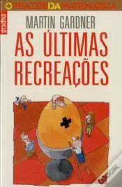
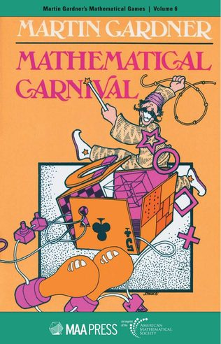
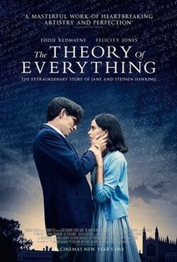
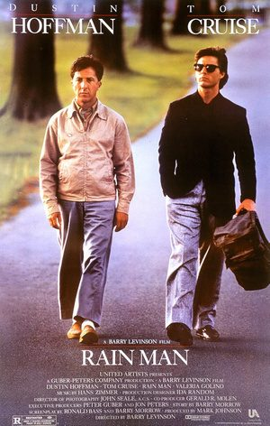

Quase a finalizar esta edição, deixamos-te algumas sugestões de leituras e de filmes. Os dois filmes sugeridos podem ser vistos também online. Se tiveres interesse, contacta a BECRE. Envia-nos os teus comentários.

## Livros

## Filmes

<strong>Por agora, é só!</strong> Desejando que tenhas gostado desta edição, esperamos pela tua colaboração na próxima edição! Há prémios para as participações mais criativas.

