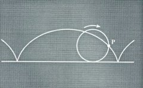
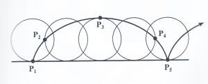
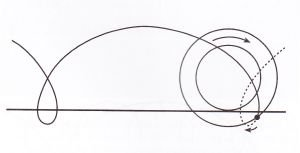

Pela enorme quantidade de matemáticos que estudaram a curva, a ciclóide ficou conhecida como “A Helena da Geometria”, em alusão à Helena de Troia, cuja mitologia preconiza ser a mulher mais bonita da Grécia.

O responsável pela divulgação da ciclóide foi Galileu, no século XVI. O século XVII foi um período de grande interesse pela matemática da mecânica e do movimento, o que poderá explicar a atenção entusiástica dispensada à ciclóide.

A **ciclóide** é definida como a curva descrita por um ponto fixo de uma circunferência que gira, sem escorregar, ao longo de uma linha reta.

Eis algumas das propriedades da ciclóide, descobertas durante o século XVII:

- O seu comprimento é quatro vezes o diâmetro da circunferência que a gera.
- A área delimitada pelo arco é o triplo da área do círculo que roda.
- O ponto da circunferência que descreve a ciclóide assume diferentes velocidades — na realidade, há mesmo um local, $P_5$, em que se encontra em repouso.

Na figura 2, cada circunferência representa um quarto de volta da circunferência em rotação. O comprimento do quarto de volta entre $P_1$ e $P_2$ é muito menor do que entre $P_2$ e $P_3$. Consequentemente, o ponto aumenta a sua velocidade entre $P_2$ e $P_3$, uma vez que deve percorrer um comprimento maior no mesmo intervalo de tempo.

O ponto permanece em repouso nos locais em que inverte o sentido do movimento.

## O paradoxo do comboio

Há muitos paradoxos fascinantes explicados pela ciclóide. O paradoxo do comboio é especialmente intrigante:

> Em qualquer momento, um comboio em movimento nunca se desloca inteiramente no sentido em que está a ser puxado pela máquina. Há sempre algumas partes que se movem no sentido oposto ao do resto do comboio.

O segredo está no rebordo das rodas, que fica abaixo do carril: um ponto desse rebordo descreve uma *ciclóide alongada*, com pequenos laços em que anda, por instantes, para trás.

<Demo id="cicloide" />

A ciclóide é uma das muitas curvas fascinantes da matemática.

