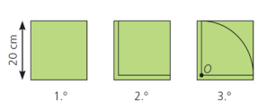
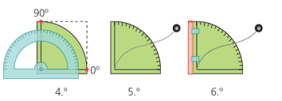
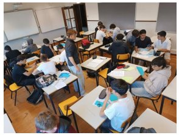
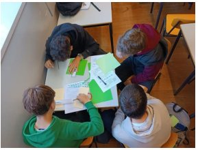
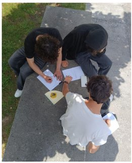
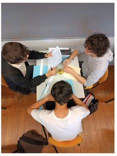
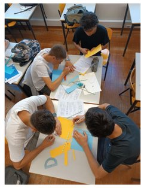
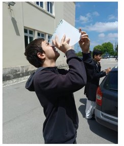
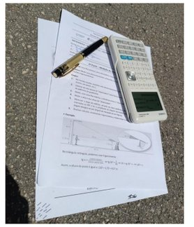
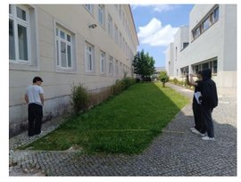

## O quadrante

O **quadrante** é um instrumento náutico antigo, com a forma de um quarto de círculo graduado de 0 a 90 e um fio de prumo no centro.

Há mais de quinhentos anos, era utilizado por astrónomos e navegantes portugueses para medir a altura de astros (expressa sob a forma de ângulo), com o objetivo de calcular a latitude que indicava a posição da embarcação no mar.

### Como construir um quadrante?

1. Recortar um quadrado em cartão grosso com 20 cm de lado.
2. Com uma régua, deixar uma margem de 1 cm em dois lados adjacentes.
3. Traçar um quarto de circunferência de centro em $O$ e com 19 cm de raio.
4. Com o transferidor, graduar o quadrante (de 0 a 90, de 5 em 5). Depois, recortar o cartão.
5. Furar o cartão no ponto $O$ e prender um fio de 30 cm de comprimento, com um peso na ponta.
6. Cortar uma palhinha e fixá-la com fita-cola no lado dos 90.

## O trabalho dos alunos

Nos dias 19 e 20 de maio de 2025, no âmbito do módulo OP11 — Distâncias inacessíveis, os alunos da turma B do 1.º ano do curso de Técnico de Eletrónica, Automação e Computadores foram desafiados a criar um quadrante e medir uma distância inacessível no espaço escolar.

Conforme preconizado pelas novas Aprendizagens Essenciais de Matemática dos Cursos Profissionais, uma das possíveis ações estratégicas do ensino do professor consiste em “propor aos alunos a elaboração de um projeto de determinação de uma distância inacessível, usando instrumentos adequados de medição, ainda que rudimentares e construídos pelos alunos”.

Na semana anterior, os alunos organizaram-se para reunir o material necessário para a realização da atividade: cartolinas, tesouras, réguas, transferidores, compassos, fio, porcas, palhinhas e fitas métricas. No dia 19, durante uma aula, foram constituídos grupos de trabalho e cada interveniente construiu o seu quadrante, seguindo as instruções do guião fornecido pelo professor.

No dia seguinte, os alunos receberam um segundo guião com as orientações necessárias para medirem uma distância inacessível, usando os quadrantes. Uns escolheram medir a altura do bloco A, outros optaram pelo bloco B, e ainda uma árvore e uma porta de grandes dimensões. Para além de terem de desenhar um esboço da situação explorada e de efetuarem cálculos envolvendo trigonometria, cada aluno escreveu um pequeno relatório.

Globalmente, todos gostaram desta aula diferente, fora da sala de aula, em que aprenderam que era possível determinar distâncias inacessíveis, usando os conhecimentos adquiridos nas aulas de Matemática e recorrendo a um instrumento de simples construção.

Como se calcula a altura com o quadrante?

Se, a uma distância $d$ do edifício, o quadrante indicar um ângulo de elevação $\alpha$ até ao topo, e os olhos estiverem a uma altura $h_0$ do chão, então a altura do edifício é

$$
h = h_0 + d \tan \alpha .
$$

Por exemplo, com $d = 20$ m, $\alpha = 35^\circ$ e $h_0 = 1{,}6$ m, obtém-se $h \approx 1{,}6 + 20 \times 0{,}700 \approx 15{,}6$ m.

