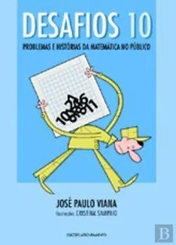

Quase a finalizar esta edição, deixamos-te algumas sugestões de leituras e de filmes. Os dois filmes sugeridos podem ser vistos também online. Se tiveres interesse, contacta a BECRE.

## Livros

")

## Filmes

")

")

<strong>Por agora, é só!</strong> Mas não terminamos esta edição sem antes apresentarmos as resoluções de todos os desafios da edição anterior. Desejando que tenhas gostado desta edição, esperamos pela tua colaboração na próxima edição! Há prémios para as participações mais criativas.

