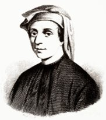
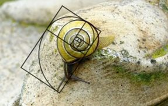
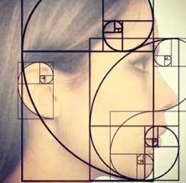
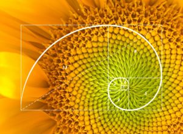
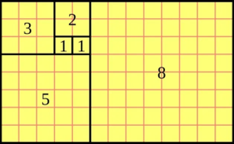
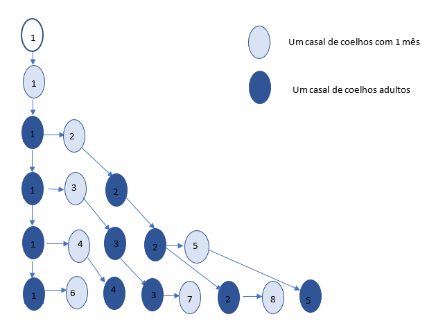

Fibonacci, ou Leonardo de Pisa, nasceu em Itália e foi um dos mais importantes matemáticos da Idade Média. Ficou conhecido por vários trabalhos, dos quais o que se destaca mais é a “Sucessão de Fibonacci”. No entanto, talvez não tenha sido este o contributo mais importante que deu à Matemática. À época, em Itália, ainda se utilizava a numeração romana nas operações de cálculo. Fibonacci defendeu fortemente a adoção do sistema decimal hindu-árabe e, aos poucos, este sistema foi percebido e aceite na Europa, e assim continuou até hoje.

A sucessão de Fibonacci é uma sequência numérica à qual, na altura, o seu autor não deu muita importância; era mais a solução de uma charada divertida. Mais tarde, verificou-se que está presente em muitas situações da Matemática e na natureza: triângulo de Pascal, retângulo de ouro, truques matemáticos, plantas, caracóis, búzios, furacões, flores, fósseis, pinhas, etc. Também a podemos encontrar em nós mesmos, pois o nosso corpo contém várias formas geométricas. Conseguimos encontrá-la no nosso rosto e em outras partes do nosso corpo — espiral de Fibonacci.

## A sucessão de Fibonacci

Começa com os seguintes elementos: $1, 1, 2, 3, 5, 8, 13, 21, 34, 55, 89, \ldots$

O leitor já deve estar a reconhecer um padrão na formação da sequência: após os dois primeiros elementos, 1 e 1, o terceiro elemento obtém-se somando o primeiro e o segundo, e assim sucessivamente: cada elemento é a soma dos dois termos anteriores.

$$
F_1 = F_2 = 1, \qquad F_{n} = F_{n-1} + F_{n-2}
$$

Claro que este processo não tem fim, dando origem a uma sequência com uma infinidade de termos.

## O problema que deu origem à sucessão

> Consideremos que um casal de coelhos tem um mês de idade. São ainda muito jovens para se reproduzirem, mas já o podem fazer aos 2 meses de idade. Admitamos que todos os meses, após os 2 meses de idade, dão origem a um novo casal de coelhos (macho e fêmea). Se todos os casais de coelhos se reproduzirem da mesma forma que o primeiro, e nenhum deles morrer, quantos casais de coelhos haverá no princípio de cada mês?

Façamos um esquema com a evolução do número de casais de coelhos ao longo do tempo:

1. **1.º mês:** 1 casal de coelhos novos.
2. **2.º mês:** 1 casal de coelhos adultos.
3. **3.º mês:** 1 casal de coelhos adultos + 1 casal de coelhos novos (0 meses).
4. **4.º mês:** 1 casal de coelhos adultos + 1 casal de coelhos novos (1 mês) + 1 casal de coelhos novo.
5. **5.º mês:** 2 casais de coelhos adultos + 1 casal de coelhos novos (1 mês) + 2 casais de coelhos novos.

E assim sucessivamente. O número de casais é, mês após mês: $1, 1, 2, 3, 5, 8, 13, \ldots$

E terminamos com uma curiosidade: <strong>23 de novembro é o dia do Fibonacci</strong>. Porquê neste dia? Nos EUA, este dia é referido como 11/23 → 1123, o que dá o mote para a Sucessão de Fibonacci.

