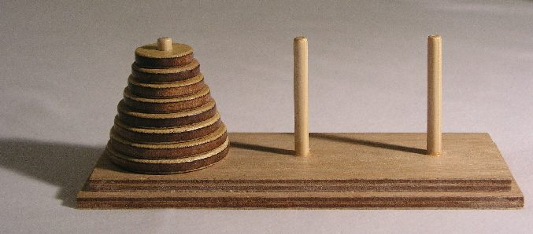
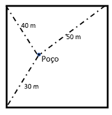

<Desafio id="desafio-192acca9" numero={1} titulo="Torre de Hanói" resposta="7|sete" unidade="movimentos">

O famoso **jogo da Torre de Hanói** foi inventado pelo matemático francês Édouard Lucas (1840–1891). Trata-se de um “quebra-cabeças” que consiste numa base contendo três pinos, em que no da esquerda estão dispostos alguns discos, uns sobre os outros, em ordem decrescente de diâmetro, de baixo para cima.

**Objetivo:** mover todos os discos para o pino da direita de forma a que, no final, a torre mantenha a sua configuração inicial.

**Regras:** mover <u>um disco de cada vez</u>, tendo em atenção que um disco maior nunca pode ficar em cima de um disco menor.

Qual é o menor número de movimentos que permitem mover todos os discos do pino da esquerda para o da direita?

- etapa 1 — 1 disco → 1 movimento
- etapa 2 — 2 discos → 3 movimentos
- etapa 3 — 3 discos → ? movimentos

Há aqui uma regularidade, um padrão. Consegues estabelecer a regra para $n$ discos?

Com 3 discos são precisos **7** movimentos.

Para mover $n$ discos, temos de mover os $n - 1$ de cima para o pino do meio, mover o disco maior e voltar a pôr os $n - 1$ discos por cima dele. Assim, $M_n = 2M_{n-1} + 1$, com $M_1 = 1$, o que dá $1, 3, 7, 15, 31, \ldots$, ou seja,

$$
M_n = 2^n - 1.
$$

</Desafio>

<Desafio id="desafio-7ddf5dbb" numero={2} titulo="O claustro do mosteiro" resposta="56.54" casas={1} unidade="m de lado" fonte="Atividades matemáticas, Brian Bolt">

Um mosteiro medieval foi construído à volta de um claustro (região central) de forma quadrada. Este claustro tinha um poço que abastecia de água todos os monges.

O poço estava situado de modo que a distância a três esquinas consecutivas era 30 m, 40 m e 50 m, respetivamente.

Quais eram as dimensões do claustro? (Arredonda às décimas.)

Coloquemos a esquina a 40 m na origem, a esquina a 50 m em $(s, 0)$ e a esquina a 30 m em $(0, s)$, sendo $(x, y)$ a posição do poço:

$$
x^2 + y^2 = 40^2, \qquad (s - x)^2 + y^2 = 50^2, \qquad x^2 + (s - y)^2 = 30^2.
$$

Subtraindo a primeira equação das outras duas obtemos $x = \dfrac{s^2 - 900}{2s}$ e $y = \dfrac{s^2 + 700}{2s}$. Substituindo na primeira, e fazendo $u = s^2$:

$$
u^2 - 3400u + 650\,000 = 0 \;\Rightarrow\; u = 1700 + 400\sqrt{14} \approx 3196{,}7
$$

(a outra solução põe o poço fora do claustro). Logo, o claustro era um quadrado com cerca de **56,5 m** de lado.

</Desafio>

<Desafio id="desafio-5806e2fb" numero={3} titulo="O poder do “4”" fonte="Problema adaptado de um livro de Malba Tahan">

Escreve os números inteiros de 0 a 100, utilizando apenas quatro algarismos 4 e operações matemáticas elementares tais como a soma, a divisão, a potenciação ou o fatorial (\*).

Por exemplo, se quisermos obter o número 3, é só fazer a seguinte operação: $(4 + 4 + 4) : 4$.

(\*) Fatorial de um número natural $n$ é o produto de todos os inteiros de 1 a $n$ e representa-se por $n!$. Por exemplo, $5! = 5 \times 4 \times 3 \times 2 \times 1$.

*Afonso Gaspar (10.º E) e Diogo Martins (12.º B)*

</Desafio>

<Desafio
  id="desafio-ce8d3a5b"
  numero={4}
  titulo="A ida ao museu"
  fonte="José Paulo Viana, Desafios"
  resposta="Pedro"
  opcoes={['Benjamim', 'Mário', 'Carlos', 'Pedro']}
>

Quatro amigos vão visitar um museu e um deles resolve entrar à borla. Aparece um guarda que quer saber qual deles entrou sem pagar.

- “Eu não fui”, diz o Benjamim.
- “Foi o Carlos”, diz o Mário.
- “Foi o Pedro”, diz o Carlos.
- “O Mário não tem razão”, diz o Pedro.

Só um deles mentiu. Quem não pagou bilhete?

O Mário e o Pedro dizem coisas opostas, por isso um deles mente — e, como só há um mentiroso, o Benjamim e o Carlos dizem a verdade. Pela afirmação do Carlos, quem entrou sem pagar foi o **Pedro**. Confirmação: nesse caso só o Mário mente.

</Desafio>

Se quiseres enviar a(s) tua(s) resolução(ões), podes utilizar o endereço de email do jornal: <a href="mailto:maismatjornal@gmail.com">maismatjornal@gmail.com</a>. Serão selecionadas para publicação as melhores resoluções.

