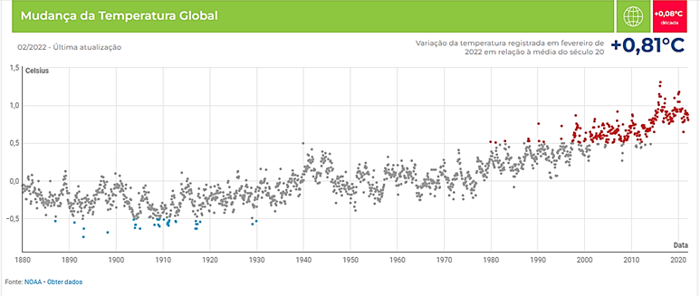

O aquecimento global potencia os desastres ambientais e pode ser medido por vários indicadores. Um deles é o aumento da temperatura média global à superfície da Terra. Este fator é utilizado pelos cientistas para avaliar e prever riscos sociais, económicos e ambientais.

“Elaborado a partir de dados da agência NOAA, dos Estados Unidos, o gráfico abaixo apresenta a tendência de aumento da temperatura registada desde 1880. Neste gráfico, pode ver-se a comparação, ao longo de mais de 100 anos, entre a variação da temperatura combinada da superfície do oceano e dos continentes com a temperatura média do século XX. É possível observar no gráfico, a vermelho, a tendência de aquecimento das últimas décadas.”

Constata-se que “a temperatura global anual aumentou a uma taxa média de 0,08 °C por década, desde 1880, **e mais do dobro dessa taxa (+0,18 °C) desde 1981**.”

Como se pode ler no gráfico, a temperatura média registada na Terra em fevereiro de 2022 foi superior à média do século XX em 0,81 °C. Pode parecer uma variação pequena!

Agora supõe que a Terra é um planeta na sua meia-idade e ainda “viverá” outros tantos anos… Qual é a idade da Terra? Pensa-se que a Terra terá cerca de 4,6 mil milhões de anos, ou seja, 460 milhões de décadas…

É só fazer umas contas… Será que conseguiremos travar esta tendência? É o desafio do presente.

*Adaptado de [umsoplaneta.globo.com](https://umsoplaneta.globo.com/indicadores/temperatura-global/)*

## 15 de novembro de 2022 — dia 8 mil milhões

Há uns dias atrás, no dia 15 de novembro, ouvimos nas notícias que a Terra atingiu, nesse dia, o número de 8 mil milhões de pessoas.

Este valor não é o limite, mas o que é que isto significa para o planeta?
