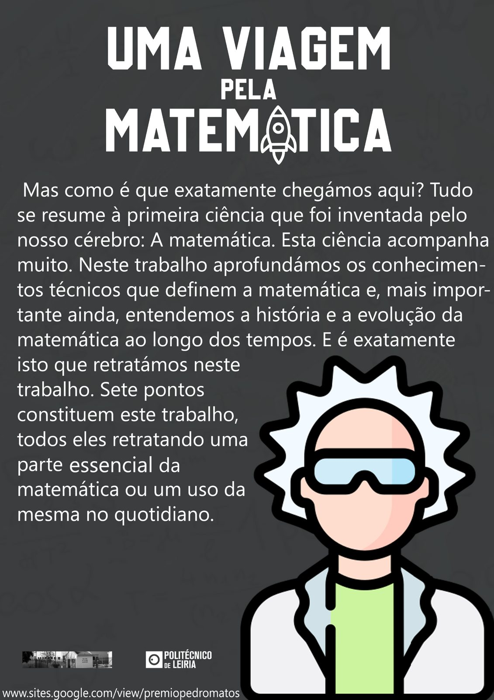
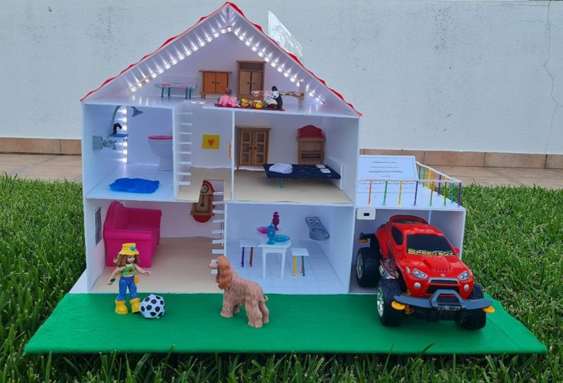
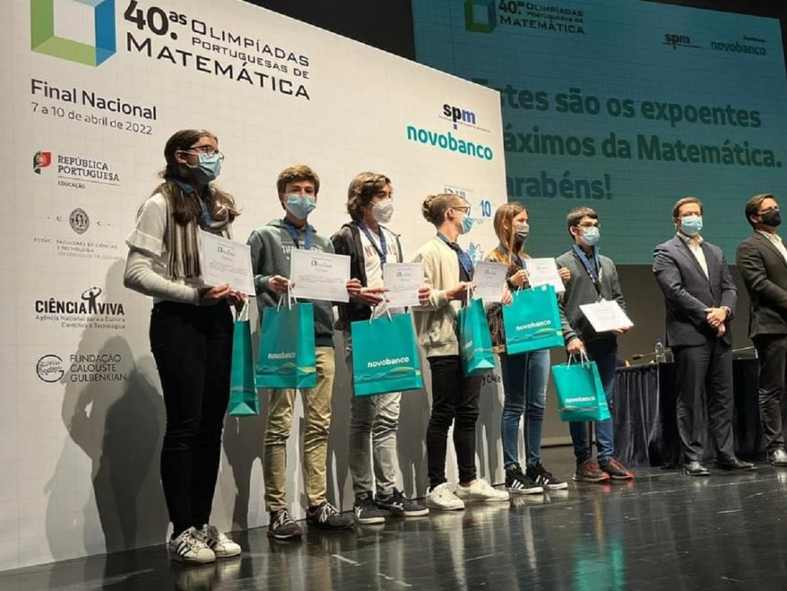

## Prémio Pedro Matos

A edição do Prémio Pedro Matos (PPM) é um projeto promovido pelo Politécnico de Leiria que desafia alunos e professores do ensino secundário e do 3.º ciclo do ensino básico a refletir sobre o indiscutível impacto da Matemática na Humanidade e a sua importância na atualidade. Este Prémio nasceu como uma homenagem a Pedro Manuel Amado Roque de Matos, professor e investigador de mérito da Escola Superior de Tecnologia e Gestão (ESTG) do Politécnico de Leiria, e tem como objetivo fomentar a criatividade e o interesse pela Matemática e as suas aplicações, bem como despoletar jovens talentos.

A esta iniciativa podem candidatar-se alunos individualmente ou em grupo (máximo de três alunos), e pode ainda fazer parte um professor do ensino secundário ou básico, ao qual caberá o papel de orientador do grupo. Os interessados deverão concretizar trabalhos sobre um dos temas propostos no ano da edição ou outros tópicos atualmente falados com um grande impacto na Humanidade.

Os trabalhos elaborados são expostos no evento Mat-Oeste do ano correspondente, iniciativa que tem lugar no Instituto Politécnico de Leiria, sugerindo-se a utilização de fotografias, desenhos, materiais interativos, vídeos, entre outros, de forma a despertar a curiosidade dos visitantes. Nas categorias “Prémio Pedro Matos” e “Prémio Pedro Matos Júnior” são premiados os três melhores trabalhos de cada uma, sendo atribuído um prémio monetário a cada um deles (200 €, 300 € ou 500 €). Os estudantes do Ensino Secundário do grupo vencedor que ingressem numa das escolas do Politécnico de Leiria terão direito, ainda, à isenção do pagamento de propina durante o 1.º ano.

No ano letivo passado, decorreu a 14.ª edição do Prémio, subordinada ao tema: “Matemática: e se a tirássemos da equação?”

O tema da edição deste ano é: “**Matemática: tragédia ou comédia?**” Citando a entidade organizadora, “com este tema queremos também sensibilizar o público em geral para as consequências da iliteracia matemática que algumas vezes terminam em tragédia e, outras vezes, felizmente, em não mais que uma comédia.”

**Vem participar!** Contacta o teu professor de Matemática!

### Testemunhos

> Tive oportunidade de entrar em contacto com este projeto no ano passado e confesso que foi um desafio que me suscitou inúmeras questões em diferentes temáticas, o que proporcionou a oportunidade de me relacionar de uma outra forma com a Matemática. Posso afirmar que a parte da maquete foi a que mais interesse me despertou, pois sabia que era algo com o qual podia haver uma moldagem a meu gosto. Já na parte do trabalho de pesquisa, em si, havia um certo padrão que tinha que ser seguido, o que me causou uma certa ansiedade, sou sincera. Participei individualmente, o que aumentou o meu volume de trabalho, por vezes difícil de conciliar com o restante trabalho escolar.
>
> Para finalizar o meu testemunho, para além dos aspetos de carácter mais prático que referi, destaco, ainda, a importância do papel do professor orientador também ao nível emocional, uma vez que o seu apoio e motivação para avançar permitiu alcançar o meu melhor. Em suma, para mim, esta experiência foi memorável!
>
> — Mara Neno, 12.º I

Os alunos Francisco Anjo e Lourenço Vendeirinho, do 8.º ano, também participaram neste concurso, tendo conseguido o 2.º lugar. Questionados sobre esta experiência, referiram o seguinte:

> Em meados de maio, a nossa professora de Matemática, Cristina Tomé, apresentou-nos um cartaz publicitário do Prémio Pedro Matos (PPM) e, ainda na mesma aula, comprometemo-nos a realizar um bom projeto para participar no concurso. Demorou mais de um mês a realizar tudo, desde o documento principal ao cartaz do projeto. Já depois de estar feito, decidimos dar-lhe o nome: Viagem pela Matemática. Em julho, no Mat-Oeste, o evento onde foi entregue o prémio nas suas 2 categorias, conseguimos conquistar um honroso 2.º lugar na categoria PPM júnior. Gostámos muito da experiência e especialmente do momento em que recebemos o prémio. Este ano, iremos tentar repetir o feito ou até alcançar o 1.º lugar.

Também as alunas Beatriz Marques e Inês Carvalho, do 12.º B, quiseram deixar aqui o seu testemunho, como participantes e vencedoras do 1.º prémio desta 14.ª edição do projeto.

> No passado ano letivo (2021/22), foi-nos proposta a participação no projeto PPM, sensivelmente em março, pela nossa Professora de Matemática A, Paula Alexandra Freitas. Aceitámos o desafio e participámos com um projeto intitulado por “tecNOmat”.
>
> O nosso trabalho foi constantemente acompanhado pela professora, com o propósito de fazer evoluir e desenvolver novas ideias. Foi, de facto, uma enorme ajuda! Não esqueçamos também que alguns dos nossos colegas também colaboraram, ao expor os seus pontos de vista em relação ao teor do trabalho. Apesar do tema do projeto ser apenas direcionado à Matemática, nós optámos por incluir um pouco de cada disciplina. Elaborámos um texto, em Word, de 10 páginas (parece mais difícil do que realmente é), assim como uma folha Excel para provar os números e gráficos apresentados em Word; um cartaz A2 muito simples; uma maquete e um pequeno vídeo.
>
> Este trabalho foi exclusivamente desenvolvido fora do tempo de aulas, o que, por sua vez, requereu bastante esforço da nossa parte, tendo em conta que o tínhamos de conciliar com estudo para testes e exames, a fim de ter tudo pronto no dia de entrega.
>
> Não podemos deixar de mencionar que foi uma experiência incrível, dado que desenvolvemos novas capacidades, tais como aplicar, na prática, alguns conceitos aprendidos em aula e assumir a responsabilidade de concluir o projeto com o qual nos comprometemos. Valeu mesmo a pena arriscar e, por isso, aconselhamos todos os alunos do 7.º ao 12.º ano a participar nas próximas edições!

Para além destas equipas, participaram ainda outras quatro, uma da ESJS e três da ESDS. Pelo 2.º ano consecutivo, o Instituto Politécnico de Leiria atribuiu distinção ao AEDS pelo trabalho realizado no âmbito do projeto.

## XLI Olimpíadas Portuguesas de Matemática

No dia 9 de novembro realizaram-se as primeiras eliminatórias das XLI Olimpíadas Portuguesas de Matemática, iniciativa promovida pela Sociedade Portuguesa de Matemática.

Participaram no evento 6 alunos na Categoria Júnior (7.º ano), 10 alunos na categoria A (8.º e 9.º anos) e 18 alunos na categoria B (secundário). Está a decorrer a fase de apreciação e classificação das provas realizadas, de modo a apurar os alunos admitidos à 2.ª eliminatória, que se realizará no dia 11 de janeiro de 2023.

No ano passado, nas XL Olimpíadas Portuguesas de Matemática, concorreram vários alunos da AEDS, havendo a destacar que quatro deles foram apurados para a 2.ª eliminatória: o Luís Costa, na categoria Júnior, a Ana Luísa Fonseca, na Categoria A, e o Vítor Clara e a Matilde Pires, na categoria B.

É com grande orgulho que parabenizamos a Ana Luísa, que passou à fase final e obteve a medalha de bronze (primeira aluna na foto).

Parabéns, Ana Luísa!
