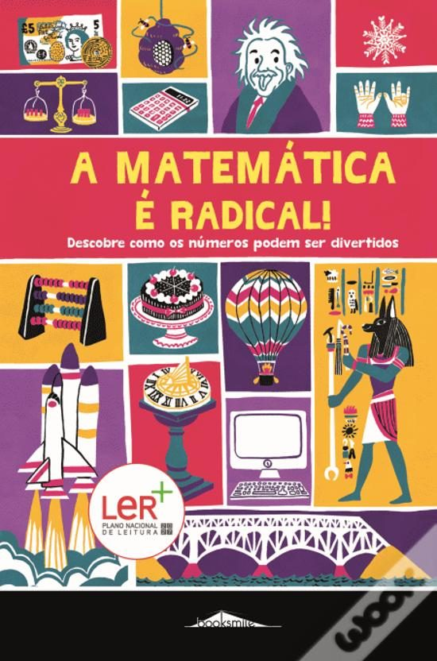
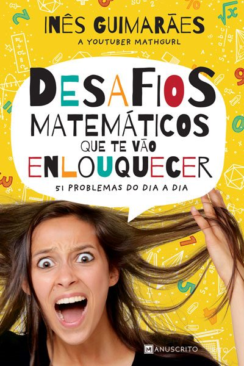
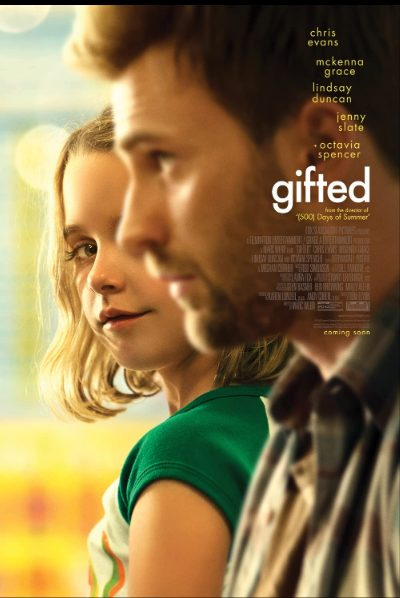
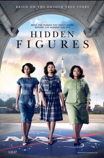

Finalizamos esta edição com algumas sugestões de leituras e de filmes, que estarão disponíveis, em breve, na Biblioteca da tua escola. Envia-nos os teus comentários.

## Livros

## Filmes

<strong>Por agora, é só!</strong> Esperamos pela tua colaboração na próxima edição!

