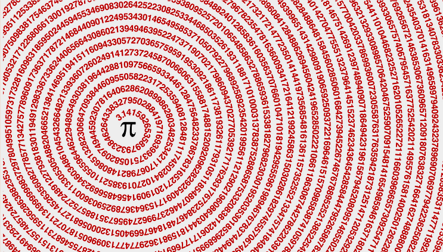

O número Pi é um número irracional, isto é, a sua representação é uma dízima infinita não periódica.

O Pi é a razão entre o perímetro e o diâmetro de uma circunferência.

Há vários métodos de cálculo de valores aproximados deste número e muitos foram os matemáticos que dedicaram o seu trabalho a este número (Arquimedes, Madhava, Newton, Leibniz, Euler, Ramanujan, D. Y. Chudnovsky, Guillera, etc.).

Teoricamente, o método geométrico de Arquimedes pode ser continuado indefinidamente, mas com a invenção do cálculo infinitesimal este método foi abandonado, recorrendo-se a séries infinitas convergentes. Por exemplo:

$$
\pi = \frac{4}{1} - \frac{4}{3} + \frac{4}{5} - \frac{4}{7} + \frac{4}{9} - \frac{4}{11} + \frac{4}{13} - \cdots \quad \text{(Leibniz)}
$$

$$
\pi = 3 + \frac{4}{2 \times 3 \times 4} - \frac{4}{4 \times 5 \times 6} + \frac{4}{6 \times 7 \times 8} - \frac{4}{8 \times 9 \times 10} + \cdots \quad \text{(Nilakantha)}
$$

Um dos métodos mais curiosos para determinar o valor de Pi é atribuído ao francês do século XVIII, o Conde Buffon, e ao seu problema da agulha: considerando uma superfície graduada com linhas paralelas, todas situadas a uma distância $d$ umas das outras, a probabilidade de uma agulha, com comprimento $d$, cair sobre uma dessas linhas é de $2/\pi$.

É fascinante descobrir a versatilidade deste número!

## O número Pi, um dos mais (des)conhecidos da Matemática

$$
\pi = 3{,}141\,592\,653\,589\,793\,238\,462\,643\,383\,279\,502\,884\,197\,169\,399\,375\,105\,820\,974\,944\,592\,307\,816\,406\,286\ldots
$$

Será que encontramos na sequência infinita dos dígitos do Pi a nossa data de nascimento, qualquer número de telemóvel ou outra sequência qualquer? As casas decimais de Pi são infinitas e não têm qualquer regularidade. Mas não são aleatórias, resultam de cálculos. Portanto, arriscamos dizer que a resposta é não! **Pronunciem-se, matemáticos!**

O número Pi inspirou a poetisa polaca Wisława Szymborska, Prémio Nobel da Literatura, a escrever um poema muito interessante, *O admirável número Pi*, que nos foi enviado pela professora Isabel Gaspar. Procura-o na biblioteca ou online: o poema percorre os algarismos de Pi e termina a lembrar que o número continua, “sempre empurrando a preguiçosa eternidade”.

## Uma breve história do Pi

O símbolo pelo qual conhecemos o número Pi deve-se ao matemático suíço Leonhard Euler, e remonta ao ano de 1737, mas a sua história remonta à antiguidade.

- Há mais de 4000 anos, os egípcios chegaram ao valor de 3,16.
- No ano 240 a. C., Arquimedes divulgou o Pi com 4 casas decimais: 3,1429 (usando um polígono de 96 lados\*).
- No séc. II d. C., usando a mesma técnica, mas com um polígono de 720 lados, Ptolomeu conseguiu uma estimativa mais precisa de Pi: 3,1416.
- Cerca de 300 anos depois, utilizando um polígono com 3072 lados, o matemático Zu Chongzhi escreveu-o com mais 4 casas decimais: 3,141 5926.
- No século XVI, o holandês Ludolph van Ceulen conseguiu obter o valor do Pi com 35 casas decimais. Isto já foi um feito espantoso, que demorou anos e anos de trabalho intensivo!

O progresso continuou muito lento, visto que os cálculos eram feitos à mão. Mais recentemente, com o aparecimento dos computadores, foi possível calcular o valor do Pi com milhões de casas decimais.

 Se um polígono tiver um número muito elevado de lados, a sua configuração será “semelhante” a um círculo e o seu perímetro será muito próximo do da circunferência, o que permitirá obter um valor aproximado de Pi. Quantos mais lados se considerar no polígono, mais próximo do valor exato será o valor que se obtém para o Pi.")

**Atualmente, conhecem-se 62,8 biliões (\*\*) de casas decimais do Pi!** Este recorde mundial foi batido no dia 14/08/2021 pela Universidade de Ciências Aplicadas de Graubünden (Suíça). Por curiosidade, referimos aqui os últimos dígitos conhecidos: 7817924264. Mas muitos mais dígitos estão por conhecer…

(\*\*) Um bilião = 1 milhão de milhão, ou seja, $10^{12}$.

## Outras curiosidades

- Há concursos para recitar de memória algarismos do Pi. Em 1995, Hiroyuki Goto memorizou 42 195 casas de Pi, definindo um novo recorde mundial na ocasião. Atualmente, outro japonês, Akira Haraguchi, já memorizou 100 000 dígitos.
- Os egiptólogos ficaram fascinados porque a Grande Pirâmide de Gizé parece aproximar-se do Pi. A altura vertical da pirâmide tem a mesma relação com o perímetro da sua base como o raio de um círculo tem com o da sua circunferência.
- O número Pi tem um **Dia Internacional: 14 de março**. A escolha desta data prende-se com a notação americana: 3/14. A primeira celebração deste dia ocorreu em 1988 nos EUA.
- Em 2019, a UNESCO declarou este dia como o **Dia Internacional da Matemática**.
- Albert Einstein nasceu no dia 14 de março (de 1879).
- Stephen Hawking morreu no dia 14 de março (de 2018).
