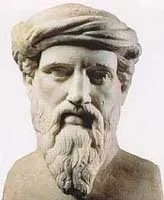

## Quem foi Pitágoras?

Pitágoras (582–497 a. C.) foi um filósofo muito importante da Grécia Antiga, considerado um dos grandes nomes da Matemática. Entretanto, o pouco que se sabe já é suficiente para reconhecer a importância dos seus estudos. Pitágoras tornou-se um grande pensador e fundador do movimento Pitagórico.

## Pitagorismo

Segundo Pitágoras, os números são a base da vida na Terra. Assim surgiu o Pitagorismo (ou Escola Pitagórica), sendo os pitagóricos seus seguidores, dos quais se destacam: Temistocleia, Filolau de Crotona, Arquitas de Tarento, Alcmeão e Melissa.

## O que é o Teorema de Pitágoras?

**Teorema:** num triângulo retângulo, o quadrado da hipotenusa é igual à soma dos quadrados dos catetos.

Sendo $c$ a hipotenusa e $a$ e $b$ os catetos:

$$
c^2 = a^2 + b^2
$$

**Já pensaste onde podes encontrar o Teorema de Pitágoras no teu dia a dia?**

**Nota:** Pitágoras é talvez o matemático mais conhecido do público em geral. No entanto, há uma questão que permanece em aberto: **Pitágoras pode não ter existido!** De facto, não há nenhum registo escrito da sua obra, contrariamente a muitos outros matemáticos da Grécia Antiga. Sabe-se que existiu uma Escola Pitagórica. O que não se sabe é se algum dos seus membros se chamava Pitágoras ou se o nome designava apenas um grupo de gregos, que deu nome à Escola…

