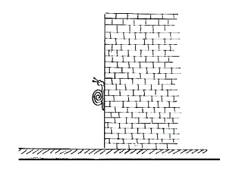
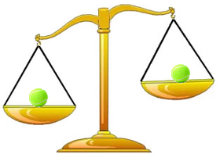

import Desafio from '../../../components/Desafio.astro';

<Desafio numero={1} titulo="O caracol" resposta="9|nove" unidade="dias" fonte="Professora Maria do Céu Faria">

Um caracol sobe um muro com 10 metros de altura. Em cada dia sobe 2 metros, mas de noite deixa-se escorregar 1 metro.

Ao fim de quantos dias chega o caracol ao cimo do muro?

Ao fim de cada dia completo (dia e noite) o caracol sobe 1 m. Ao fim de 8 dias completos está a 8 m de altura. No 9.º dia sobe 2 m e chega aos 10 m — já não escorrega! Chega ao cimo ao fim de **9 dias**.

</Desafio>

<Desafio numero={2} titulo="Contando conjuntos" resposta="15|quinze" unidade="conjuntos" fonte="OPM 2023">

A Genoveva quer escolher um conjunto de três números inteiros diferentes, de 1 a 9, cujo produto seja divisível por 4 mas não seja divisível por 8.

Por exemplo, a Genoveva poderá escolher o conjunto $\{2, 6, 7\}$, mas não o conjunto $\{2, 4, 5\}$.

Quantos conjuntos diferentes poderá escolher a Genoveva?

O produto tem de ter exatamente dois fatores 2. Entre 1 e 9, os ímpares são $1, 3, 5, 7, 9$; os que têm um só fator 2 são $2$ e $6$; o $4$ tem dois; o $8$ tem três (não pode entrar).

- **Com o 4:** os outros dois números têm de ser ímpares: $\binom{5}{2} = 10$ conjuntos.
- **Sem o 4:** é preciso o 2 e o 6, mais um ímpar: $5$ conjuntos.

No total, **15** conjuntos.

</Desafio>

<Desafio numero={3} titulo="Número de triângulos" resposta="76|setenta e seis" unidade="triângulos">

Com os 9 pontos de um tabuleiro 3 × 3, quantos triângulos consegues formar?

E se o tabuleiro tiver 4 × 4 = 16 pontos?

Há $\binom{9}{3} = 84$ maneiras de escolher 3 pontos. Destas, 8 são de pontos alinhados (3 linhas, 3 colunas e 2 diagonais), que não formam triângulo. Ficam **76** triângulos.

Com 16 pontos: $\binom{16}{3} = 560$ escolhas, das quais 44 são de três pontos alinhados; ficam **516** triângulos.

</Desafio>

<Desafio numero={4} titulo="Qual é a moeda falsa?" fonte="José Paulo Viana, Desafios">

Temos oito moedas rigorosamente iguais na sua aparência exterior. No entanto, uma delas é falsa e pesa menos do que as outras sete. Descobre qual é a falsa **fazendo apenas duas pesagens** numa balança de pratos.

**1.ª pesagem:** pomos 3 moedas em cada prato e deixamos 2 de fora.

- Se a balança ficar equilibrada, a falsa está nas 2 que ficaram de fora. **2.ª pesagem:** comparamos essas duas; a mais leve é a falsa.
- Se um dos pratos subir, a falsa está nesse grupo de 3. **2.ª pesagem:** comparamos duas dessas moedas. Se equilibrar, a falsa é a terceira; senão, é a mais leve.

</Desafio>

<Desafio numero={5} titulo="Moedas falsas (II)" fonte="José Paulo Viana, Desafios">

Uma pessoa tem **10 sacos** com moedas, e cada saco tem 10 moedas. Num dos sacos só há moedas falsas e nos outros só moedas verdadeiras. As moedas falsas pesam todas 9 gramas, e as verdadeiras 10 gramas.

**Apenas com uma pesagem**, como poderemos descobrir qual o saco das moedas falsas?

Numeramos os sacos de 1 a 10 e tiramos 1 moeda do saco 1, 2 moedas do saco 2, …, 10 moedas do saco 10. São $55$ moedas, que pesariam $550$ g se fossem todas verdadeiras.

Pesamo-las todas de uma só vez. Cada moeda falsa pesa menos 1 g, por isso a diferença para $550$ g indica o número do saco: se a balança marcar $543$ g, faltam 7 g e o saco das moedas falsas é o **7**.

</Desafio>

<Desafio
  numero={6}
  titulo="A Banca Francesa"
  resposta="Têm a mesma probabilidade"
  opcoes={['A Série Grande', 'A Série Pequena', 'Têm a mesma probabilidade']}
>

O jogo de Casino “Banca Francesa” é um jogo português. Inicialmente era jogado apenas nos casinos portugueses, agora é jogado internacionalmente.

Neste jogo, o *croupier* (empregado do Casino) lança 3 dados cúbicos e equilibrados. Cada jogador tem três apostas à escolha:

- a Série Grande (a soma dos dados pode ser 14, 15 ou 16);
- a Série Pequena (a soma dos dados terá de ser 5, 6 ou 7);
- a Série dos Ases (a soma é 3).

Não saindo estes números, a jogada é considerada nula e o *croupier* tem de lançar os 3 dados novamente até sair um destes resultados, sem que o apostador tenha de pagar qualquer valor extra.

Ao sair Série Grande, quem nela tiver apostado ganha o total apostado. O mesmo acontece se sair Série Pequena. No caso de a série vencedora ser a Série dos 3 Ases, o apostador ganha 61 vezes o valor apostado.

**Problema:** das séries Grande e Pequena, qual terá maior probabilidade de ocorrer? Qual é a probabilidade de cada uma delas? A Série dos Ases é muito menos provável, daí o prémio ser bastante mais elevado. Ainda assim, a razão das probabilidades será de 61 para 1?

Há $6^3 = 216$ resultados possíveis. Contando os casos:

| Soma | 5 | 6 | 7 | 14 | 15 | 16 | 3 |
| --- | :-: | :-: | :-: | :-: | :-: | :-: | :-: |
| Casos | 6 | 10 | 15 | 15 | 10 | 6 | 1 |

A Série Pequena e a Série Grande têm ambas $31$ casos: **têm a mesma probabilidade** (por simetria, $x \mapsto 7 - x$ em cada dado transforma uma série na outra).

Como as jogadas nulas se repetem, só contam os $31 + 31 + 1 = 63$ casos válidos:

$$
P(\text{Grande}) = P(\text{Pequena}) = \frac{31}{63} \approx 49{,}2\%, \qquad P(\text{Ases}) = \frac{1}{63} \approx 1{,}6\%.
$$

A razão entre as probabilidades da Série Grande (ou Pequena) e da Série dos Ases é de **31 para 1**, e não de 61 para 1.

</Desafio>

Se quiseres enviar a(s) tua(s) resolução(ões), podes utilizar o endereço de email do jornal: <a href="mailto:maismatjornal@gmail.com">maismatjornal@gmail.com</a>. Serão selecionadas para publicação as melhores resoluções.

