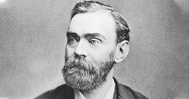
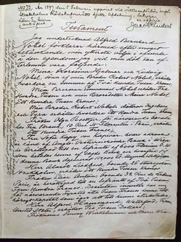
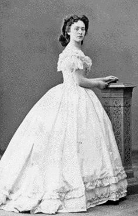
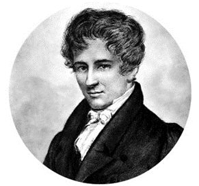

**“E o Prémio Nobel da Matemática vai para…”** Quem pensa já ter ouvido este anúncio várias vezes está absolutamente equivocado.

Quando, em 1895, Alfred Nobel (1833–1896) assinou o seu último testamento, instituiu que uma grande parte da sua imensa fortuna se destinaria à atribuição de prémios a quem, “no ano precedente, tenha prestado um contributo valioso à humanidade”.

Nobel especificou as áreas a distinguir com o prémio, de periodicidade anual, sendo o valor dividido em cinco partes iguais, cabendo três partes a quem fizesse a descoberta, desenvolvimento ou invenção mais relevante no campo da Física, no campo da Química e no campo da Fisiologia ou da Medicina; uma parte para a pessoa que, no campo da Literatura, produzisse a obra mais extraordinária e com um propósito idealista; e uma parte para a pessoa que mais tivesse contribuído para a aproximação entre nações, a redução de armamento e a promoção da paz. Estavam criados os Prémios Nobel da Física, da Química, da Medicina, da Literatura e da Paz.¹

A leitura do testamento causou generalizada polémica, a ponto de os primeiros prémios terem sido atribuídos apenas cinco anos mais tarde, em 1901. Mas suscitou sobretudo profunda consternação entre os académicos matemáticos, por verificarem que a sua área não era contemplada. É inegável que Nobel tinha um profundo interesse pelas áreas que elegeu. O que parece despertar estranheza é o facto de ter excluído a Matemática dos prémios. As razões para esta “omissão” permanecem até hoje desconhecidas, e as justificações avançadas são apenas deduções, resvalando até para o domínio da especulação.

Aquela que tem fomentado maior curiosidade junto do público respeita à hostilidade entre Nobel e o mais famoso matemático sueco da sua época, Magnus Gösta Mittag-Leffler, por alegadamente ter mantido uma relação amorosa com a amante de Nobel, a austríaca Sophie Hess. Ainda que entre os dois homens tenham ocorrido atritos, como afirmou posteriormente Mittag-Leffler, não é garantido que Mittag-Leffler tenha chegado a conhecer Sophie Hess.

Assim, a existir uma retaliação por parte de Nobel ao excluir a Matemática dos prémios, essa dever-se-ia a razões de ordem pessoal e/ou profissional e não a rivalidades amorosas. A hipótese sentimental afigura-se, portanto, pouco plausível, pelo que o enigma se mantém.

As razões para a não existência de um Prémio Nobel da Matemática poderão até ser mais simples do que se tem querido supor: talvez Alfred Nobel tenha desejado premiar invenções práticas, com impacto direto na vida das pessoas, e a Matemática afigurava-se-lhe demasiado teórica; talvez Alfred Nobel entendesse que a teorização matemática já estava contemplada nas descobertas das restantes ciências; talvez Nobel não tivesse um entusiasmo concreto pela Matemática, embora reconhecesse a sua aplicabilidade; talvez Nobel se tenha, simplesmente, esquecido de incluir a Matemática no seu testamento…

O certo é que o mundo académico reconhece a importância e o estímulo intelectual que um prémio desta envergadura confere. Por isso, foi instituída em 1932 a Medalha Fields, que recompensa, de quatro em quatro anos, dois, três ou quatro matemáticos com idade inferior a 40 anos, e o Prémio Abel, em homenagem ao matemático norueguês Niels Henrik Abel, de frequência anual e estabelecido pelo governo da Noruega em 2002, no valor de 7,5 milhões de coroas norueguesas (cerca de 650 000 euros).

Como se vê, há cada vez mais razões para investirmos na Matemática!

<small>¹ Em 1968, o Sveriges Riksbank (Banco Central Sueco) estabeleceu o Prémio das Ciências Económicas em Memória de Alfred Nobel, com base no donativo recebido da Fundação Nobel, nesse ano, por ocasião do tricentenário da criação do banco.</small>
