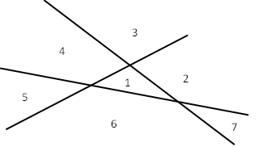

import Desafio from '../../../components/Desafio.astro';

<Desafio numero={1} titulo="As bodas de rubi" resposta="11|onze|16|dezasseis" unidade="filhos" fonte="Atividades matemáticas, Brian Bolt">

Na celebração das suas bodas de rubi (40 anos de casados), Guilherme e Rute convidaram toda a família para uma festa. Pensando na sua longa vida juntos, Guilherme recordou como se enamorou da jovem Rute, quando andavam os dois no colégio, havia muitos anos. Contemplando os seus filhos e as suas famílias, questionava-se se voltariam a estar todos juntos no aniversário das bodas de ouro.

Absorto nos seus pensamentos, deu-se conta que a diferença entre o quadrado da sua idade e o quadrado da idade da sua esposa Rute era exatamente igual ao quadrado do número dos seus filhos.

Que idade tinham Guilherme e Rute quando se casaram e quantos filhos tiveram? (Responde com o número de filhos.)

Sejam $g$ e $r$ as idades atuais e $n$ o número de filhos: $g^2 - r^2 = n^2$, ou seja, $(g - r)(g + r) = n^2$.

Como se conheceram no colégio, têm idades próximas; e, casados há 40 anos, têm ambos mais de 55 anos.

- **Diferença de 1 ano** ($g = r + 1$): vem $g + r = 2r + 1 = n^2$. Para $r \ge 58$, o primeiro valor que dá um quadrado perfeito é $r = 60$: $2 \times 60 + 1 = 121 = 11^2$. Guilherme tem 61 anos e Rute 60: **casaram-se com 21 e 20 anos e tiveram 11 filhos.**
- **Diferença de 2 anos** ($g = r + 2$): vem $4(r + 1) = n^2$, e $r = 63$ dá $4 \times 64 = 256 = 16^2$. Guilherme teria 65 anos e Rute 63: casaram-se com 25 e 23 anos e tiveram **16 filhos**.

A primeira resposta parece a mais provável… mas ambas cumprem o enunciado! Haverá mais alguma possibilidade?

</Desafio>

<Desafio numero={2} titulo="Em quantas partes dividem o plano várias retas?" resposta="56|cinquenta e seis" unidade="regiões" fonte="Atividades matemáticas, Brian Bolt">

Três linhas retas dividem o plano, no máximo, em 7 regiões, como se pode perceber pela figura. Completa a tabela seguinte, escrevendo em cada caso o número máximo de regiões que se podem formar:

| Número de retas ($n$) | 0 | 1 | 2 | 3 | 4 | 5 | 6 | 7 |
| --- | - | - | - | - | - | - | - | - |
| Número de regiões ($r$) | | | | 7 | | | | |

Continuando a sequência, sem desenhares as linhas, és capaz de dizer quantas regiões se formam no máximo com a) 10 retas, b) 100 retas, c) $n$ retas? (Responde para 10 retas.)

| $n$ | 0 | 1 | 2 | 3 | 4 | 5 | 6 | 7 |
| --- | - | - | - | - | - | - | - | - |
| $r$ | 1 | 2 | 4 | 7 | 11 | 16 | 22 | 29 |

Cada nova reta corta todas as anteriores (em pontos diferentes), atravessando $n$ regiões e dividindo cada uma em duas: a $n$-ésima reta acrescenta $n$ regiões. Logo,

$$
r_n = 1 + (1 + 2 + \cdots + n) = 1 + \frac{n(n+1)}{2}.
$$

a) $r_{10} = 56$; b) $r_{100} = 5051$; c) $r_n = \dfrac{n^2 + n + 2}{2}$.

</Desafio>

<Desafio numero={3} titulo="Uma moeda a menos" fonte="José Paulo Viana, Desafios">

Temos nove sacos com moedas. O primeiro tem 100 moedas, o segundo tem 200, o terceiro tem 300, e assim sucessivamente até ao último que tem 900 moedas. As moedas são todas iguais e os sacos (vazios) pesam todos o mesmo.

Um brincalhão tirou uma moeda de um dos sacos. Queremos voltar a pô-la no sítio, só que não sabemos qual é o saco e contar todas as moedas dá muito trabalho.

De repente, alguém diz: “É fácil, bastam duas pesagens para descobrir o saco onde falta uma moeda.” Como será isto possível?

Os sacos vazios também pesam, por isso o número de sacos em cada prato da balança tem de ser igual. Fazemos 3 grupos de 3 sacos, todos com um total de 1200 moedas: **grupo 1:** sacos 1, 2 e 9; **grupo 2:** sacos 3, 4 e 5; **grupo 3:** sacos 6, 7 e 8.

**1.ª pesagem:** colocamos o grupo 1 num prato e o grupo 2 no outro. Se a balança equilibrar, o saco com uma moeda a menos está no grupo 3; se não equilibrar, está no grupo do prato que subiu.

**2.ª pesagem:** comparamos dois sacos desse grupo, um em cada prato. Como têm números de moedas muito diferentes, juntamos sacos de um grupo “bom” para equilibrar: por exemplo, se o saco estiver no grupo 3, pomos num prato os sacos 7 e 1 (800 moedas) e no outro os sacos 6 e 2 (também 800 moedas) — os sacos 1 e 2 já sabemos que estão completos. Se a balança equilibrar, o saco procurado é o que ficou de fora; se não, é o do prato que fica em cima.

*Resolução publicada na edição seguinte (Ano 2, Edição 1).*

</Desafio>

Se quiseres enviar a(s) tua(s) resolução(ões), podes utilizar o endereço de email do jornal: <a href="mailto:maismatjornal@gmail.com">maismatjornal@gmail.com</a>. Serão selecionadas para publicação as melhores resoluções.

