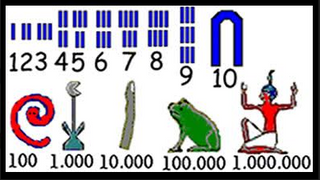
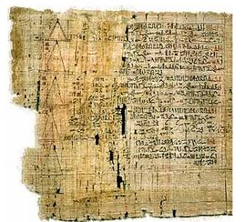
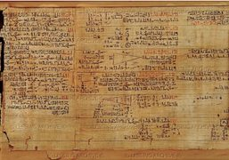

## Onde e como surgiram os números?

As primeiras representações numéricas surgiram para dar resposta a uma necessidade básica: a contagem de animais.

No antigo Egito, os números eram representados por traços, riscos e outros símbolos, como se pode ver na figura. Contudo, a ordem de colocação dos símbolos não era relevante. Por exemplo, com um símbolo de 1000, um de 100 e dois de 10 podemos ler o número 1120.

Os números que utilizamos hoje em dia foram criados pelos indianos, em meados do século V da era cristã, mas foram os árabes que expandiram essa forma de contagem, cujos caracteres ficaram conhecidos por “algarismos”. A primeira inscrição que se conhece que contém o algarismo 0 data do séc. IX.

*Leonor Trindade, 10.º F*

## O Papiro de Rhind

Os egípcios criaram o primeiro alfabeto fonético e inventaram o **papiro — o precursor do papel**, que era formado a partir da planta papiro.

O papiro mais antigo que se conhece foi escrito cerca de 1750 anos a. C. e é designado por Papiro de Rhind. Possui este nome devido ao antiquário de Berlim que o comprou em 1858, Henry Rhind. Rhind passava por problemas de saúde e visitou o Egito pois sabia do conhecimento medicinal que os egípcios possuíam. Chegando a Tebas, comprou um antigo papiro que havia sido descoberto no templo mortuário do faraó egípcio Ramsés II.

Este papiro também é conhecido por Papiro de Ahmes, que foi o escriba que o copiou de um texto ainda mais antigo, e mede cerca de 5,5 m de comprimento por 0,32 m de largura. Neste, encontramos um texto matemático com mais de 80 problemas de aritmética, frações, cálculo de áreas, volumes, progressões, regra de três simples, equações lineares, trigonometria básica e geometria.

Apenas aquando das Invasões Francesas esta escrita (hieroglífica) foi descodificada pelo francês Jean-François Champollion (1790–1832). Até aí julgava-se que cada símbolo representava um som, mas afinal representava uma palavra e a justaposição de duas palavras criava uma nova palavra.

Este papiro mostrou-nos que os egípcios se interessavam e sabiam muito de Matemática. Não nos esqueçamos que foram eles que construíram as pirâmides!!! **É um curso prático de Matemática com cerca de 4000 anos!** E ainda hoje se estuda este papiro.

## Multiplicação egípcia: $71 \times 19 = {?}$

Os egípcios sabiam calcular o dobro e a metade de uma determinada quantidade, mas não usavam/conheciam tabuadas. No entanto, faziam todas as operações elementares.

Tinham um método muito engenhoso para efetuar multiplicações que aqui vamos apresentar, fazendo a conta acima indicada. Consideravam duas colunas de números que se iniciavam com o 1 e o multiplicador da operação, neste caso 1 e 19 (1.ª linha da operação).

- Depois, duplicavam os valores da linha anterior.
- E repetiam o processo até o número da coluna da esquerda estar o mais próximo possível do multiplicando (71), mas sem o ultrapassar.
- Escolhiam os números da coluna da esquerda que somam 71: $64 + 4 + 2 + 1$.
- Assinalavam os correspondentes números da coluna da direita.
- Somavam esses valores, o que dá o resultado da operação.

| | |
| --: | --: |
| ★ **1** | **19** |
| ★ **2** | **38** |
| ★ **4** | **76** |
| 8 | 152 |
| 16 | 304 |
| 32 | 608 |
| ★ **64** | **1216** |
| **71** | **1349** |

$$
71 \times 19 = 1349
$$

**Porque é que este método funciona?** De facto,

$$
71 \times 19 = (1 + 2 + 4 + 64) \times 19 = 1 \times 19 + 2 \times 19 + 4 \times 19 + 64 \times 19
$$

O que vemos na 1.ª linha da operação é $1 \times 19$, na 2.ª, $2 \times 19$, na 3.ª, $4 \times 19$ e na última, $64 \times 19$. Os egípcios:

- já usavam a propriedade distributiva;
- sabiam que é possível escrever qualquer número natural como soma de potências de 2 (distintas) — é extraordinário, já que esta propriedade foi demonstrada muito mais tarde (uns 4000 anos) por Leibniz (1646–1716).

Experimenta, agora, fazer $19 \times 71$.

*Adaptado de Professor Jorge Nuno Silva, a quem muito agradecemos.*

**Problema 79 do papiro** — os egípcios usavam a Matemática também com fins recreativos, por pura diversão. Já ouviste falar em progressões geométricas? Parece que os egípcios já as conheciam:

*“Sete mulheres velhas estão a caminho de Roma; cada mulher tem sete mulas; cada mula carrega sete sacos; cada saco contém sete pães; e para cada pão há sete facas; e para cada faca há sete bainhas. Quantos, no total, estão a caminho de Roma?”*

