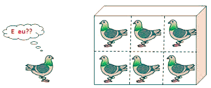

## O problema dos aniversários

**Numa turma de 28 alunos, qual será a probabilidade de que haja pelo menos dois deles a fazerem anos no mesmo dia?**

Para resolver este problema, vamos começar por pensar ao contrário. Vamos **calcular a probabilidade de as 28 pessoas fazerem anos em dias todos diferentes**. Para cada uma delas, o número de possibilidades é 365.

Como estamos a considerar que fazem anos em dias diferentes, há 365 dias favoráveis para o 1.º aluno, 364 para o 2.º, 363 para o 3.º, e assim sucessivamente, até ao 28.º, que poderá fazer anos num qualquer dos 338 dias que restam.

$$
P = \frac{365}{365} \times \frac{364}{365} \times \frac{363}{365} \times \cdots \times \frac{338}{365} = \frac{365 \times 364 \times 363 \times \cdots \times 338}{365^{28}}
$$

Assim, a probabilidade de isto não acontecer, ou seja, de haver pelo menos duas pessoas com o aniversário no mesmo dia é

$$
P = 1 - \frac{365 \times 364 \times 363 \times \cdots \times 338}{365^{28}} \approx 0{,}6545
$$

**É superior a 65 %!** Esperavas este resultado? E na tua turma, há pessoas a fazerem anos no mesmo dia? Qual é a probabilidade de isso acontecer?

Na tabela seguinte estão os valores das probabilidades ($P$) se considerarmos o problema com $N$ pessoas:

| $N$ | 5 | 10 | 15 | 20 | 23 | 25 | 30 | 40 | 45 | 50 |
| --- | - | - | - | - | - | - | - | - | - | - |
| $P$ | 0,03 | 0,12 | 0,25 | 0,41 | 0,51 | 0,57 | 0,71 | 0,89 | 0,94 | 0,97 |

## O problema de Monty Hall

Na década de 1970, um problema de probabilidades correu mundo, o problema de Monty Hall. Este problema/paradoxo foi inspirado no concurso televisivo dos EUA “Let’s make a deal”, que tinha como apresentador Monty Hall, daí o nome do problema.

A discussão em torno do problema ainda foi maior na década de 90, quando uma colunista, Marilyn vos Savant, apresentou a solução do problema num dos seus artigos. A escritora foi fortemente criticada, chegando a receber 10 000 cartas a contestar a sua tese, sendo que 1000 destas estavam assinadas por matemáticos que, em alguns casos, até a insultavam. Convém esclarecer que Savant não tinha formação matemática… mas foi considerada a pessoa com o QI mais elevado do mundo.

### Problema: onde está o carro?

Imagina um programa de televisão em que o concorrente deve escolher uma de entre três portas, sabendo que atrás de uma porta há um carro e atrás das outras, duas cabras, uma em cada.

O concorrente escolhe uma porta e o apresentador, que sabe o que está por trás de cada uma das portas, abre uma outra porta, que tem uma cabra.

Nota que duas das portas têm cabras, pelo que, mesmo que o concorrente tenha escolhido uma delas, o apresentador terá sempre outra para abrir.

Depois disto, o apresentador pergunta ao concorrente se quer mudar a sua escolha ou se a mantém.

**Deve o concorrente mudar a sua escolha? É esta a questão!** Só o fará se isso aumentar a probabilidade de ganhar o carro, naturalmente! Qual seria a tua decisão? Experimenta:

<MontyHall />

Ver a explicação

Na primeira escolha, a probabilidade de acertar no carro é $\frac{1}{3}$ — e o apresentador abrir uma porta com uma cabra não muda isso, porque ele pode sempre fazê-lo.

- Se o concorrente **mantém** a porta, ganha apenas quando acertou à primeira: probabilidade $\frac{1}{3}$.
- Se **muda**, ganha sempre que errou à primeira (o apresentador eliminou a outra cabra e o carro só pode estar na porta que sobra): probabilidade $\frac{2}{3}$.

Mudar **duplica** a probabilidade de ganhar o carro!

Este é um exemplo de um problema de probabilidade que se percebe facilmente, mas cuja solução não é assim tão simples. A prova disso foi o facto de ter confundido matemáticos muito experientes, geniais, mesmo, como Paul Erdős. Diz-se que este matemático só ficou convencido com a resolução apresentada ao ver uma simulação computacional que validava a solução, realizada por outro matemático seu amigo (Vazsonyi).

## O princípio do pombal ou das gavetas de Dirichlet

> Se $n + 1$ pombos habitam $n$ casas, teremos de ter, pelo menos, dois pombos na mesma casa.

Aplicamos esta regra para concluir, por exemplo, que:

**Problema 1:** num grupo de 13 pessoas, pelo menos duas fazem anos no mesmo mês. É fácil justificar esta afirmação!

**Problema 2:** em Lisboa há mais de 10 pessoas que têm o mesmo número de cabelos.

Vejamos como podemos justificar esta propriedade. Em Lisboa há mais de 2 milhões de pessoas. Não há ninguém que atinja os 200 000 cabelos, ou seja, o número de cabelos varia entre 0 (carecas) e 199 999 cabelos (pesquisas na internet permitiram saber que, em média, o ser humano tem cerca de 150 000, entre os 20 e os 30 anos). Ora, em cada conjunto de 200 000 pessoas, pelo menos duas delas terão o mesmo número de cabelos. Dado que em Lisboa podemos formar, pelo menos, 10 grupos com 200 000 pessoas, concluímos que há em Lisboa pelo menos 10 pessoas com o mesmo número de cabelos.

**Problema 3:** numa gaveta, há 12 meias brancas e 12 meias pretas. Quantas meias devemos retirar, ao acaso, para termos a certeza de obter um par de meias da mesma cor?

A resposta é simples: apenas 3 meias. As duas primeiras meias retiradas podem ter a mesma cor (branca ou preta), aqui bastam duas. Se as cores alternarem, a terceira meia já repete a cor de uma das duas anteriores, visto haver apenas 2 cores: B P B ou B P P, …

E se existissem, ainda, 12 meias azuis? **(Desafio 1)**

**Problema 4:** se marcarmos 13 pontos num retângulo 3 × 4, como o da figura, existem dois pontos tais que a distância entre si é menor do que $\sqrt{2}$. Fica a teu cargo a explicação desta propriedade **(Desafio 2)**.

Ver as resoluções dos desafios 1 e 2

**Desafio 1.** Com três cores, as três primeiras meias podem ser todas de cores diferentes; a quarta repete forçosamente uma cor. É preciso retirar **4 meias**.

**Desafio 2.** Dividimos o retângulo 3 × 4 em 12 quadrados de lado 1. Com 13 pontos e 12 quadrados, pelo princípio do pombal há dois pontos no mesmo quadrado — e a maior distância possível dentro de um quadrado de lado 1 é a diagonal, $\sqrt{2}$. Logo há dois pontos a uma distância não superior a $\sqrt{2}$.

