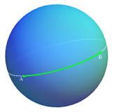
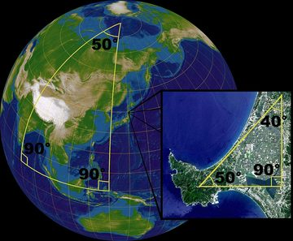
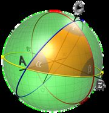

E se as retas fossem diferentes do que habitualmente concebemos? Estás curioso? **Então este artigo é para ti!**

E esta ideia não se fica pela imaginação, pela teoria, é mesmo uma realidade. Tem aplicação nos sistemas GPS, por exemplo. Vejamos de que Geometria estamos a falar.

Ao longo de toda a tua escolaridade, foste estudando Geometria, a geometria Euclidiana, mas todo esse estudo foi baseado em superfícies planas: linhas e eixos cartesianos.

Mas, se o “plano” fosse uma esfera, tal como a Terra, seria tudo igual?

É aqui que entra a Geometria esférica. Na esfera, o caminho mais curto entre dois pontos é dado por um arco de circunferência. Essa circunferência é usualmente designada por círculo máximo quando se obtém intersetando a esfera com um plano contendo o seu centro.

- Estas circunferências máximas serão as “retas”;
- os tais arcos serão os “segmentos de reta”.

Então **não existem retas paralelas**, visto que todas elas se cortam em algum ponto da superfície.

Como é que respondemos a questões básicas, como por exemplo:

**Qual é a distância entre A (Macapá, Brasil) e B (Ilhéu das Rolas, S. Tomé e Príncipe), que se encontram ambas na linha do equador?**

A geometria euclidiana não fornece um resultado preciso a esta questão, como podes compreender, dado a Terra não ser plana. Na Geometria Euclidiana, o caminho mais curto entre dois pontos é o **segmento de reta** determinado por eles.

**Como será um triângulo nesta Geometria? Qual é o valor da soma das amplitudes dos ângulos internos de um triângulo?**

A tua resposta deve ser 180°. Mas isso é verdade na geometria euclidiana. Na geometria esférica, a resposta é outra: a soma dos ângulos internos de um triângulo que esteja desenhado sobre uma esfera é **maior do que 180 graus**, como se exemplifica nas figuras.

A Geometria Esférica (ou Elítica) começou a ser estudada por matemáticos no século XIX, especialmente por Bernhard Riemann, que a investigou na década de 1850. Os resultados foram muito controversos e estes matemáticos durante muito tempo repreendidos por colegas. Hoje em dia a Geometria Esférica é de grande valor na navegação e na astronomia.

Muito antes disto, foram vários os investigadores portugueses que se dedicaram à Cartografia, Astronomia e Ciência Náutica, dos quais se destaca Pedro Nunes (1502–1578). Em 1537, Pedro Nunes sugeria que o barco devesse procurar seguir o rumo de um círculo máximo, efetuando as necessárias correções a intervalos de tempo regulares para contrariar o efeito da curva loxodrómica. Para tal, o matemático português propôs um método matemático que foi alvo de duras críticas pela sua difícil aplicabilidade em alto mar naquela época.

*Fonte: [infoescola.com](https://www.infoescola.com/matematica/geometria-esferica/)*
