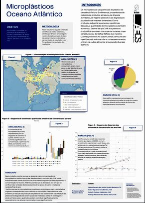
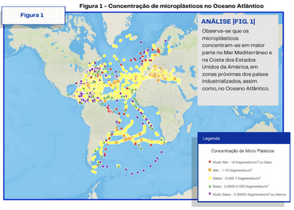
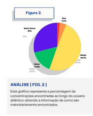
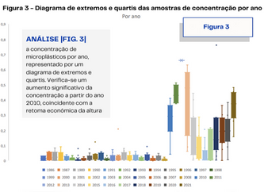
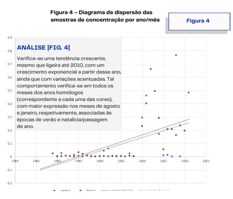

No âmbito do conteúdo temático Estatística, no final do ano letivo passado, os alunos Leonor M., Pedro M., Rodolfo C. e Rodrigo V., do 11.º B, realizaram um póster subordinado ao tema *Microplásticos nos oceanos*, nomeadamente no Oceano Atlântico.

**Objetivo:** aprofundar e consolidar os conceitos da estatística e a recolha e tratamento de dados com recurso a ferramentas de cálculo, aplicados a um problema real.

**Metodologia:** neste estudo, foi seguido o método científico de análise estatística, dividido por 5 fases: amostragem e recolha de dados, criação de base de dados, tratamento de dados, apresentação de resultados e por fim análise e interpretação dos resultados.

## Introdução

Os microplásticos são partículas de tamanho inferior a 5 milímetros, provenientes da indústria de produtos abrasivos, da higiene pessoal ou da degradação do plástico de maiores dimensões. Com a produção industrial a aumentar nas últimas décadas, a quantidade de microplásticos também aumentou. Estima-se que 10 % dos plásticos produzidos terminam nos oceanos e mares, o que constitui cerca de 60 % a 90 % do lixo marinho.

Quando presentes no oceano, estas partículas são ingeridas pela vida marinha e, consequentemente, entram na nossa cadeia alimentar, provocando diversas doenças.

## Conclusão

Neste trabalho conclui-se que as áreas de maior concentração de microplásticos encontram-se no Mar Mediterrâneo e na costa dos EUA, zonas muito industrializadas. Desde 2010 houve um aumento exponencial da sua presença e concentração no Oceano Atlântico, sendo que as alturas do ano em que a emissão de poluentes é maior é na época de verão e na época natalícia/final do ano. Verifica-se que os microplásticos constituem um problema para a sociedade, desencadeando problemas graves, como foi referido na introdução.

Para solucionar este problema, a redução da produção de plásticos não sustentáveis e a utilização de plásticos biodegradáveis seriam medidas a adotar. A reciclagem é ainda um fator para o qual todos podem contribuir significativamente.

*Fontes: centros nacionais de informação ambiental NCEI; Administração oceânica e atmosférica nacional dos EUA (NOAA).*

<strong>Sabias que existem ilhas de plásticos nos oceanos?</strong> Faz uma pesquisa sobre este assunto!

