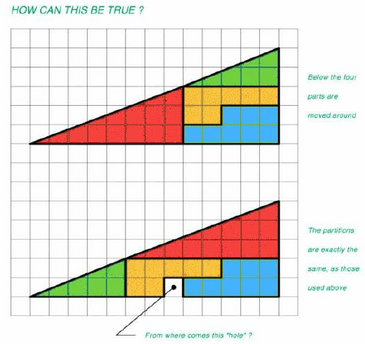

import Desafio from '../../../components/Desafio.astro';

<Desafio numero={1} titulo="A nação de Zox" fonte="Truques de Lógica Matemática, Kurt Smith">

A nação de Zox consiste em cinco ilhas: Zog, Zod, Zob, Zop e Zoz. A população total das cinco ilhas é de 750 Zoxianos. Calcula quantos Zoxianos vivem em cada ilha.

Seguem-se algumas pistas para te ajudar:

1. A ilha maior é Zod. A ilha mais pequena não é Zoz.
2. A ilha mais pequena tem 1/10 dos Zoxianos de toda a nação de Zox.
3. Uma das ilhas tem 1/5 da população total de Zox. Outra ilha tem 1/3.
4. Zob é uma vez e meia maior do que uma das outras ilhas.
5. Zop tem mais 100 pessoas do que a ilha mais pequena.

- A ilha mais pequena tem $750 / 10 = 75$ habitantes; Zop tem $75 + 100 = 175$.
- Há uma ilha com $750 / 5 = 150$ e outra com $750 / 3 = 250$; a maior, Zod, tem 250.
- A quinta ilha tem $750 - 75 - 175 - 150 - 250 = 100$.
- Zob é uma vez e meia outra ilha: $150 = 1{,}5 \times 100$, logo Zob tem 150 e a ilha com 100 é Zoz (que não pode ser a mais pequena).
- A mais pequena é, portanto, Zog.

**Zod: 250; Zop: 175; Zob: 150; Zoz: 100; Zog: 75.**

</Desafio>

<Desafio numero={2} titulo="What?!" fonte="Rodrigo Paiva, 10.º B">

Movendo as quatro peças, passamos do triângulo da esquerda para o da direita, que são (ou parecem) iguais. Mas sobra um quadrado! Como é que explicas isto?

Nenhuma das figuras é realmente um triângulo! O triângulo vermelho tem catetos 8 e 3 (inclinação $\frac{3}{8} = 0{,}375$) e o verde tem catetos 5 e 2 (inclinação $\frac{2}{5} = 0{,}4$). Como as inclinações são diferentes, a “hipotenusa” não é uma linha reta: na figura da esquerda está ligeiramente dobrada para dentro e, na da direita, ligeiramente para fora.

A diferença de área entre as duas figuras é exatamente o quadrado de área 1 que “sobra” — está espalhada, de forma quase invisível, ao longo da hipotenusa.

</Desafio>

<Desafio numero={3} titulo="Às compras" resposta="62" unidade="€" fonte="Pierre Berloquin, 100 jogos numéricos, Gradiva">

Timóteo gastou tudo o que tinha no bolso em cinco lojas. Em cada loja gastou 1 € a mais do que a metade do que tinha ao entrar. Quanto tinha o Timóteo no bolso à partida?

Se entrou numa loja com $x$ euros, saiu com $x - \left(\frac{x}{2} + 1\right) = \frac{x}{2} - 1$. Logo, se saiu com $y$, entrou com $2(y + 1)$.

Andando para trás a partir de 0 €: $0 \to 2 \to 6 \to 14 \to 30 \to 62$. O Timóteo tinha **62 €**.

</Desafio>

Se quiseres enviar a(s) tua(s) resolução(ões), podes utilizar o endereço de email do jornal: <a href="mailto:maismatjornal@gmail.com">maismatjornal@gmail.com</a>. Serão selecionadas para publicação as melhores resoluções.

