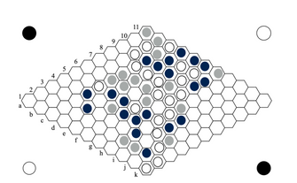
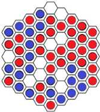
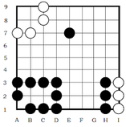
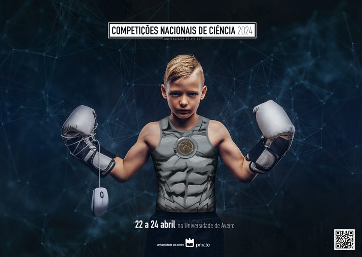
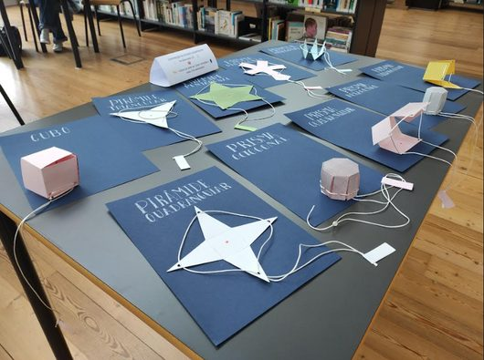
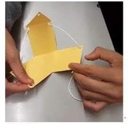
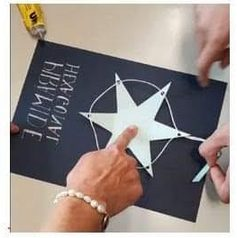

## XLII Olimpíadas Portuguesas de Matemática

No dia 8 de novembro realizaram-se as primeiras eliminatórias das XLII Olimpíadas Portuguesas de Matemática, iniciativa promovida pela Sociedade Portuguesa de Matemática.

Participaram no evento 15 alunos na categoria Júnior (7.º ano), 11 alunos na categoria A (8.º e 9.º anos) e 29 alunos na categoria B (Secundário). Está a decorrer a fase de apreciação e classificação das provas realizadas, de modo a apurar os alunos admitidos à 2.ª eliminatória, que se realizará no dia 10 de janeiro de 2024.

## Campeonato Nacional de Jogos Matemáticos

A 17.ª edição do CNJM terá lugar em Aveiro, no dia 14 de março de 2024. Dia Internacional da Matemática! Dia do Pi! A ESDS irá participar neste evento e os jogos a concurso, para alunos do ensino secundário, são: **Produto, Atari Go e Nex**.

Como habitualmente, cada escola pode participar com um aluno por jogo. Pode ser a tua vez!

Podes consultar as regras dos jogos nos links seguintes: [Produto](http://ludicum.org/jogos/abstr/produto/view), [Atari Go](http://ludicum.org/jogos/abstr/atari-go/view), [Nex](http://ludicum.org/jogos/abstr/nex/view).

Inscreve-te e participa neste mega evento!

## Canguru Matemático

É um concurso que pretende estimular e motivar o maior número possível de alunos para a Matemática e é um complemento a outras atividades, tais como olimpíadas. Em Portugal, a organização deste concurso está a cargo do Departamento de Matemática da Faculdade de Ciências e Tecnologia da Universidade de Coimbra, com o apoio da Sociedade Portuguesa de Matemática.

O Concurso é para todos (não existe seleção prévia) e a prova consiste num questionário de escolha múltipla de várias questões de dificuldade crescente. As inscrições começam em janeiro.

## PmatE

No dia 24 de abril de 2024 terão lugar as Competições Nacionais de Ciência 2024 (PmatE), evento promovido pela Universidade de Aveiro. A ESDS irá participar nas provas de Matemática destas competições — Concurso Xeqmat. Inscreve-te junto do teu professor.

## SuperTmatik

Este ano letivo, a Escola Básica José Saraiva inscreveu-se no campeonato SuperTmatik, de cálculo mental, nomeadamente para o 3.º ciclo do Ensino Básico (7.º, 8.º e 9.º ano).

Este campeonato tem como objetivos: desenvolver o cálculo mental; desenvolver destrezas numéricas e de cálculo; promover o contacto social entre pares; e reforçar a componente lúdica na aprendizagem da Matemática.

Para selecionar os alunos finalistas, vão realizar-se eliminatórias presenciais, utilizando os baralhos de cartas, até ao dia 22 de março de 2024 (com datas concretas ainda a definir). No final das eliminatórias, serão selecionados 2 alunos de cada ano. Assim, teremos 6 finalistas para a grande final, que se realizará online, entre os dias 6 e 24 de maio de 2024.

## Do plano para 3D — exposição de trabalhos de alunos

No âmbito do módulo 1, Geometria, na disciplina de Matemática e com auxílio da professora Susana Martins, foi realizada uma atividade prática, no período de quatro aulas.

Assim, os alunos do 1.º D GPSI (Curso de Gestão e Programação de Sistemas Informáticos) realizaram uma planificação 2D e 3D de variados sólidos geométricos, utilizando o software GeoGebra, com a finalidade de criar uma exposição, na qual alunos e docentes pudessem interagir de forma a montar os sólidos geométricos planificados pelos alunos.

Esta exposição interativa esteve disponível ao público, na biblioteca da Escola Domingos Sequeira, a partir do passado dia 20 de novembro.

*Texto de Valentina Lima, 1.º D*
