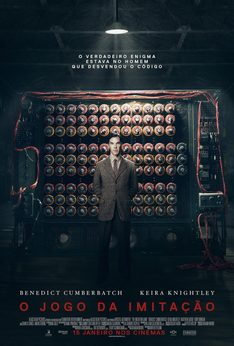
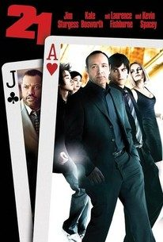

Quase a finalizar esta edição, deixamos-te algumas sugestões de leituras e de filmes. Os livros que propomos estão ambos disponíveis na Biblioteca Municipal. Os dois filmes sugeridos podem ser vistos e requisitados na Biblioteca da ESDS. Envia-nos os teus comentários.

## Livros

")

")

## Filmes

<strong>Por agora, é só!</strong> Mas não terminamos esta edição sem antes apresentarmos as resoluções dos desafios da edição anterior! Desejando que tenhas gostado, esperamos pela tua colaboração na próxima edição!

