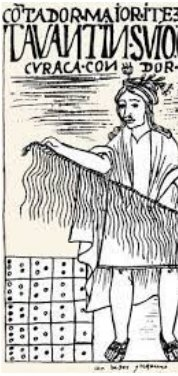
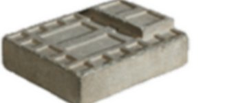
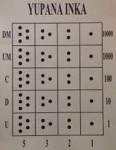
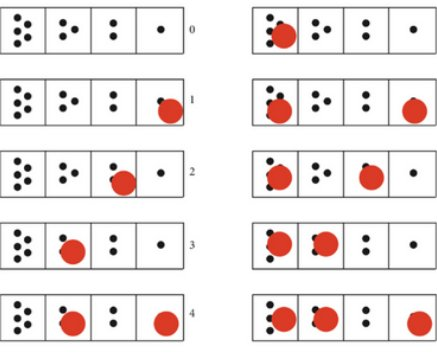
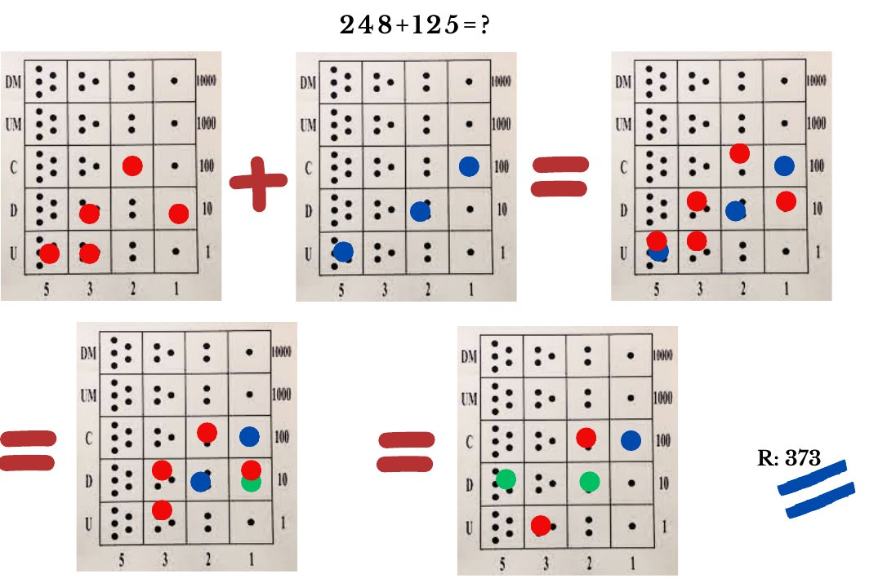
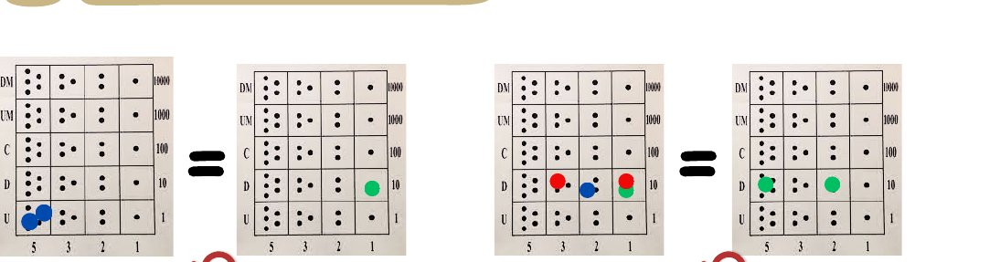
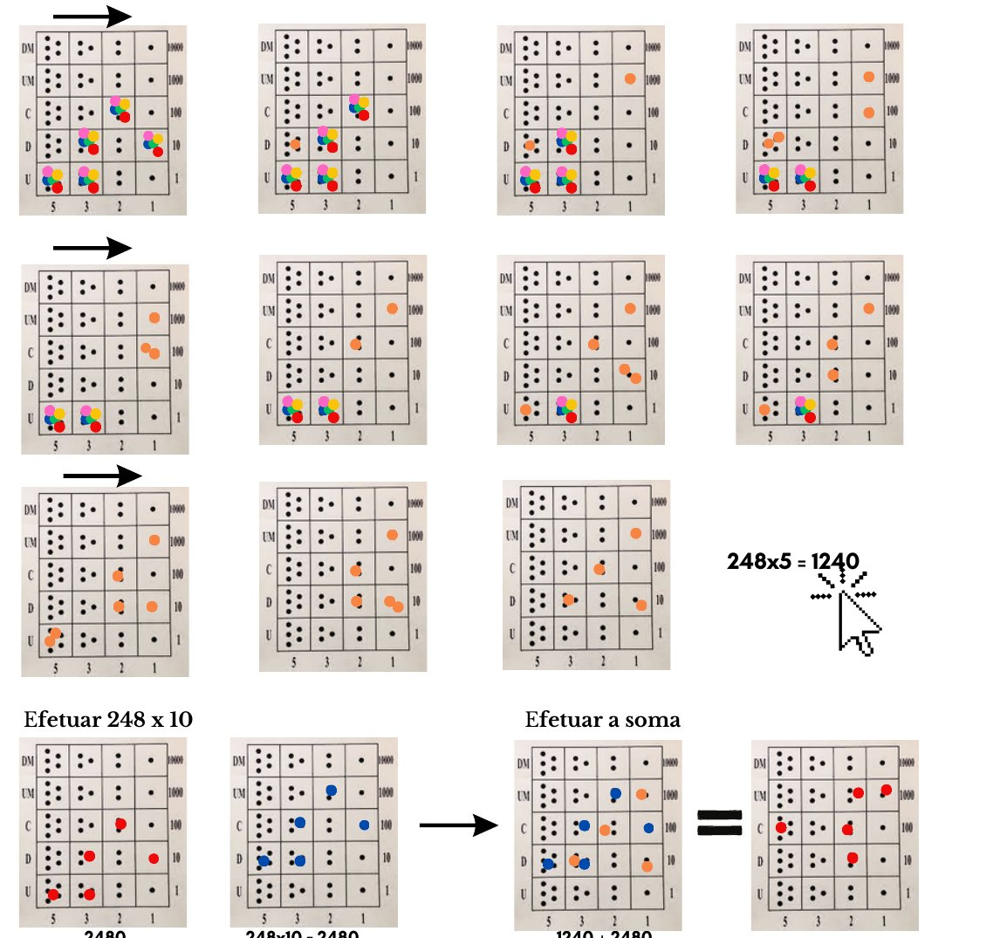

Na figura, que aparece num documento sul-americano do séc. XVII, vê-se uma pessoa segurando um conjunto de fios (Quipu) e, em baixo, a representação de um objeto (ábaco Yupana), o que sugere a associação dos dois.

Artefactos arqueológicos destes objetos chegaram aos nossos dias, mas sem qualquer explicação sobre a sua utilização, razão pela qual o que se conhece sobre eles são possíveis teorias (interpretações) para o seu funcionamento. Pensa-se que estes povos utilizavam o ábaco Yupana para fazer contas e o conjunto de linhas com nós, os Quipus, para representação e registo de valores numéricos no dia a dia.

O Yupana destinava-se a cálculos numéricos — era um tabuleiro de cálculo. Para além das operações básicas da aritmética, permitia implementar algoritmos mais complexos — era **a calculadora dos incas**! Vejamos como é e como funciona o ábaco Yupana.

O ábaco Yupana era composto por 4 colunas e 5 ou mais linhas (o número de linhas está relacionado, como veremos a seguir, com a ordem de grandeza do resultado da conta a efetuar).

> Em cada uma das cinco linhas, há quatro quadrados com, respetivamente, e da direita para a esquerda, uma, duas, três e cinco pintas. Somos de opinião de que as filas se destinam a representar os diversos dígitos da numeração decimal, sendo a linha inferior destinada às unidades, a segunda às dezenas, e assim sucessivamente.
>
> — Jorge Nuno Silva

## A representação dos números no Yupana

Os números de 0 a 9 representam-se na linha inferior; os números de 10 a 99 representam-se nas duas linhas inferiores.

 e 27 (2 dezenas e 7 unidades).")

Há uma característica notável neste ábaco: **podemos representar qualquer número sem necessitar de ter mais do que uma marca em qualquer casa.**

<Desafio titulo="Representa no Yupana">

Experimenta representar 28, 64 e 325, por exemplo.

</Desafio>

## Somar no Yupana: $248 + 125 = {?}$

### Como se fazem as simplificações?

- Nota que $5 + 5 = 10$. Assim, duas marcas na casa do 5 equivalem a uma marca na casa do 1, na linha de cima. E isto acontece em qualquer linha: 5 + 5 unidades = 1 dezena, 5 + 5 dezenas = 1 centena, etc.
- Temos $1 + 1 + 2 + 3 = 7 = 5 + 2$. Assim, as quatro marcas da linha 2 equivalem a duas marcas nessa mesma linha, não havendo mais do que uma marca por casa.

<Desafio titulo="Somar no Yupana">

Deixamos a teu cargo fazer as seguintes operações: $47 + 35$ e $322 + 185$. Bom trabalho! Envia-nos os teus esquemas para divulgarmos a tua resolução.

</Desafio>

## Multiplicar no Yupana: $248 \times 15 = {?}$

1. Escrever $248 \times 15 = 248 \times (10 + 5) = 248 \times 10 + 248 \times 5$.
2. Fazer $248 \times 10$ (vimos que equivale a passar as peças para a linha de cima).
3. Fazer $248 \times 5$.
4. Somar os dois resultados anteriores.

O que é novo aqui? Fazer $248 \times 5$. Ora, $5 \times 248 = 248 + 248 + 248 + 248 + 248$, portanto teremos de considerar a representação de 248 e colocar 5 peças em cada casa, em vez de uma. E efetuar a soma, tal como vimos anteriormente.

$$
248 \times 15 = 3720
$$

<Desafio titulo="Multiplicar no Yupana">

Experimenta fazer $55 \times 4$ e $245 \times 13$.

</Desafio>

*Adaptado de Professor Jorge Nuno Silva, a quem muito agradecemos.*
