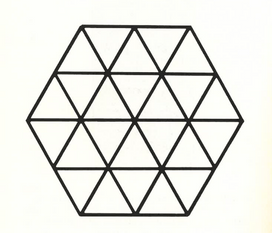
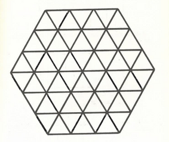

<Desafio numero="1a" titulo="Quantos triângulos?" resposta="38|trinta e oito" unidade="triângulos" fonte="100 jogos geométricos, Pierre Berloquin">

Quantos triângulos existem nesta figura?

Contamos por tamanhos:

- **lado 1:** os 24 triângulos pequenos;
- **lado 2:** 12 triângulos (6 com o vértice no centro do hexágono e 6 apoiados nos lados);
- **lado 3:** 2 triângulos grandes (um a apontar para cima e outro para baixo).

No total, $24 + 12 + 2 = $ **38** triângulos.

</Desafio>

<Desafio numero="1b" titulo="Quantos hexágonos regulares?" resposta="27|vinte e sete" unidade="hexágonos" fonte="100 jogos geométricos, Pierre Berloquin">

Quantos hexágonos regulares existem nesta figura?

Um hexágono regular desenhado nas linhas da figura tem o centro num dos pontos da rede.

- **lado 1:** podem ter o centro em qualquer ponto interior a uma distância de até 2 do centro: 19 hexágonos;
- **lado 2:** centro a uma distância de até 1: 7 hexágonos;
- **lado 3:** só o hexágono exterior: 1.

No total, $19 + 7 + 1 = $ **27** hexágonos.

</Desafio>

<Desafio
  numero={2}
  titulo="Qual é o mais alto?"
  fonte="100 jogos lógicos, Pierre Berloquin"
  resposta="O primeiro"
  opcoes={['O primeiro', 'O segundo', 'Não é possível saber']}
>

Um general tenta escolher um cozinheiro de entre 625 voluntários. Manda-os formar num quadrado de 25 filas (horizontais) e 25 colunas (verticais). Manda sair o mais alto de cada **coluna** e escolhe o mais baixo de entre eles.

Depois muda de ideias. Fá-los regressar aos respetivos lugares, manda sair o mais pequeno de cada **fila** e escolhe o maior de entre eles.

Sendo diferentes os dois cozinheiros escolhidos, qual deles é o mais alto?

<small>Na versão em papel, o enunciado falava em “fila” nas duas escolhas, o que não permitia chegar a uma resposta. O erro foi corrigido na edição seguinte e aqui já aparece a versão correta.</small>

Seja $A$ o primeiro escolhido (o mais alto da sua coluna) e $B$ o segundo (o mais baixo da sua fila). Consideremos o voluntário $C$ que está, ao mesmo tempo, **na coluna de $A$ e na fila de $B$**.

- Como $A$ é o mais alto da sua coluna, $A$ é pelo menos tão alto como $C$.
- Como $B$ é o mais baixo da sua fila, $C$ é pelo menos tão alto como $B$.

Logo $A \ge C \ge B$ e, sendo diferentes, **o primeiro cozinheiro é o mais alto**.

</Desafio>

<Desafio
  numero={3}
  titulo="Economia doméstica"
  fonte="Eduardo Veloso e José Paulo Viana, Desafios 3, Edições Afrontamento"
  resposta="TIC"
  opcoes={['NEV', 'TIC', 'SOL']}
>

A Ana Luzia foi ao supermercado. À entrada recebeu um folheto onde se publicitavam três detergentes à venda. Eram todos muito bons, só que:

- a embalagem de NEV era 40 % mais cara que a de TIC e 20 % mais leve que a de SOL;
- a embalagem de SOL era 50 % mais pesada que a de TIC e custava mais 20 % que a de NEV.

A Ana Luzia não se atrapalhou e foi buscar a mais económica. Que detergente comprou ela?

Mais adiante reparou que o preço do seu queijo preferido tinha subido 10 %. Resolveu então comprar menos 10 % que o habitual. Desta forma, gastou mais, menos ou o mesmo que o costume?

Tomemos a embalagem de TIC com preço 1 e peso 1.

| | Preço | Peso | Preço por unidade de peso |
| --- | :-: | :-: | :-: |
| TIC | 1 | 1 | **1** |
| NEV | 1,4 | $0{,}8 \times 1{,}5 = 1{,}2$ | $\approx 1{,}17$ |
| SOL | $1{,}2 \times 1{,}4 = 1{,}68$ | 1,5 | 1,12 |

A mais económica é **TIC**.

No queijo: $1{,}1 \times 0{,}9 = 0{,}99$. Gastou **menos** (1 % a menos) do que o costume.

</Desafio>

Se quiseres enviar a(s) tua(s) resolução(ões), podes utilizar o endereço de email do jornal: <a href="mailto:maismatjornal@gmail.com">maismatjornal@gmail.com</a>. Serão selecionadas para publicação as melhores resoluções. E duas delas terão prémio!

