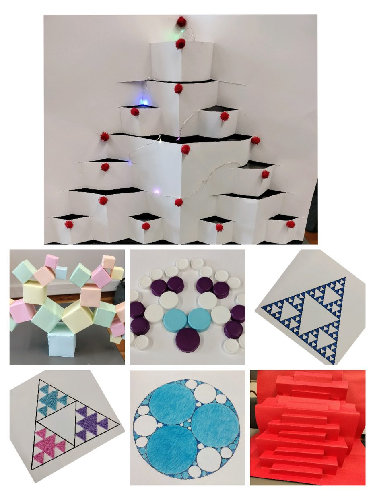
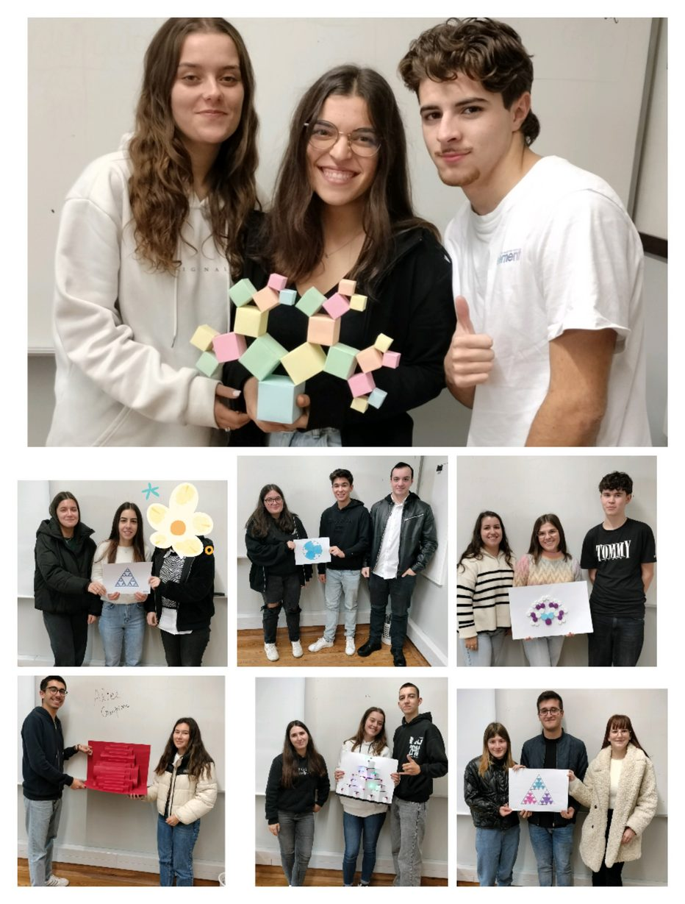

## XLII Olimpíadas Portuguesas de Matemática

No dia 10 de janeiro de 2024, realizaram-se as segundas eliminatórias das XLII Olimpíadas Portuguesas de Matemática, iniciativa promovida pela Sociedade Portuguesa de Matemática. Participaram no evento dois alunos da categoria Júnior, Gabriel Sobreira e Tomás Venda, dois alunos da categoria A, Beatriz Conde e Pedro Gameiro, e três alunos da categoria B, Ana Luísa Fonseca, Miguel Filipe Cardo e Miguel José Rodrigues. O evento teve lugar na Escola Secundária Afonso Lopes Vieira.

## Campeonato Nacional de Jogos Matemáticos

Hoje, dia 14 de março, está a decorrer o 17.º Campeonato Nacional de Jogos Matemáticos. A Escola Secundária do nosso agrupamento participa no evento com os alunos Diana Vieira Marques, do 11.º F, Rafael Frade e Micael Mendes, do 2.º B, nos jogos Nex, Atari Go e Produto, respetivamente. Boa sorte a todos os participantes!

## Exposição de trabalhos de alunos

Na disciplina de Matemática, mais concretamente no decorrer da lecionação do módulo A8 — Modelos Discretos, foi solicitado aos alunos um trabalho com formas geométricas que possuíssem um padrão interessante na sua construção, formando figuras muitas vezes estéticas e bonitas. A réplica de alguns fractais simples foi evidenciada nas apresentações, o que realçou positivamente o empenho e interesse dos alunos pela disciplina.

Parabéns a todos os alunos do EP — Técnico de Gestão (3.º C) e Técnico de Contabilidade (3.º E).

*Professora Lúcia Casalta*
