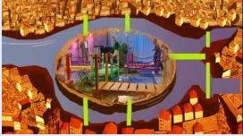
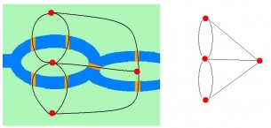

Estás perante um famoso quebra-cabeças da história da matemática: **o problema das pontes de Königsberg**.

Königsberg, que hoje se chama Kaliningrado e é um enclave russo, era uma cidade da antiga Prússia. Tinha sete pontes, como as da figura, e houve quem tentasse traçar um caminho que percorresse todas as pontes sem repetir nenhuma. Achava-se ser possível e esta ideia tornou-se mesmo numa lenda popular, num mito. E… nunca ninguém conseguiu!

Em 1736, o matemático suíço **Leonhard Euler** mostrou que o problema <u>não era possível</u>. Ele usou um modelo simplificado: substituiu as zonas da cidade por pontos e as pontes por traços. Assim, os caminhos foram representados por segmentos de reta e as suas interseções por pontos.

Hoje consideramos que o esquema que Euler usou para explicar a sua ideia foi o primeiro grafo da história da Matemática. Com este trabalho, Euler deu origem a um ramo importantíssimo da Matemática, que se chama **Teoria dos Grafos**.

Euler percebeu que o problema só era possível se não existissem mais de dois pontos de onde saíssem um número ímpar de traços.

Porquê?

Sempre que o passeio passa por uma zona da cidade, entra por uma ponte e sai por outra: gasta duas pontes. Por isso, em cada zona que não seja o início nem o fim do passeio, o número de pontes tem de ser **par**. Só o ponto de partida e o de chegada podem ter um número ímpar de pontes.

Em Königsberg, as quatro zonas tinham 5, 3, 3 e 3 pontes — quatro números ímpares. O passeio era impossível!

