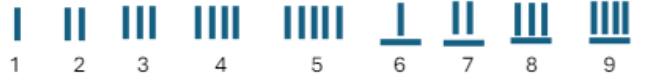
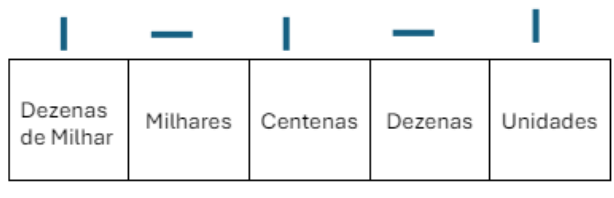
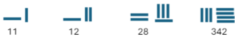
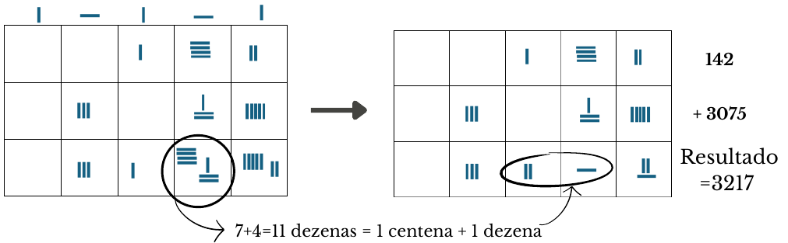
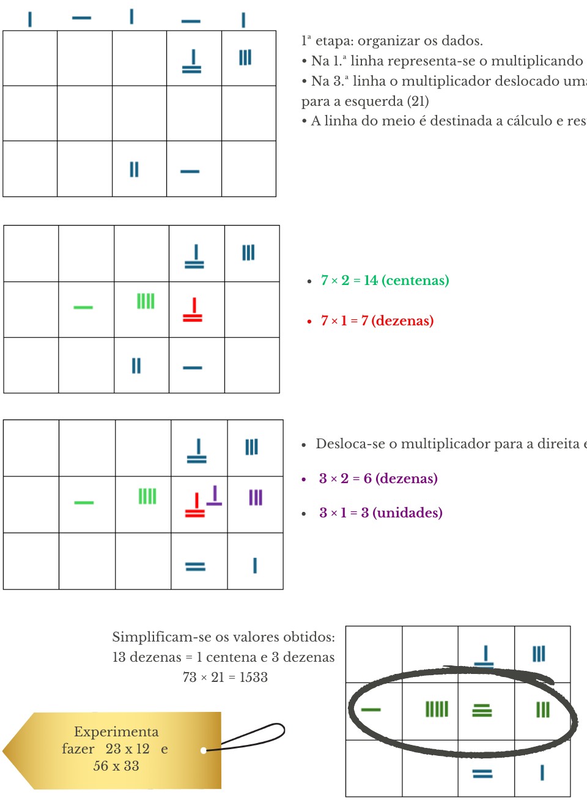
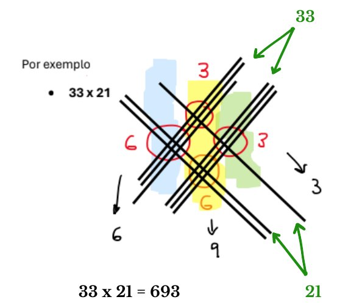
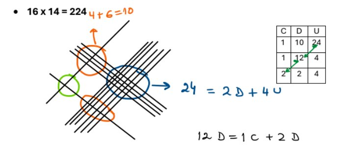
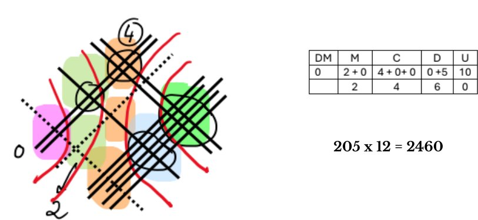
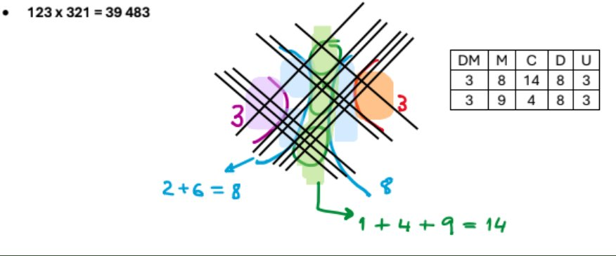

## A numeração

Na antiguidade (desde o séc. V a. C.), os chineses usavam numeração decimal e os algarismos eram representados por pauzinhos; um pauzinho equivalia a uma unidade e colocavam-se até cinco; a partir daí, um pau com outra orientação valia 5 unidades. Por exemplo, os números de 1 a 9 tinham a representação seguinte:

- Para escrever números de ordem superior a 10, com dois ou mais algarismos, eles alternavam a orientação dos pauzinhos. Se um pau vertical significava uma unidade, 1 pau horizontal ao lado significava 1 dezena, 1 pau novamente vertical ao lado significava 1 centena, e assim sucessivamente, alternando a posição dos pauzinhos.
- A orientação destes pauzinhos define a posição dos algarismos.
- Da direita para a esquerda, leem-se as unidades, as dezenas, as centenas, os milhares, as dezenas de milhar, etc., como fazemos na nossa numeração.

A título de exemplo, representemos mais alguns números: 11, 12, 28 e 342.

## Operações básicas

Para fazerem contas, os chineses utilizavam uma mesa de cálculo. Na **adição** basta juntar os pauzinhos e simplificar o resultado. Vejamos o seguinte exemplo: $142 + 3075 = {?}$

Precisamos de linhas: duas para as parcelas (as duas linhas superiores) e outra para o resultado. Nota: o zero era representado por um espaço.

### Como se multiplicava?

Observamos que a multiplicação é uma adição, mas com as parcelas iguais. Mas se tivermos muitas parcelas, com este método a conta torna-se quase impossível de concretizar. Os chineses desenvolveram um algoritmo para multiplicar dois números que é muito semelhante ao nosso e que vamos passar a apresentar.

**Exemplo:** $73 \times 21 = {?}$

$$
73 \times 21 = (70 + 3) \times (20 + 1) = \underbrace{(70 \times 20) + (70 \times 1)}_{1.^{\text{a}}} + \underbrace{(3 \times 20) + (3 \times 1)}_{2.^{\text{a}}}
$$

1. **1.ª etapa: organizar os dados.** Na 1.ª linha representa-se o multiplicando (73); na 3.ª linha o multiplicador deslocado uma casa para a esquerda (21); a linha do meio é destinada a cálculo e resultado.
2. $7 \times 2 = 14$ (centenas) e $7 \times 1 = 7$ (dezenas).
3. Desloca-se o multiplicador para a direita e faz-se $3 \times 2 = 6$ (dezenas) e $3 \times 1 = 3$ (unidades).
4. Simplificam-se os valores obtidos: 13 dezenas = 1 centena e 3 dezenas.

<Desafio titulo="Na mesa de cálculo">

Experimenta fazer $23 \times 12$ e $56 \times 33$.

</Desafio>

## Multiplicar com linhas

Vamos mostrar outro método para fazer multiplicações que aparece geralmente associado aos chineses, facto do qual não há certezas. Não deixa de ser extremamente interessante! Este método consiste em:

- representar cada um dos fatores por conjuntos de linhas paralelas, devidamente separadas, para designarem os valores das unidades, dezenas, centenas, etc., desse número;
- um dos fatores é desenhado com uma certa orientação e o outro com orientação diferente de modo a que se cruzem;
- as interseções destes conjuntos de linhas vão dar as unidades, as dezenas, as centenas, os milhares, as dezenas de milhar, etc., do resultado, conforme os exemplos sugerem.

### Outros exemplos

O número de interseções é, da esquerda para a direita: 1, 10 e 24, ou seja:

- 24 unidades, o que dá 2 dezenas e **4 unidades** → vão 2 unidades para as dezenas;
- $10 + 2 = 12$ dezenas, ou seja, 1 centena e **2 dezenas** → vai mais 1 centena para as centenas;
- $1 + 1 = $ **2 centenas**.

$$
16 \times 14 = 224
$$

**$205 \times 12 = {?}$** E se um dos algarismos de algum fator for o zero? Vamos representá-lo por uma linha a tracejado. Para percebermos melhor a ordem de grandeza das interseções, vamos representar 12 por 012 (assim multiplicamos dois números com o mesmo número de algarismos (3)). As interseções a tracejado não vão contar — de facto, repara que $0 \times n = 0$, qualquer que seja o número $n$.

<Desafio titulo="Experimenta fazer">

$11 \times 13$, $14 \times 19$, $46 \times 22$ e $311 \times 45$.

</Desafio>
