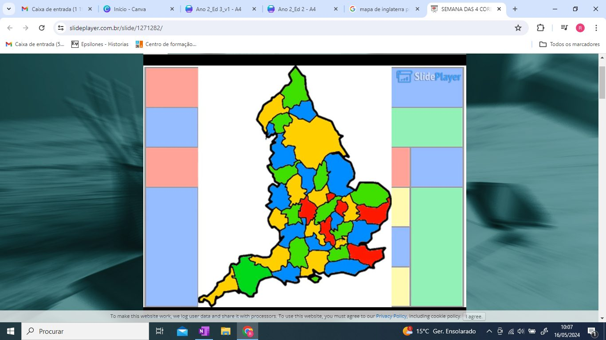

**O teorema das quatro cores** afirma que

> é possível pintar qualquer mapa de modo que duas regiões adjacentes não tenham a mesma cor, usando apenas 4 cores (ou menos).

*Nota: adjacente significa que as duas regiões compartilham um segmento de curva limite comum.*

O resultado parece simples, mas demorou mais de 100 anos a ser demonstrado. Este problema começou com Francis Guthri numa brincadeira a pintar o mapa de Inglaterra usando o menor número possível de cores. Guthri verificou que o conseguia fazer com apenas 4 cores. Aconteceria o mesmo com qualquer outro mapa? Provou-se que sim.

Passaram pelo problema, entre outros: Francis Guthri (1852), De Morgan, William Hamilton, Arthur Cayley (1878), Alfred Kempe (1879), Percy Heawood (1890) e, finalmente, **Wolfgang Haken e Kenneth Appel (1976)**.

O procedimento adotado por Haken e Appel na sua demonstração foi transformar um mapa qualquer num mapa padrão, que pudesse ser pintado com 4 cores. Mas existiam 487 regras para fazer esta equivalência entre mapas e, depois, poderiam encontrar um de entre os 1482 mapas-padrão possíveis. Foi aí que o computador deu a resposta, testando este elevado, mas finito, número de possibilidades.

**Foi o primeiro teorema importante a ser provado usando um computador.** É impossível (muito difícil) prová-lo sem esta tecnologia.

O teorema das 4 cores é um dos problemas mais conhecidos em Teoria dos Grafos.

**Para saberes mais:** visualiza o [vídeo “A primeira demonstração feita por computador”](https://youtu.be/EP9wRq2m-YA) e experimenta com outros mapas. Envia-nos os teus trabalhos!
